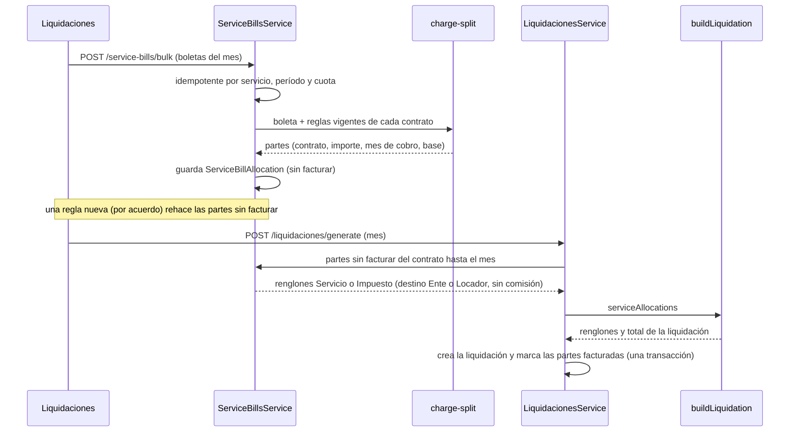

# ADR-0008: Impuestos y servicios trasladables: tres pagadores, reglas con vigencia y boletas

## Estado

Aceptado.

## Fecha

2026-11-01.

## Contexto

Un alquiler no es solo el alquiler: el contrato dice también quién paga los
impuestos y los servicios de la propiedad (luz, gas, agua, internet, expensas,
tasa municipal e impuesto inmobiliario provincial) y cómo. Lo que se relevó en
la inmobiliaria piloto (`docs/tesis/31-registro-de-feedback.md`, FB-08) es que
cada contrato lo resuelve a su manera:

- a veces el inquilino paga directo al ente y el dinero nunca pasa por la
  inmobiliaria;
- a veces el inquilino le paga el importe a la inmobiliaria y ésta paga al ente;
- a veces el inquilino lo paga junto con el alquiler y todo pasa al locador, que
  es quien paga, sin que la inmobiliaria gane nada (pasamanos);
- puede trasladarse un porcentaje de la boleta, la parte que corresponde al
  consumo de la unidad (un edificio con una boleta de agua para varias unidades)
  o un importe fijo;
- la tasa municipal y el impuesto inmobiliario llegan con una opción anual con
  descuento o en cuotas mensuales;
- el acuerdo puede cambiar durante el contrato, siempre por escrito.

Hasta ahora el sistema tenía `Service` (el servicio de una propiedad con un
importe mensual de referencia) y `ServicePayment` (un pago registrado, con fecha
de pago obligatoria, que además alimenta el recordatorio de vencimientos). Eso
no dice quién paga, no tiene boleta, y el generador de liquidaciones ya acepta
renglones de servicios y de impuestos pero nadie se los daba.

## Decisión

**La regla de traslado es un dato del contrato, con vigencia; la boleta es una
entidad propia; y el reparto de cada boleta entre los contratos se calcula con un
motor puro y se guarda antes de liquidar.**

- **Tres pagadores** (`ChargePayer`):
  - `Inquilino`: paga directo al ente. No hay renglón en la liquidación.
  - `Inmobiliaria`: el inquilino le paga a la inmobiliaria y ésta paga al ente.
    El renglón (`Servicio` o `Impuesto`) se cobra al inquilino con destino `Ente`
    y no es comisionable.
  - `Propietario`: el inquilino lo paga con el alquiler y todo pasa al locador
    (por cuenta y orden). El renglón se cobra al inquilino con destino `Locador`,
    no es comisionable, y su descripción lleva la leyenda «por cuenta y orden del
    locador».
- **Regla con vigencia.** `ContractChargeRule` (contrato, servicio, pagador, modo
  de reparto, porcentaje o importe fijo, plan de pago, recupero anual, desde y
  hasta, acuerdo). La clave es `[contractId, serviceId, validFrom]`. Un cambio no
  pisa la regla: cierra la vigente el día anterior y crea una versión nueva. La
  regla de un mes es la vigente el día 1 de ese mes (o el día de inicio del
  contrato, si empieza después), igual que el alquiler y las reglas de ADR-0010.
- **Los cambios son por acuerdo.** En un contrato que ya no es borrador, la regla
  nueva exige un acuerdo `CambioCargo` (ADR-0010) de la misma fecha; sin él, 409
  `CHARGE_RULE_REQUIRES_AGREEMENT`. Un contrato en borrador admite reglas sin
  acuerdo. Una regla ya usada para facturar no se edita (409
  `CHARGE_RULE_IN_USE`): se reemplaza con otra versión.
- **La boleta es su propia entidad** (`ServiceBill`): servicio, período (primer
  día del mes), cuota (`installmentLabel`, por defecto `MM/AAAA`), importe,
  importe sin descuento, vencimiento, consumo (total y por unidad), estado, quién
  pagó y cuándo, comprobante. La clave es `[serviceId, period, installmentLabel]`,
  así que la carga masiva es idempotente. `ServicePayment` queda para el pago
  registrado y suma `billId`: marcar pagada una boleta deja un pago ligado, de modo
  que el recordatorio de vencimientos sigue funcionando.
- **Modos de reparto** (`ChargeSplitMode`), calculados por el motor puro
  `packages/shared/src/charge-split` con `Money` y el reparto por mayor resto:
  - `Porcentaje`: `tenantSharePct` % de la boleta, al centavo, mitad hacia arriba.
    El resto lo absorbe quien pagó.
  - `Consumo`: consumo de la unidad sobre el consumo total de la boleta; las
    unidades suman la boleta por mayor resto y la diferencia (áreas comunes,
    unidades vacías) no se traslada. Una unidad que paga directo ocupa su parte.
  - `Fijo`: `fixedAmount`, sin superar el importe de la boleta.
- **Plan anual.** Con `paymentPlan = Anual` el importe de la boleta es el anual.
  `annualRecovery = Prorrateado` (de fábrica, lo habitual) lo reparte en
  `annualInstallments` cuotas mensuales iguales (de 1 a 12, de fábrica 12; mayor
  resto) a partir del mes de la boleta; `Unico` lo cobra entero en el mes de la
  boleta. Es libre elegir cada uno por regla.
- **Descuento por pago anual** (`annualDiscountBeneficiary`): con `Inquilino` (de
  fábrica) se reparte lo efectivamente pagado. Con `Locador` o `Inmobiliaria` se
  cobra el importe sin descuento (`nominalAmount`) y la diferencia con lo que habría
  correspondido sobre lo pagado se guarda en la parte (`surplus`) y sale como un
  renglón `Cargo` aparte a nombre de ese beneficiario, sin comisión; el renglón del
  servicio o impuesto sale por lo pagado.
- **Cuotas que quedan al terminar el contrato** (`remainingInstallmentsOnEnd`): con
  `CobrarEnLiquidacionFinal` (de fábrica) las cuotas posteriores al último mes del
  contrato se suman a la cuota de ese último mes (con su diferencia por descuento);
  con `Descartar` no se cobran. En los dos casos el cálculo lo informa.
- **Reparto guardado.** Al cargar o corregir una boleta, y al cambiar una regla,
  el reparto se guarda en `ServiceBillAllocation`: contrato, regla, pagador, importe,
  base de cálculo, mes de liquidación (`chargePeriod`), número de cuota y, una vez
  incluida, la liquidación y la fecha. La clave es `[billId, contractId,
  chargePeriod]`. Lo guardado se rehace mientras no se facture; lo ya facturado no
  se toca.
- **La liquidación consume el reparto.** Al generar la liquidación de un contrato
  y un mes, el servicio toma las partes sin facturar con `chargePeriod` hasta ese
  mes (también las de meses anteriores), las pasa al generador como
  `serviceAllocations` y las marca facturadas en la misma transacción que crea la
  liquidación (`updateMany ... billedAt IS NULL`, y si alguna ya estaba marcada la
  transacción falla). Cada parte entra en una sola liquidación, aun con dos
  generaciones simultáneas. Una boleta cargada después de generada la liquidación
  del mes no la modifica: entra en la próxima que se genere. Borrar una liquidación
  en borrador, o quitar uno de esos renglones, libera la parte para la siguiente.

## Alternativas descartadas

- **Un solo indicador «quién paga» en el contrato.** Es lo más simple, pero no
  expresa que cada servicio de un mismo contrato lo paga uno distinto, ni el
  porcentaje o el consumo, ni el plan anual, y un cambio a mitad del contrato
  destruye el acuerdo anterior. Se descartó.
- **Reutilizar `ServicePayment` como boleta.** Tiene fecha de pago obligatoria y
  alimenta el recordatorio de vencimientos: una boleta todavía no pagada no
  cabe, y mezclar lo que se debe con lo que se pagó rompe el recordatorio. Se
  agregó `ServicePayment.billId` para ligarlos sin confundirlos.
- **Calcular el reparto al liquidar, sin guardarlo.** Evita una tabla, pero la
  liquidación quedaría atada a las reglas de ese momento: cambiar una regla
  después reescribiría lo que ya se cobró, y no habría manera de mostrar de
  dónde sale cada renglón. Guardar el reparto deja trazabilidad y permite marcar
  «facturado una sola vez».
- **Cobrar el anual siempre de una vez.** Es lo que haría un cálculo ingenuo, pero
  el inquilino no recibe una boleta anual cada mes: se deja pactar el recupero
  en 12 cuotas o de una vez.

## Consecuencias

Positivas:

- Cada contrato dice, servicio por servicio, quién paga y cómo; los cambios por
  acuerdo conservan la historia.
- La liquidación explica cada renglón de servicio o impuesto (boleta, cuota, base
  de cálculo) y distingue lo que va al ente de lo que pasa al locador; ninguno
  cuenta para la comisión.
- La carga mensual es una planilla: pegar desde una hoja de cálculo, validar por
  celda, guardar de una vez, y repetir la carga no duplica nada.

Negativas:

- Hay una tabla más que mantener sincronizada con las reglas: cambiar una regla o
  una boleta rehace las partes sin facturar. Lo ya facturado queda como estaba, y
  una corrección posterior se hace con una versión nueva de la regla o con un
  ajuste manual en la liquidación.
- Con `Descartar`, las cuotas de un plan anual posteriores al fin del contrato no se
  trasladan; con `CobrarEnLiquidacionFinal` se cobran todas juntas en la última
  liquidación, que puede ser un monto alto para el inquilino.
- Un servicio de un edificio repartido por consumo necesita el consumo de cada
  unidad (`unitConsumptions`, por la API); la pantalla de carga mensual todavía
  carga el consumo total de la boleta.
- Se asume la moneda de la boleta igual a la de la liquidación; las partes de
  otra moneda quedan pendientes.

## Decidido por Manuel el 2026-11-02

Cuatro reglas de dinero no estaban en lo relevado; se consultaron y quedaron así:

- **Recupero anual:** se elige libremente por regla; lo típico es en cuotas, y la
  cantidad de cuotas (1 a 12) también se elige.
- **Descuento por pago anual:** configurable por regla: lo recibe el inquilino, el
  locador o la inmobiliaria.
- **Cuotas restantes al terminar el contrato:** configurable por regla: cobrarlas en
  la liquidación final o descartarlas.
- **Importe fijo** nunca supera la boleta, y un cambio de regla rige para las
  boletas de los meses siguientes a su fecha (la regla de un mes es la vigente el
  día 1), igual que el alquiler.
