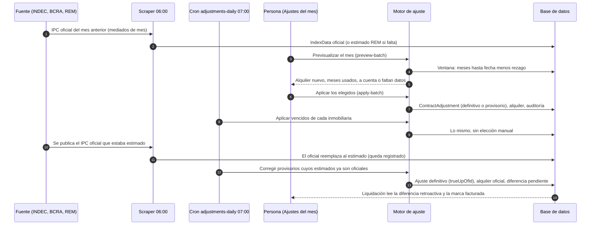

# ADR-0011: Ajuste con rezago, estimación y corrección

## Estado

Aceptado.

## Fecha

2026-10-31.

## Contexto

El ajuste de un alquiler por índice (IPC, ICL, CCP, UVA) se calculaba con los
valores publicados entre la fecha del ajuste anterior y la del ajuste actual,
sin rezago: el ajuste de abril usaba hasta el IPC de abril. Eso no es lo que
hace la administración real (FB-13) y tenía tres problemas:

- **El IPC de un mes se publica a mediados del mes siguiente.** El ajuste del 1
  de abril usa, en la práctica, el IPC publicado hasta febrero: el rezago es de
  dos meses. Con rezago 0 el ajuste de abril necesitaba un dato que no existía
  hasta mayo.
- **Con un mes sin publicar el motor ajustaba de menos en silencio.** Se
  calculaba con los meses que había (por ejemplo tres de cuatro) y el alquiler
  quedaba corto sin ningún aviso (DEF-27, parienta de DEF-20 y DEF-25, que
  cerraron el caso del 0 %).
- **Si el INDEC todavía no publicó, no se puede esperar.** Los ajustes del mes
  se cargan juntos, decenas por vez (FB-23), y la liquidación sale el día 20.
  La administración cobra "a cuenta" con el valor esperado y lo corrige después.

La fuente del IPC es el archivo de series del INDEC en datos.gob.ar, con la
inflación mensual del BCRA como respaldo en los días entre el anuncio y la
actualización del archivo (#109). Los valores esperados (REM del BCRA) se cargan
como índices estimados (`IndexData.isEstimate`, ADR-0010).

## Decisión

**El ajuste usa los índices de los meses que terminan `indexLagMonths` meses
antes de la fecha del ajuste; un mes sin valor oficial se cubre con el estimado
solo si la inmobiliaria permite el pago a cuenta, y el ajuste provisorio se
corrige cuando se publica el oficial.**

- **Rezago.** Es una regla del contrato (`ContractTermsVersion.indexLagMonths`,
  por defecto el `ipcLagMonths` de la inmobiliaria, 2). La ventana de índices de
  un ajuste termina `indexLagMonths` meses antes de su fecha. El comienzo se
  corre igual solo si es la fecha de un ajuste anterior (que usó índices hasta su
  propio rezago), de modo que dos ajustes seguidos se reparten los meses sin
  superponerse; si es el inicio del contrato o del tramo no se corre, porque los
  meses anteriores al alquiler no cuentan. Con rezago 2, el ajuste de abril de un
  contrato que empezó en enero usa enero y febrero; el de julio, marzo, abril y
  mayo. Los contratos que existían antes de este cambio quedaron con rezago 0, que
  es lo que el motor hacía (ADR-0010): su resultado no cambia. Un contrato sin
  versión de reglas tampoco aplica rezago.
- **Base.** `Vigente` aplica el índice del período al alquiler de hoy. `Original`
  aplica el factor acumulado desde el inicio del tramo al alquiler inicial del
  tramo (`ContractPeriod.initialRent`), de modo que un alquiler renegociado no
  arrastra su aumento al índice.
- **Meses fijos y escalonado.** Con `fixedInitialMonths`, un ajuste que cae antes
  de cumplirse esos meses no cambia el alquiler y su cronograma queda `Skipped`
  (no ancla la ventana del ajuste siguiente). El escalonado (`customSteps`) aplica
  el porcentaje del último escalón cuyo `fromMonth` ya llegó; antes del primero el
  alquiler no cambia, porque es la regla pactada y no un dato faltante. La UVA se
  calcula como el ICL, con el cociente entre el primer y el último valor diario de
  la ventana.
- **Una ventana incompleta no se ajusta.** Cada mes de las series mensuales debe
  estar. Si falta alguno sin estimado, o hay estimado pero el pago a cuenta está
  apagado, el ajuste responde `MISSING_INDEX_DATA` con el índice y los meses que
  faltan; el cronograma sigue pendiente. Nunca se ajusta con menos meses ni con
  0 % (DEF-20, DEF-25, DEF-26, DEF-27).
- **Provisorio.** Con un mes cubierto por un estimado y `allowProvisional` activo
  (valor por defecto de la inmobiliaria, activo de fábrica), el ajuste se aplica y
  se guarda con `isProvisional`, listando en `indexValues` qué meses fueron
  estimados. El alquiler sube con el valor estimado ("a cuenta").
- **Corrección.** Cuando todos los estimados del ajuste ya tienen valor oficial, el
  proceso diario lo recalcula partiendo del alquiler anterior al provisorio y crea
  el ajuste definitivo, enlazado por `trueUpOfId`. Si el provisorio sigue siendo lo
  vigente, el alquiler pasa al oficial; si ya hubo ajustes posteriores, el contrato
  partió de otro valor y la corrección queda registrada para revisión manual
  (`rentUpdated: false`). La diferencia retroactiva (oficial menos provisorio, por
  cada mes facturado con el provisorio) no genera ningún cargo acá: queda como dato
  (`getPendingTrueUps`, `GET /contracts/:id/adjustments?pendingTrueUp=true`) que el
  armado de liquidaciones lee, y se marca facturada con `markTrueUpBilled`
  (`ContractAdjustment.trueUpBilledAt`). Con eso una corrección no se factura dos
  veces.
- **Proceso diario y aplicación masiva.** `adjustments-daily` corre a las 07:00 de
  Buenos Aires, después de la lectura de índices de las 06:00, por inmobiliaria
  (`TenantCron`): aplica los vencidos, corrige los provisorios, escribe el
  `ContractAdjustment` y audita con `AuditService`. Los contratos que quedan sin
  ajustar se informan con los meses que faltan. Para el trabajo manual,
  `POST /adjustments/preview-batch` muestra los ajustes que vencen hasta un mes y
  `POST /adjustments/apply-batch` aplica los elegidos, cada contrato en su
  transacción.

## Alternativas descartadas

- **Esperar el índice oficial antes de ajustar.** Bloquea el ciclo: el ajuste del
  mes y la liquidación del día 20 dependerían de que el INDEC publique a tiempo, y
  el alquiler queda sin actualizar mientras tanto. Se descartó; el pago a cuenta
  con estimado lo evita y la corrección recupera la diferencia.
- **Aplicar 0 % si falta el dato.** Es lo que hacía el barrido (DEF-20, DEF-25) y
  deja el cronograma como aplicado con un alquiler sin actualizar. Se descartó: un
  dato faltante es un error visible, no un valor.
- **Ajustar con los meses que haya.** Es el DEF-27: el alquiler queda corto sin
  aviso. Se descartó; la ventana completa es una condición del cálculo.
- **Aplicar el rezago como un desplazamiento del dato y no de la ventana.** Obliga
  a guardar el índice fechado en el mes de aplicación y rompe la serie publicada.
  Correr la ventana deja los índices fechados como los publicó la fuente.
- **Corregir sobre el último alquiler sin recalcular.** Cuando hay ajustes
  posteriores el error se compone con el índice siguiente; se prefiere informarlo
  para revisión a pisar un alquiler que ya cambió por otra razón.

## Consecuencias

Positivas:

- El ajuste de cada contrato usa los índices que la administración usa, y un
  dato faltante se ve con el mes que falta.
- Los ajustes del mes se aplican juntos, con previsualización y resultado por
  contrato, sin cargarlos uno por uno.
- El pago a cuenta no frena el ciclo y se corrige solo, dejando la diferencia
  disponible para facturarla.

Negativas:

- Hay dos ajustes del mismo período mientras dura el provisorio (el provisorio y su
  corrección). Los lectores del historial distinguen por `isProvisional` y
  `trueUpOfId`.
- La corrección espera a que todos los estimados del ajuste tengan oficial; un
  ajuste con varios meses estimados no se corrige parcialmente.
- El alquiler de un contrato con ajustes posteriores a un provisorio no se corrige
  solo.
