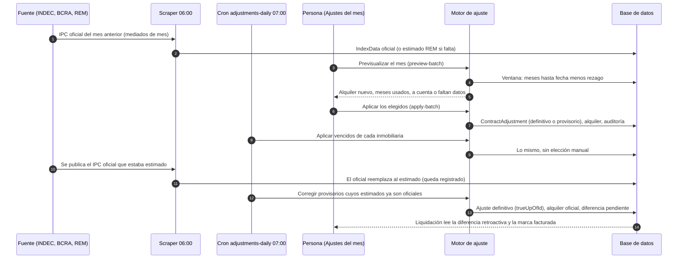
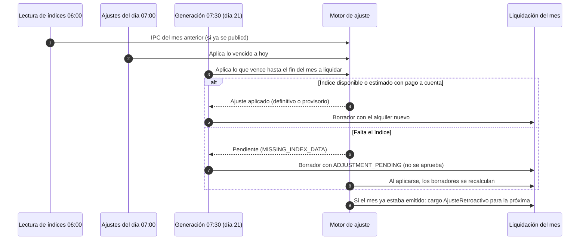

# ADR-0011: Ajuste con rezago, estimación y corrección

## Estado

Aceptado.

## Fecha

2026-10-31.

## Contexto

El ajuste de un alquiler por índice (IPC, ICL, CCP, UVA) se calculaba con los
valores publicados entre la fecha del ajuste anterior y la del ajuste actual,
sin rezago: el ajuste de abril usaba hasta el IPC de abril. Eso no es lo que
hace la administración real (FB-13) y tenía tres problemas:

- **El IPC de un mes se publica a mediados del mes siguiente.** El ajuste del 1
  de abril usa, en la práctica, el IPC publicado hasta febrero: el rezago es de
  dos meses. Con rezago 0 el ajuste de abril necesitaba un dato que no existía
  hasta mayo.
- **Con un mes sin publicar el motor ajustaba de menos en silencio.** Se
  calculaba con los meses que había (por ejemplo tres de cuatro) y el alquiler
  quedaba corto sin ningún aviso (DEF-27, parienta de DEF-20 y DEF-25, que
  cerraron el caso del 0 %).
- **Si el INDEC todavía no publicó, no se puede esperar.** Los ajustes del mes
  se cargan juntos, decenas por vez (FB-23), y la liquidación sale el día 20.
  La administración cobra "a cuenta" con el valor esperado y lo corrige después.

La fuente del IPC es el archivo de series del INDEC en datos.gob.ar, con la
inflación mensual del BCRA como respaldo en los días entre el anuncio y la
actualización del archivo (#109). Los valores esperados (REM del BCRA) se cargan
como índices estimados (`IndexData.isEstimate`, ADR-0010).

## Decisión

**El ajuste usa los índices de los meses que terminan `indexLagMonths` meses
antes de la fecha del ajuste; un mes sin valor oficial se cubre con el estimado
solo si la inmobiliaria permite el pago a cuenta, y el ajuste provisorio se
corrige cuando se publica el oficial.**

- **Rezago.** Es una regla del contrato (`ContractTermsVersion.indexLagMonths`,
  por defecto el `ipcLagMonths` de la inmobiliaria, 2). La ventana de índices de
  un ajuste termina `indexLagMonths` meses antes de su fecha. El comienzo se
  corre igual solo si es la fecha de un ajuste anterior (que usó índices hasta su
  propio rezago), de modo que dos ajustes seguidos se reparten los meses sin
  superponerse; si es el inicio del contrato o del tramo no se corre, porque los
  meses anteriores al alquiler no cuentan. Con rezago 2, el ajuste de abril de un
  contrato que empezó en enero usa enero y febrero; el de julio, marzo, abril y
  mayo. Los contratos que existían antes de este cambio quedaron con rezago 0, que
  es lo que el motor hacía (ADR-0010): su resultado no cambia. Un contrato sin
  versión de reglas tampoco aplica rezago.
- **Base.** `Vigente` aplica el índice del período al alquiler de hoy. `Original`
  aplica el factor acumulado desde el inicio del tramo al alquiler inicial del
  tramo (`ContractPeriod.initialRent`), de modo que un alquiler renegociado no
  arrastra su aumento al índice.
- **Meses fijos y escalonado.** Con `fixedInitialMonths`, un ajuste que cae antes
  de cumplirse esos meses no cambia el alquiler y su cronograma queda `Skipped`
  (no ancla la ventana del ajuste siguiente). El escalonado (`customSteps`) aplica
  el porcentaje del último escalón cuyo `fromMonth` ya llegó; antes del primero el
  alquiler no cambia, porque es la regla pactada y no un dato faltante. La UVA se
  calcula como el ICL, con el cociente entre el valor del día en que termina la
  ventana y el del día en que empieza.
- **Una ventana incompleta no se ajusta.** Cada mes de las series mensuales debe
  estar. Si falta alguno sin estimado, o hay estimado pero el pago a cuenta está
  apagado, el ajuste responde `MISSING_INDEX_DATA` con el índice y los meses que
  faltan; el cronograma sigue pendiente. Nunca se ajusta con menos meses ni con
  0 % (DEF-20, DEF-25, DEF-26, DEF-27).
- **Las series diarias exigen sus dos extremos.** El ICL y la UVA se publican todos
  los días corridos, feriados incluidos, así que el valor de una fecha es el de esa
  fecha: no se toma el más cercano ni se admite tolerancia. Si falta el valor del
  día en que empieza o del día en que termina la ventana (ya corrida por el
  rezago), el ajuste responde `MISSING_INDEX_DATA` con esas fechas (`YYYY-MM-DD`).
  Los días de en medio no importan: el cociente solo usa los extremos. Antes se
  tomaban el primer y el último valor existentes dentro de la ventana, y una serie
  que arrancaba tarde daba porcentajes sin relación con el período (DEF-120). El
  histórico de la serie de sistema se carga por rango con `POST
  /index-data/backfill` (DEF-121).
- **Provisorio.** Con un mes cubierto por un estimado y `allowProvisional` activo
  (valor por defecto de la inmobiliaria, activo de fábrica), el ajuste se aplica y
  se guarda con `isProvisional`, listando en `indexValues` qué meses fueron
  estimados. El alquiler sube con el valor estimado ("a cuenta").
- **Corrección.** Cuando todos los estimados del ajuste ya tienen valor oficial, el
  proceso diario lo recalcula partiendo del alquiler anterior al provisorio y crea
  el ajuste definitivo, enlazado por `trueUpOfId`. Si el provisorio sigue siendo lo
  vigente, el alquiler pasa al oficial; si ya hubo ajustes posteriores, el contrato
  partió de otro valor y la corrección queda registrada para revisión manual
  (`rentUpdated: false`). La diferencia retroactiva (oficial menos provisorio, por
  cada mes facturado con el provisorio) no genera ningún cargo acá: queda como dato
  (`getPendingTrueUps`, `GET /contracts/:id/adjustments?pendingTrueUp=true`) que el
  armado de liquidaciones lee, y se marca facturada con `markTrueUpBilled`
  (`ContractAdjustment.trueUpBilledAt`). Con eso una corrección no se factura dos
  veces.
- **Proceso diario y aplicación masiva.** `adjustments-daily` corre a las 07:00 de
  Buenos Aires, después de la lectura de índices de las 06:00, por inmobiliaria
  (`TenantCron`): aplica los vencidos, corrige los provisorios, escribe el
  `ContractAdjustment` y audita con `AuditService`. Los contratos que quedan sin
  ajustar se informan con los meses que faltan. Para el trabajo manual,
  `POST /adjustments/preview-batch` muestra los ajustes que vencen hasta un mes y
  `POST /adjustments/apply-batch` aplica los elegidos, cada contrato en su
  transacción.

## Alternativas descartadas

- **Esperar el índice oficial antes de ajustar.** Bloquea el ciclo: el ajuste del
  mes y la liquidación del día 20 dependerían de que el INDEC publique a tiempo, y
  el alquiler queda sin actualizar mientras tanto. Se descartó; el pago a cuenta
  con estimado lo evita y la corrección recupera la diferencia.
- **Aplicar 0 % si falta el dato.** Es lo que hacía el barrido (DEF-20, DEF-25) y
  deja el cronograma como aplicado con un alquiler sin actualizar. Se descartó: un
  dato faltante es un error visible, no un valor.
- **Ajustar con los meses que haya.** Es el DEF-27: el alquiler queda corto sin
  aviso. Se descartó; la ventana completa es una condición del cálculo.
- **Tomar el valor publicado más cercano a una fecha sin valor en el ICL y la UVA.**
  Con series que se publican todos los días, un día sin valor es un hueco de datos
  y no un fin de semana; usar el vecino oculta una carga incompleta, que es lo que
  dio los porcentajes absurdos del DEF-120. Se descartó; se informa la fecha que
  falta y se completa la serie.
- **Aplicar el rezago como un desplazamiento del dato y no de la ventana.** Obliga
  a guardar el índice fechado en el mes de aplicación y rompe la serie publicada.
  Correr la ventana deja los índices fechados como los publicó la fuente.
- **Corregir sobre el último alquiler sin recalcular.** Cuando hay ajustes
  posteriores el error se compone con el índice siguiente; se prefiere informarlo
  para revisión a pisar un alquiler que ya cambió por otra razón.

## Consecuencias

Positivas:

- El ajuste de cada contrato usa los índices que la administración usa, y un
  dato faltante se ve con el mes que falta.
- Los ajustes del mes se aplican juntos, con previsualización y resultado por
  contrato, sin cargarlos uno por uno.
- El pago a cuenta no frena el ciclo y se corrige solo, dejando la diferencia
  disponible para facturarla.

Negativas:

- Hay dos ajustes del mismo período mientras dura el provisorio (el provisorio y su
  corrección). Los lectores del historial distinguen por `isProvisional` y
  `trueUpOfId`.
- La corrección espera a que todos los estimados del ajuste tengan oficial; un
  ajuste con varios meses estimados no se corrige parcialmente.
- El alquiler de un contrato con ajustes posteriores a un provisorio no se corrige
  solo.

## Addendum: el ajuste del mes en la liquidación (3 de noviembre de 2026)

El ensayo general del primer ciclo en sombra sobre una copia de la inmobiliaria
piloto mostró que la liquidación del mes salía sin el ajuste que rige desde su
día 1 (DEF-130 a DEF-134). La inmobiliaria liquida alrededor del 20 del mes
anterior con ese ajuste incluido, y con el rezago de dos meses su índice ya está
publicado (el IPC de un mes sale alrededor del 12 del siguiente). El proceso
diario de ajustes, en cambio, solo aplicaba lo vencido a la fecha: el ajuste del
1 de diciembre se aplicaba el 1 de diciembre, la liquidación de diciembre ya
estaba generada con el alquiler anterior y nadie cobraba ese mes.

Decisión, sin cambiar las reglas de este ADR:

- **La generación aplica antes los ajustes del mes.** Al generar el período, se
  aplican primero, con `applyDueAdjustments` hasta el último instante del mes y el
  mismo motor (rezago, base, estimado y pago a cuenta), los ajustes pendientes con
  fecha dentro de él; después se arma la liquidación con el alquiler que rige. El
  alquiler del contrato pasa al nuevo en ese momento, como ya pasaba con la
  aplicación masiva de *Ajustes del mes*. El proceso diario de generación corre a
  las 07:30, después de la lectura de índices (06:00) y de los ajustes (07:00).
- **Sin índice rige este ADR.** Con un estimado y el pago a cuenta activo, el
  ajuste se aplica provisorio y la liquidación sale a cuenta. Sin estimado (o con
  el pago a cuenta apagado) el ajuste sigue pendiente; como el ADR no definía qué
  hace la liquidación, la decisión segura es que no se pueda cobrar un importe
  equivocado: la liquidación en Borrador o En Revisión lleva la advertencia
  bloqueante `ADJUSTMENT_PENDING` y aprobarla responde 409. La advertencia se
  calcula al leer y cuenta los ajustes que empiezan a regir en el período (un
  ajuste a mitad de mes, según `midMonthAdjustmentMode`); un ajuste atrasado de
  meses anteriores no bloquea las liquidaciones siguientes, lo informa el proceso
  diario de ajustes.
- **Sobre un borrador no hay cobro retroactivo.** Cuando el ajuste se aplica
  después (aplicación masiva, cálculo manual, el proceso diario o la generación
  del día siguiente), las liquidaciones del contrato todavía editables desde el mes
  del ajuste rehacen sus renglones de alquiler y bonificación y conservan los demás.
- **Liquidación ya emitida: convención pactable.** La corrección de este ADR cubre
  solo la diferencia entre provisorio y oficial. Para un ajuste que se aplica
  después de emitido un mes en que ya regía se agregó la convención
  `lateAdjustmentBilling` (ADR-0010: valor por defecto de la inmobiliaria, pactable
  por contrato). Con `Retroactivo`, la de fábrica porque reproduce la práctica de
  cobrar el mes con su ajuste, la diferencia de cada mes emitido (alquiler neto de
  bonificaciones con el ajuste menos sin él) queda como cargo `AjusteRetroactivo`
  del centro de carga, comisionable y a favor del locador, que entra en la próxima
  liquidación; con `SinRetroactivo` el ajuste rige desde la próxima.

## Addendum: un ajuste que baja el alquiler no se aplica en silencio (4 de noviembre de 2026)

Con base `Original` (el índice acumulado desde el inicio del tramo sobre el alquiler inicial), el alquiler nuevo puede quedar por debajo del vigente. Este ADR no define si un ajuste puede bajar el alquiler: es una regla de dinero por confirmar con la inmobiliaria y con Manuel. Mientras tanto, el comportamiento seguro es que no ocurra sin que una persona lo vea:

- La previsualización y la aplicación informan, además de `percentage` (variación del índice), `rentChangePct`, la variación del alquiler nuevo sobre el vigente; la previsualización marca `rentDecrease`.
- El proceso diario y la generación de liquidaciones no aplican ese ajuste: lo saltean con el motivo estable `RENT_DECREASE_REQUIRES_REVIEW` y queda pendiente (la liquidación del período lleva `ADJUSTMENT_PENDING`).
- La aplicación masiva lo aplica sólo si el contrato figura en `confirmRentDecrease`; *Ajustes del mes* no lo elige con *Elegir todos* y pide confirmarlo. La auditoría asienta `rentDecreaseConfirmed`.
- Las correcciones de un provisorio a su valor oficial no pasan por esta revisión: corrigen un alquiler ya aplicado.

Convención a confirmar: si la inmobiliaria acepta que un ajuste baje el alquiler (y en qué contratos), la revisión pasaría a ser una convención pactable (ADR-0010) y no una regla fija.

