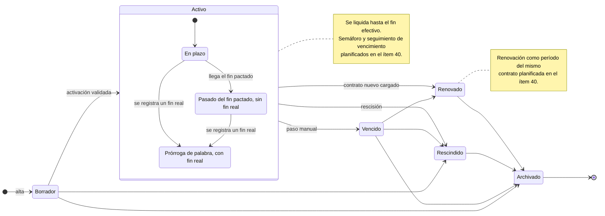

# Criterios de Aceptación

Criterios organizados por módulo. Se utilizan como referencia durante el desarrollo y como guía para las pruebas de extremo a extremo de la API, que son las que verifican estos criterios contra una base real (ver `docs/pruebas.md`).

Los criterios marcados como del piloto se agregaron el 2 de noviembre de 2026 y describen solo lo que ya está integrado en `main`; lo planificado figura como tal. Los casos de prueba que los verifican están en `../calidad/05-casos-de-prueba.md` y su relación con los hallazgos del piloto, en `33-matriz-de-trazabilidad.md`.

## Auth

- Dado un usuario con credenciales válidas, cuando ingresa email y contraseña, entonces recibe un token de acceso y uno de refresh con expiración configurada.
- Dado un token de refresh válido, cuando se invoca el endpoint de renovación, entonces se emite un nuevo token de acceso y se invalida el anterior.
- Dado un usuario sin sesión, cuando intenta acceder a un recurso protegido, entonces el sistema responde 401.
- Dado un usuario autenticado en una inmobiliaria, cuando consulta datos de otra, entonces el sistema responde 403 o 404 sin filtrar información.
- Un usuario invitado puede registrar su contraseña antes de la expiración del token de invitación.

Del piloto (CU-27, CU-28 y CU-29):

- La invitación la crea el Admin con un rol; el enlace es de un solo uso y vence a los 7 días. En la base solo queda el hash del token, y el valor en claro se ve una única vez. Reenviar la invitación invalida el enlace anterior.
- Una invitación vencida, usada o reemplazada se rechaza (`INVITATION_EXPIRED`, `INVITATION_ALREADY_ACCEPTED` o `INVITATION_NOT_FOUND`) y no crea el usuario.
- El pedido de recupero de contraseña responde siempre lo mismo, exista o no la cuenta. El enlace de recupero vence a la hora, se usa una sola vez y, al usarlo, cierra todas las sesiones del usuario.
- El cambio de contraseña desde el perfil exige la contraseña actual y cierra las sesiones de los otros dispositivos.
- La baja de un usuario y el cambio de rol rigen desde el pedido siguiente. El Admin no puede darse de baja a sí mismo ni dejar a la inmobiliaria sin un Admin activo.
- Un rol al que la política de lectura le cierra un recurso sensible recibe 403 `READ_FORBIDDEN` en las rutas de ese recurso y ve en `null` el documento y las cuentas bancarias dentro de personas y contratos. Si la política no se puede cargar, se deniega. El Admin siempre lee todo.

## Propiedades

- Una propiedad nueva queda con estado disponible al crearse, salvo que se indique lo contrario.
- No se puede crear un contrato sobre una propiedad con estado fuera de servicio.
- Las imágenes cargadas conservan un orden visible y se puede definir la portada.
- Los cambios de estado quedan registrados en la auditoría con usuario y timestamp.
- Una propiedad no puede eliminarse si tiene contratos activos; el sistema lo bloquea con mensaje explicativo.

## Contratos

- Un contrato requiere propiedad disponible, inquilino, fechas de inicio y fin, y monto inicial mayor a cero. Desde el piloto, también uno o más locadores.
- La modalidad de ajuste debe definirse al alta y queda inmutable salvo modificación explícita con auditoría.
- El estado de disponibilidad vive en la operación de la propiedad y se transiciona sobre ella, no sobre la propiedad. El alta del contrato en borrador no lo cambia; la activación sí (ver «Activación del contrato»).
- Las garantías cargadas se pueden listar y el contrato no puede activarse sin al menos una garantía válida (salvo excepción habilitada).
- La renovación se resuelve dando de alta un contrato nuevo con las mismas partes: el contrato anterior queda en estado Renovado y no hay clonado automático de partes ni de garantías. La renovación como un período nuevo del mismo contrato está planificada en el ítem 40.

### Estados del contrato

El diagrama muestra los estados del contrato y sus transiciones tal como las valida la máquina de estados compartida (`packages/shared/src/state-machine/contract-state-machine.ts`). Dentro de Activo se distinguen las situaciones que agregó el piloto: el contrato pasado de su fin pactado sigue activo y se sigue liquidando, y una prórroga de palabra se registra con un fin real. Lo marcado como planificado no existe todavía.

El paso a Vencido, Renovado y Archivado es manual: no hay una tarea que venza contratos por fecha, a propósito, porque un contrato pasado de su fin sin decisión sigue cobrándose (decisión del piloto ante la prórroga de palabra). El panel de calidad de datos lista los contratos vencidos sin decisión para que no queden olvidados.

### Activación del contrato

Del piloto (CU-05 y CU-25):

- Un contrato se crea en Borrador y pasa a Activo solo por la activación, que valida que tenga propiedad, inquilino y fechas coherentes, que sus locadores vigentes sumen exactamente cien por ciento en cada fecha del contrato y que no haya otro alquiler activo de la misma propiedad con fechas superpuestas. Si algo falla, responde `CONTRACT_NOT_ACTIVATABLE` con la lista de problemas y el contrato queda en Borrador.
- Un contrato creado directamente como Activo pasa por las mismas validaciones.
- Al activarse, la operación de alquiler de la propiedad queda en Alquilado.
- El cambio de estado por edición respeta la máquina de estados; pasar a Activo por edición se rechaza y remite a la activación.

### Locadores, reglas y acuerdos

Del piloto (CU-25, CU-26, CU-32 y CU-37):

- En un contrato que ya salió de Borrador, todo cambio de locadores deja la suma en cien por ciento en cada fecha; si no, se rechaza con `LESSOR_SHARES_INVALID` y las fechas que no suman. Una cesión se carga cerrando a un locador y abriendo a otro en la misma fecha.
- El cobrador de un locador tiene que tener un poder de cobro vigente, y la cuenta tiene que ser del locador.
- La regla vigente de un contrato en una fecha es la de la última versión de reglas con fecha anterior o igual; lo que la versión no fija toma el valor por defecto de la inmobiliaria.
- Un acuerdo que cambia reglas crea una versión nueva desde su fecha y no modifica las anteriores. No se acepta antes del inicio del contrato ni con la fecha de una versión existente, y no se corrige ni se borra si una versión posterior depende de él.
- El fin real es opcional, no puede ser anterior al inicio y, al cargarse o quitarse, rehace el cronograma de ajustes pendiente hasta el fin efectivo.

## Liquidaciones

- La generación de una liquidación crea la línea de alquiler del período y las líneas que correspondan según los tipos disponibles: alquiler, ajuste, extra, descuento y multa.
- El monto de alquiler refleja el último ajuste aplicado al período liquidado.
- Una liquidación no puede modificarse si ya tiene comprobante ARCA emitido; solo se admite anulación con nota de crédito.
- El sistema impide generar dos liquidaciones para el mismo contrato y período.
- El total de la liquidación equivale a la suma de sus líneas, sin discrepancias por redondeo mayor a un centavo.

Del piloto (CU-09, CU-11, CU-30 y CU-33):

- La generación toma el alquiler y las reglas vigentes en el mes liquidado, no liquida meses anteriores al inicio ni posteriores al fin efectivo, vence el día pactado y prorratea el primer y el último mes según la convención del contrato, con redondeo al centavo.
- Además de los tipos anteriores, una línea puede ser impuesto, servicio, cargo, honorario o ajuste retroactivo. Cada línea tiene destino (locador o inmobiliaria) y marca de comisionable; la comisión se calcula solo sobre lo comisionable, que son el alquiler y los punitorios, nunca reparaciones, impuestos ni servicios.
- La parte del inquilino de cada boleta, cada cargo pendiente y cada corrección de un ajuste provisorio entra una sola vez, en la primera liquidación que la toma. Si esa liquidación se borra o se anula, vuelven a quedar pendientes en la misma transacción.
- Un cargo que supera el umbral de anticipo del contrato no entra solo en la liquidación: se cobra por adelantado o se fuerza su imputación.
- El punitorio se calcula sobre el saldo impago, según la regla del contrato o, si no la fija, la de la inmobiliaria, y entra como línea Multa comisionable. Su condonación exige motivo, queda auditada y no se aplica a un punitorio ya cobrado.
- Al aprobarse, la liquidación recibe un número de recibo correlativo y el documento muestra el total en letras.

## Pagos

- Un pago puede ser total o parcial; el saldo restante queda como deuda imputable.
- Cuando la suma de los pagos alcanza el total de la liquidación, esta pasa sola al estado Pagada.
- Cada pago queda asociado a un medio de pago —transferencia, efectivo, MercadoPago o cheque— y a la liquidación que imputa.
- El pago se registra siempre contra su liquidación; el módulo de pagos es de consulta agregada de cobranzas y deuda.
- La validación del saldo y el alta del pago son atómicas: dos pagos simultáneos no pueden superar el saldo.
- Del piloto (CU-11): al registrar un pago se puede saldar en el mismo acto el punitorio devengado a la fecha del pago, que se agrega como línea Multa; el monto a pagar a una fecha se consulta sin registrar nada.

## Ajustes

Del piloto (CU-07 y CU-08):

- El ajuste de un mes usa el índice con el rezago pactado (dos meses por defecto para el IPC) y la base pactada (alquiler original o vigente).
- La previsualización de los ajustes del mes no escribe nada y muestra, por contrato, el alquiler actual y el nuevo, los valores de índice usados y si el resultado es provisorio.
- La aplicación de los ajustes elegidos procesa cada contrato en su propia transacción e informa por contrato si se aplicó o por qué se salteó; un contrato con error no frena a los demás.
- Sin el índice del mes no hay ajuste: el contrato queda con `MISSING_INDEX_DATA`, salvo que la inmobiliaria admita el pago a cuenta, en cuyo caso el ajuste se aplica como provisorio con un índice estimado y se corrige cuando el índice se publica.
- Los meses iniciales sin ajuste y el escalonado son reglas pactadas, no datos faltantes: el alquiler no cambia y no se informa error.

## Migración y calidad de datos

Del piloto (CU-34 y CU-36):

- Un lote de importación se puede ensayar sin escribir nada y el ensayo devuelve las mismas acciones que la ejecución.
- La importación es idempotente por referencia externa: el mismo lote dos veces deja todo sin cambios, y una corrección actualiza solo lo que cambió.
- Cada fila queda registrada con su acción (creada, actualizada, sin cambios o con error) y sus errores. En el modo todo o nada, una fila con error impide escribir el lote.
- Un contrato importado como activo cumple las mismas reglas que la activación.
- Un lote de una inmobiliaria no es visible ni utilizable desde otra.
- El panel de calidad de datos no modifica nada; un hallazgo desaparece cuando se corrige el dato.
- La unión de personas repetidas mueve todas sus relaciones en una sola transacción y queda auditada con el antes y el después; la previsualización muestra lo mismo sin cambiar nada.

## Tickets

- Un ticket abierto desde el portal del inquilino aparece de inmediato en el listado de tickets de la inmobiliaria: la apertura es sincrónica, no diferida.
- Los tickets pueden tener uno o más comentarios y archivos adjuntos.
- Al asignar un proveedor, el ticket pasa al estado Proveedor asignado, que es una de las etapas de su máquina de estados.
- Un ticket cerrado no admite nuevos comentarios públicos para el inquilino, salvo reapertura.
- La categoría del ticket es obligatoria.

## Portal inquilino

- El inquilino solo accede a información del contrato y las propiedades donde figura como parte.
- El inquilino descarga el comprobante en PDF de cada una de sus liquidaciones.
- Las credenciales del portal son independientes de las credenciales del sistema interno.
- El inquilino no edita datos desde el portal: los cambios de contacto los hace la inmobiliaria sobre la ficha de la persona.
- Las sesiones expiran y se renuevan mediante refresh token específico del portal.

## ARCA

- La emisión exige que la configuración del tenant (CUIT, punto de venta, certificados) esté validada.
- Una emisión exitosa devuelve CAE, fecha de vencimiento y queda persistida en `Comprobante` ligado a la liquidación.
- Una emisión fallida no genera comprobante y guarda el detalle del error en auditoría.
- Una nota de crédito siempre referencia al comprobante original.
- En ambiente de homologación, los comprobantes se marcan como tales y no se muestran en reportes oficiales.

## CRM

- Un lead pertenece a una sola etapa del pipeline en un momento dado.
- El movimiento de etapa queda registrado en el historial del lead.
- Una visita exige propiedad, lead y fecha futura.
- Al convertir un lead, sus datos personales se transfieren a la entidad `Person`; el contrato se da de alta después, como una operación aparte.
- Un lead descartado se conserva con motivo de descarte y queda fuera de reportes activos.

<!-- Cierre item 02 -->
