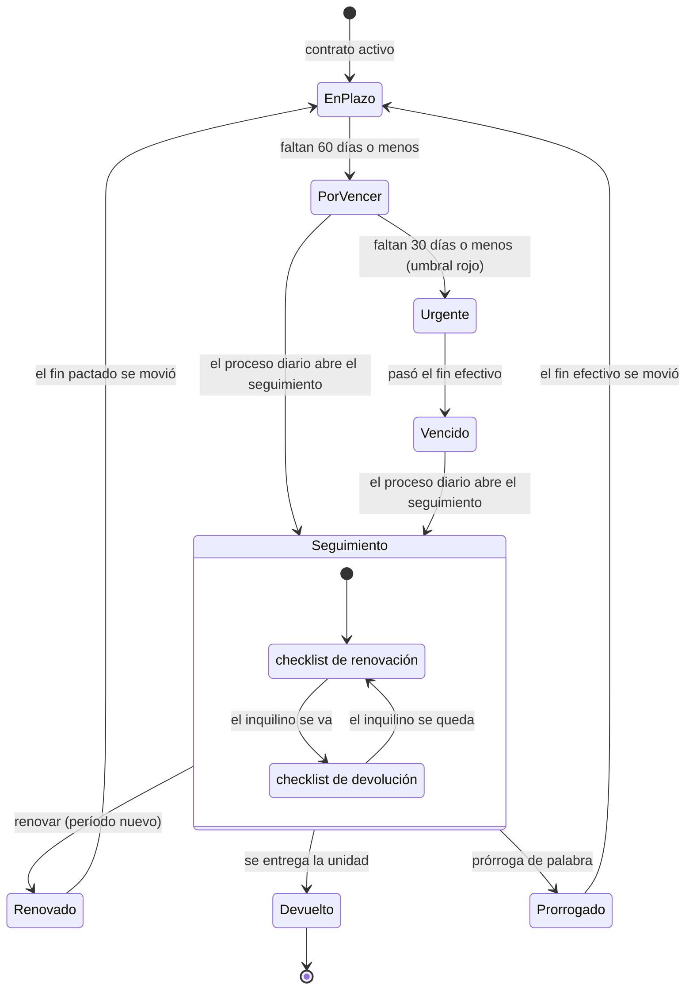

# Roles y Casos de Uso

## Roles

El sistema define siete roles internos en el enum `UserRole`, compartido entre el backend y el frontend. Un usuario tiene exactamente un rol, y al crearse sin especificarlo queda en Lectura, que es el más restringido.

El control de acceso se aplica endpoint por endpoint. Las operaciones que modifican datos se restringen por rol con `@Roles`, usando grupos de roles con nombre (`MANAGEMENT_ROLES`, `SALES_ROLES`, `BILLING_ROLES` y otros, en `apps/api/src/common/auth/role-groups.ts`) en lugar de listas escritas en cada ruta. Las lecturas sin `@Roles` están disponibles para cualquier usuario autenticado de la inmobiliaria, salvo los recursos sensibles que cubre la política de lectura de la sección siguiente: lo que se restringe por rol es crear, editar, borrar, transicionar estados y configurar. Algunas lecturas de gestión sí llevan rol propio, como los punitorios y el panel de calidad de datos (Admin y Gerente) o los lotes de importación (solo Admin).

### Matriz de lectura de datos sensibles

Además de `@Roles`, siete recursos sensibles tienen una política de lectura por rol, configurable por inmobiliaria (`Tenant.readPolicy`). **Por defecto todos los roles de personal leen todo**: el "casi todo abierto" ya no es un hecho fijo del código sino el valor por defecto, que la dirección puede cerrar sin desarrollo. Para el piloto se mantiene el valor por defecto, por decisión de la dirección.

| Recurso | Qué protege | Cuando el rol no puede leerlo |
|---|---|---|
| `persons.bankAccounts` | Cuentas bancarias (CBU y alias) de personas y propietarios | `GET /persons/:id/bank-accounts` responde 403 `READ_FORBIDDEN`; en las fichas y contratos el campo `bankAccounts` viaja en `null` |
| `persons.document` | DNI y CUIT en las personas | La persona se lee completa, con `dni` y `cuit` en `null` |
| `contracts.commission` | Comisión pactada en cada contrato | `GET /contracts/:id/commission` responde 403; en el contrato, `commission` en `null` |
| `renditions` | Rendiciones a propietarios | 403 `READ_FORBIDDEN` |
| `reports.financial` | Reportes (JSON, Excel y PDF) | 403 `READ_FORBIDDEN` |
| `invoices` | Facturas y sus PDF | 403 `READ_FORBIDDEN` |
| `audit` | Registro de auditoría | 403 `READ_FORBIDDEN` |

El rol Admin siempre puede leer todo: la política que lo omite se rechaza al guardarla, para que la inmobiliaria no pierda el acceso a su propia información. La política se aplica sumada a `@Roles`: ambas deben permitir. Si la política no se puede cargar, la lectura se deniega (falla cerrado), en el espíritu del ADR-0006.

Se configura desde Configuración → Permisos (Admin) o con `PUT /tenants/me/read-policy`. La web oculta las secciones y los ítems del menú que el rol no puede leer; la API es la que impone la política.

### Matriz de acceso por rol en los módulos del piloto

La tabla resume quién puede operar en lo que agregó el piloto, tal como lo imponen los grupos de roles de la API. Las lecturas siguen la regla general de esta sección; «Lectura» indica que el rol solo consulta. El portal del inquilino no aparece porque no tiene acceso a ninguno de estos módulos.

| Operación | Admin | Gerente | Ventas | Liquidaciones | Soporte, Marketing y Lectura |
|---|---|---|---|---|---|
| Invitar usuarios, cambiar roles, dar de baja, generar enlaces de recupero | Sí | Lectura del equipo | No | No | No |
| Configurar la política de lectura de datos sensibles | Sí | No | No | No | No |
| Configurar los valores por defecto de la inmobiliaria | Sí | Sí | Lectura | Lectura | Lectura |
| Activar un contrato y editar sus locadores | Sí | Sí | Sí | Lectura | Lectura |
| Registrar, corregir y quitar acuerdos del contrato | Sí | Sí | Lectura | Lectura | Lectura |
| Previsualizar y aplicar los ajustes del mes | Sí | Sí | No | Sí | No |
| Cargar boletas y reglas de traslado; cargar cargos | Sí | Sí | Lectura | Sí | Lectura |
| Generar liquidaciones y editar sus renglones | Sí | Sí | Lectura | Sí | Lectura |
| Aprobar y enviar liquidaciones en lote | Sí | Sí | Lectura | Lectura | Lectura |
| Registrar un cobro indicando quién recibió el dinero | Sí | Sí | No | Sí | No |
| Ver cuentas, libro de caja, custodia, recibos de cobro y compensaciones | Sí | Sí | No | Sí | Solo Lectura |
| Crear y editar las cuentas de la inmobiliaria | Sí | Sí | No | No | No |
| Cargar movimientos y conversiones, entregar custodia, registrar compensaciones | Sí | Sí | No | Sí | No |
| Ver y condonar punitorios | Sí | Sí | No | No | No |
| Configurar los parámetros de punitorios de la inmobiliaria | Sí | Lectura | No | No | No |
| Importar lotes del sistema anterior | Sí | No | No | No | No |
| Consultar el panel de calidad de datos | Sí | Sí | No | No | No |
| Unir personas repetidas | Sí | Previsualiza | No | No | No |
| Estimar, preautorizar, presupuestar y aprobar presupuestos de una incidencia | Sí | Sí | No | Lectura | Soporte sí; Marketing y Lectura, no |
| Pagar al proveedor de una incidencia e imputar el gasto | Sí | Sí | No | Sí | No |
| Enviar un recibo o un estado de cuenta por mail o WhatsApp | Sí | Sí | No | Sí | No |
| Ver la bandeja de salida de mensajes | Sí | Sí | Sí | Sí | Soporte y Lectura sí; Marketing, no |
| Reintentar o cancelar un mensaje; ver la configuración de la mensajería | Sí | Sí | No | No | No |
| Registrar el alta o la baja de mensajes de una persona | Sí | Sí | Sí | Sí | No (Soporte y Lectura consultan) |

En el piloto, la función de dirección usa el rol Admin. Las otras dos funciones de la inmobiliaria (atención y publicación, muestras e inventarios) todavía no tienen usuario propio: cuando lo tengan, la decisión de la dirección es que por ahora vean todo, así que la política de lectura queda en su valor por defecto. El mecanismo para cerrar lecturas existe y se prueba (CP-257 a CP-265), de modo que restringir a una función es una configuración y no un desarrollo.

### Admin

Es el rol con mayor nivel de permisos dentro de un tenant. Suele corresponder al dueño o socio de la inmobiliaria, o a un encargado administrativo con responsabilidad sobre la configuración del sistema. Es el único que llega a la configuración de la conexión con ARCA y a la administración de roles.

Permisos principales:

- Cambio de rol y desactivación de usuarios dentro de la inmobiliaria.
- Configuración de la conexión con ARCA: certificado, emisores y puntos de venta.
- Carga, edición y borrado de valores de índices, y disparo de su obtención automática.
- Configuración de los parámetros de punitorios de la inmobiliaria, y condonación de multas.
- Disparo manual de las corridas de notificaciones y de punitorios.
- Acceso a todos los contratos, liquidaciones, rendiciones y reportes.
- Visualización del log de auditoría.

### Gerente

Responsable operativo. Trabaja sobre todo el circuito con el mismo alcance que el Admin, salvo la configuración de índices, punitorios y certificados fiscales. Puede invitar usuarios, pero no cambiarles el rol ni desactivarlos.

Permisos principales:

- Alta, edición y baja de propiedades, personas, contratos y proveedores.
- Plantillas de contrato y de email.
- Aplicación de ajustes y rescisión de contratos.
- Aprobación y envío de liquidaciones en lote.
- Rendiciones, comprobantes, tickets, leads y embudos.
- Reportes, envíos programados, importación y auditoría.

### Ventas

Usuario comercial. Trabaja sobre la cartera de propiedades, las personas y el embudo de leads. No configura parámetros globales ni aplica ajustes.

Permisos principales:

- Alta y edición de propiedades, con sus operaciones, imágenes y tasaciones.
- Alta y edición de personas, con sus roles y documentos.
- Alta y edición de contratos, y generación del documento a partir de una plantilla.
- Cálculo del ajuste de un contrato, sin aplicarlo.
- Gestión del embudo comercial y de leads, con visitas e interacciones.
- Exportación de propiedades y personas.
- Acceso de lectura a comprobantes y reportes operativos.

### Liquidaciones

Usuario de administración y cobranzas. Es el rol que recorre el circuito del dinero de punta a punta.

Permisos principales:

- Generación de las liquidaciones del período, edición de sus líneas y transición de sus estados.
- Registro de pagos e imputación de saldos.
- Cuenta corriente y estado de cuenta mensual de los locadores, y pagos a locadores (las rendiciones por contrato quedan como histórico de consulta).
- Emisión de comprobantes ARCA y notas de crédito, y administración de emisores.
- Acceso a los reportes financieros y a los indicadores de flujo de caja y morosidad.

### Soporte

Mesa de reclamos. Atiende el circuito de mantenimiento.

Permisos principales:

- Apertura, edición y cierre de tickets, con comentarios y adjuntos.
- Transición de estados del ticket y asignación de proveedores.
- Carga del costo del trabajo realizado.
- Acceso de lectura a propiedades, personas, contratos y comprobantes.

### Marketing

Rol acotado a la comunicación con los leads.

Permisos principales:

- Alta, edición, borrado y previsualización de plantillas de email.
- Envío de un correo a un lead a partir de una plantilla.
- Acceso de lectura general, sujeto a la política de lectura de datos sensibles.

### Lectura

Rol de consulta. Ve los listados y los detalles sin ninguna acción disponible, salvo los datos sensibles que la política de lectura de la inmobiliaria le cierre. Sobre pagos y comprobantes tiene lectura explícita.

### Inquilino

Usuario externo a la inmobiliaria, autenticado contra el portal de autogestión. No comparte espacio de credenciales con los usuarios internos y no tiene rol: lo que puede ver está delimitado por la persona a la que pertenece su token.

Permisos principales:

- Consulta del estado de su contrato y de su saldo pendiente.
- Consulta de sus liquidaciones y descarga del comprobante en PDF de cada una.
- Apertura y seguimiento de reclamos de mantenimiento sobre la propiedad alquilada, con adjuntos y comentarios.

El inquilino no edita sus propios datos desde el portal: los cambios de contacto los hace la inmobiliaria sobre la ficha de la persona.

## Casos de uso prioritarios

A continuación se listan los casos de uso considerados centrales para la operación del MVP. Cada uno indica actor primario y una descripción breve. Donde se nombra un rol, es el rol real que habilita la operación.

### Gestión de propiedades y personas

- **CU-01 Alta de propiedad** — Ventas. Registra una propiedad con dirección, características, fotos, catastro y, si es una unidad, su edificio. Los dueños se registran como titulares, con porcentaje opcional y sin que tengan que sumar cien: la titularidad es independiente de quién alquila (ver CU-25). *Modificado por el piloto:* FB-01.
- **CU-02 Cambio de estado de una operación** — Ventas. Transiciona el estado de la operación de venta o alquiler de la propiedad: borrador, disponible, reservada, alquilada, vendida, ocupada, suspendida o archivada. El estado vive en la operación, no en la propiedad, de modo que un mismo inmueble puede estar publicado en venta y alquilado a la vez.
- **CU-03 Alta de persona** — Ventas. Carga una persona física o jurídica y asigna uno o más roles: propietario, inquilino, garante, comprador, proveedor, lead o apoderado. El rol es una etiqueta de cliente: dice cómo se relaciona la persona con la inmobiliaria, no a qué contrato pertenece. Se pone solo cuando la persona se carga como locador, titular o apoderado, de modo que no hace falta asignarlo antes para poder firmar un contrato.
- **CU-04 Vinculación de garantías** — Ventas. Asocia al contrato una garantía propietaria, bancaria, un seguro de caución o un depósito.

### Contratos

- **CU-05 Alta de contrato** — Ventas. Genera un contrato a partir de una propiedad, sus locadores, un inquilino, sus garantías y su esquema de ajuste, y produce el documento a partir de una plantilla. Para activarlo, los locadores vigentes tienen que sumar exactamente 100 % del cobro; el documento incluye a los locadores y a los apoderados que firman por ellos.
- **CU-06 Renovación de contrato** — Admin o Gerente. Renueva el contrato como un período nuevo del mismo contrato (no se clona): fechas, alquiler, regla de ajuste, garantes que reafirman y honorarios; ver CU-39. El estado Renovado queda para los contratos que se renovaron dando de alta uno nuevo antes de este mecanismo.
- **CU-07 Configurar ajuste** — Ventas o Gerente. Define la modalidad de ajuste —IPC, ICL, CCP, UVA, porcentaje fijo, escalonado o personalizado— y su periodicidad, de mensual a anual. Desde el piloto también fija el rezago del índice, la base del ajuste (alquiler original o vigente) y los meses iniciales sin ajuste; lo que el contrato no fija toma el valor por defecto de la inmobiliaria. En un contrato activo con más de una versión de reglas, cambiar la modalidad es un acuerdo (CU-32). *Modificado por el piloto:* FB-13 y FB-25.
- **CU-08 Calcular y aplicar ajuste** — Ventas calcula, Admin o Gerente aplica. El cálculo toma el índice publicado para el período; la aplicación escribe el nuevo monto en el contrato. Desde el piloto el caso habitual es mensual y masivo: Admin, Gerente o Liquidaciones piden la previsualización de todos los ajustes que vencen en el mes (con el índice de dos meses antes por defecto), revisan contrato por contrato y aplican los elegidos; cada contrato se aplica en su propia transacción y la respuesta dice cuáles se aplicaron y por qué se salteó el resto. *Flujo alternativo:* si el índice del mes no está publicado y la inmobiliaria admite el pago a cuenta, el ajuste se aplica como provisorio con un índice estimado y se corrige solo cuando el índice se publica, con la diferencia como renglón de la liquidación siguiente; si no lo admite, el contrato queda con `MISSING_INDEX_DATA` y no se ajusta. Una tarea diaria aplica los vencidos y corrige los provisorios. *Modificado por el piloto:* FB-13 y FB-23.
- **CU-25 Registrar locadores de un contrato** — Ventas, Gerente o Admin. Indica quién alquila (propietario, usufructuario, sublocador, acreedor u otro), qué porcentaje del cobro le corresponde, desde y hasta cuándo, qué cuenta recibe su parte y, si cobra otra persona, quién. Los locadores vigentes suman 100 % en cada fecha; una cesión se carga cerrando a uno y abriendo a otro en la misma fecha. Para cambiar el reparto de un contrato activo se reemplaza el conjunto de una vez. Los contratos migrados con varios propietarios quedan marcados para revisar el reparto.
- **CU-32 Registrar un acuerdo** — Admin o Gerente. Registra un convenio fechado entre las partes —renegociación, rebaja, bonificación, cambio de reglas, de reparto o de cargo, prórroga o salida— con su documento. Si cambia reglas, crea una versión nueva desde su fecha sin tocar las anteriores, de modo que una liquidación de un mes pasado se sigue calculando con las reglas de ese mes. *Flujo alternativo:* no se acepta un acuerdo anterior al inicio del contrato ni dos versiones con la misma fecha; un acuerdo del que dependen versiones posteriores no se corrige ni se borra. *Origen:* FB-08 y FB-13 (todo es pactable).
- **CU-26 Registrar un apoderado** — Ventas, Gerente o Admin. Registra que una persona actúa en nombre de otra, con los alcances cobrar, firmar o administrar; con firma indistinta (alcanza con uno) o conjunta (firman todos los del grupo); general o acotado a un contrato o una propiedad, con su vigencia y el documento del poder. Un apoderado con poder de cobro puede ser el cobrador de un locador; mientras lo sea, el poder no se puede revocar.

### Liquidaciones y pagos

- **CU-09 Generar las liquidaciones del mes** — Liquidaciones. Recibe el período y produce las liquidaciones de todos los contratos activos, informando cuántas creó y cuántas omitió por ya existir. Desde el piloto la generación corre sola unos diez días antes del mes (y se puede pedir a mano), toma el alquiler y las reglas vigentes en ese mes, respeta el inicio y el fin efectivo del contrato, el día de vencimiento pactado y el prorrateo del primer y del último mes según las convenciones del contrato, y suma las partes de boletas sin facturar, los cargos pendientes, las correcciones de ajustes provisorios y los punitorios del mes anterior. Cada renglón —alquiler, ajuste, extra, descuento, multa, impuesto, servicio, cargo, honorario o ajuste retroactivo— lleva su destino y si es comisionable. Al aprobarla recibe un número de recibo y el documento muestra el total en letras. *Flujo alternativo:* un contrato fuera de fecha o un primer mes que la convención cobra al firmar se informa y no se liquida; si la liquidación se anula, los cargos, boletas, correcciones y punitorios que traía vuelven a pendiente. *Modificado por el piloto:* FB-07, FB-08 y FB-13.
- **CU-10 Registrar pago** — Liquidaciones. Asocia un pago total o parcial a una liquidación e imputa el saldo. Si el pago completa el total, la liquidación pasa sola a Pagada. Indica quién recibió el dinero (la inmobiliaria, en una caja o un banco, o el locador; por defecto según el flujo de pago del contrato) y si la parte de los locadores queda en custodia; el sistema reparte el cobro entre la inmobiliaria, los entes y cada locador y, si cobró la inmobiliaria, deja el ingreso en su caja y emite el recibo numerado. *Origen:* FB-06.
- **CU-11 Calcular punitorio** — Sistema. Aplica el recargo correspondiente al pasar la fecha de vencimiento sin pago, según la regla pactada en el contrato o, si no la fija, los parámetros de la inmobiliaria (tasa diaria fija o porcentual, o la mayor entre el doble de la tasa activa del Banco Nación y un porcentaje diario). Desde el piloto el punitorio se calcula sobre el saldo impago, se informa al día en el monto a pagar de cada liquidación y se cobra como renglón «Multa», comisionable, al registrar el pago o en la liquidación siguiente. *Modificado por el piloto:* FB-07.
- **CU-12 Condonar punitorio** — Admin o Gerente. Anula la multa acumulada de un caso, o todas las de un contrato hasta una fecha, con motivo obligatorio y fila de auditoría. No se condona un punitorio ya cobrado. *Modificado por el piloto:* FB-07.
- **CU-13 Generar rendición al propietario** — Liquidaciones. Consolida lo cobrado en el período, descuenta la comisión pactada en el contrato y los conceptos deducidos, y emite el documento del propietario. Desde el piloto se emite una rendición por cada locador vigente, con su parte según el porcentaje de cobro, y no se genera si los locadores no suman cien. *Retirado en 3.2:* las rendiciones quedan como histórico de consulta; lo reemplaza CU-35 (ADR-0009).
- **CU-33 Cargar las boletas del período** — Admin, Gerente o Liquidaciones. Carga en una planilla las boletas de impuestos y servicios del mes —una por servicio y período, o por cuota—, con importe, vencimiento y consumo. Cada boleta se reparte según la regla de traslado vigente de cada contrato de la unidad: quién paga (inquilino, inmobiliaria o locador), en qué proporción (porcentaje, consumo o fijo) y con qué plan (mensual o anual en cuotas). La parte del inquilino entra en su próxima liquidación sin comisión. *Flujo alternativo:* volver a cargar la misma boleta la actualiza y no la duplica; una regla nueva en un contrato activo exige un acuerdo de cambio de cargo con esa fecha (CU-32); una boleta anulada quita las partes todavía no facturadas. *Origen:* FB-08.

### Facturación electrónica

- **CU-14 Emitir comprobante ARCA** — Liquidaciones. Envía la solicitud a ARCA, recibe el CAE y persiste el comprobante. *Modificado por el piloto:* el alquiler se factura por cuenta del locador (CU-43), no a nombre de la inmobiliaria. *Origen:* FB-11.
- **CU-15 Anular comprobante** — Liquidaciones. Emite la nota de crédito que referencia al comprobante original.

### Tickets y mantenimiento

- **CU-16 Abrir reclamo** — Inquilino o Soporte. Registra un reclamo con categoría, descripción y adjuntos.
- **CU-17 Asignar proveedor** — Soporte. Vincula al ticket un proveedor de los habilitados por rubro y zona, y lo lleva al estado correspondiente. *Modificado por el piloto:* con un presupuesto aprobado el proveedor ya está elegido y solo se confirma la asignación (CU-40). *Origen:* FB-09.
- **CU-18 Cerrar ticket** — Soporte. Recorre la máquina de estados hasta Resuelto o Cerrado, con el costo del trabajo cargado. *Modificado por el piloto:* el pagador del costo es uno de tres (inquilino, locador o inmobiliaria) y el gasto se imputa con CU-40. *Origen:* FB-09.
- **CU-40 Gestionar una reparación: autorización, presupuesto, pago e imputación** — Soporte (autorización y presupuestos), Liquidaciones (pago e imputación); Admin y Gerente hacen todo, Lectura consulta. Anota el costo estimado de la incidencia; si supera el límite que la inmobiliaria resuelve sin consultar (valor por defecto, 0: siempre se consulta), el caso espera la autorización del locador y se registra hasta qué importe, quién la dio, cuándo y por qué canal (WhatsApp, teléfono, mail o presencial). Carga los presupuestos de los proveedores y el locador (o quien lo representa) aprueba uno: se anota quién, cuándo y por qué canal, el proveedor y el importe aprobados pasan al ticket y los demás presupuestos se descartan. Con el trabajo en marcha la inmobiliaria paga al proveedor desde una de sus cuentas (un movimiento del libro de caja, en una o varias partes sin pasarse de lo aprobado) y, terminado el trabajo, imputa lo pagado a quien lo soporta, **una sola vez**: el inquilino en su próxima liquidación, el locador en su próximo estado o la inmobiliaria como gasto propio. Puede sumar un honorario por gestión de la reparación (un porcentaje de lo pagado o un importe fijo), cargado como otro gasto puntual de la inmobiliaria y nunca como comisión. *Flujo alternativo:* un caso por debajo del límite se presupuesta o se trabaja sin consultar; no se paga ni se imputa antes de tiempo; la inmobiliaria no se cobra honorario a sí misma; una segunda imputación se rechaza; el límite sin consultar se puede pactar por contrato (con importe y moneda) y el honorario por gestión por contrato; un caso con pagos al proveedor no se cancela. *Origen:* FB-09.

### CRM

- **CU-19 Captar lead** — Ventas. Carga un interesado, lo ubica en una etapa del embudo y registra su origen. Una consulta enviada desde el micrositio público entra por esta vía sin intervención.
- **CU-20 Agendar visita** — Ventas. Programa una visita a una propiedad para un lead.
- **CU-21 Convertir lead** — Ventas. Promueve el lead a `Person`, desde donde se puede dar de alta el contrato como una operación aparte.
- **CU-45 Publicar una propiedad y copiar el aviso** — Admin, Gerente, Ventas y Marketing publican y configuran lo que corresponde a su rol (los portales y la privacidad, Admin y Gerente); el resto del personal consulta. En la tarjeta *Publicación* de la ficha registra, por operación y por portal (Zonaprop, Argenprop, MercadoLibre, Clasificados La Voz o los que la inmobiliaria cargue, más el **micrositio propio**), el estado del aviso —no publicado, publicado, pausado o vencido—, la dirección o el código del aviso, la fecha de publicación y el vencimiento. Para publicar en un portal pide el **aviso para copiar**: título y descripción armados con los datos de la ficha por plantillas, dentro de los límites de caracteres y de fotos de ese portal, con las fotos en orden de carga y botones para copiar cada parte; el texto no lleva datos de propietarios ni de inquilinos, quita teléfonos, mails y links del texto libre y muestra solo la zona mientras la inmobiliaria no permita la dirección exacta. La pantalla *Publicaciones* lista las unidades disponibles que no están publicadas en ningún lado, los avisos por vencer y vencidos y los publicados de unidades que ya se alquilaron, vendieron o dieron de baja, que se pausan con un botón. Publicar en el micrositio propio es marcar el aviso del portal *micrositio*: solo lo marcado aparece en el sitio público, sin datos privados. Quien visita el sitio filtra por operación, tipo, zona y precio, ve la ficha y envía una consulta, que entra como interesado (CU-19). *Flujos alternativos:* una operación que no está disponible ni reservada no se publica (409); un aviso con la fecha de vencimiento pasada figura vencido aunque nadie lo haya tocado; un portal dado de baja no admite nuevos avisos publicados; el formulario descarta, sin avisar, lo que llega con el campo señuelo lleno; una propiedad de otra inmobiliaria nunca se ve ni se consulta. Ningún portal externo se publica desde el sistema: ninguno ofrece una interfaz confirmada (ver el alcance). *Origen:* FB-17.

### Portal del inquilino

- **CU-22 Login del inquilino** — Inquilino. Accede al portal con credenciales propias.
- **CU-23 Consultar saldo y liquidaciones** — Inquilino. Visualiza liquidaciones del contrato y descarga comprobantes.
- **CU-24 Abrir reclamo desde el portal** — Inquilino. Genera un ticket que llega al backlog de la inmobiliaria.

### Migración y calidad de datos

- **CU-34 Importar desde el sistema anterior** — Admin. Envía un lote de personas, propiedades y contratos (con locadores, reglas, comisión e historial de ajustes) preparado por un script de migración, primero como ensayo sin escribir y después de verdad. Cada fila se identifica por su referencia externa, de modo que volver a enviar el mismo lote no cambia nada y una corrección actualiza solo lo que cambió. El resultado de cada fila queda registrado y se descarga para corregir el origen. *Flujo alternativo:* en el modo «todo o nada», que es el de la carga final, una fila con error impide escribir el lote entero; un contrato activo cuyos locadores no suman cien, sin inquilino o superpuesto con otro alquiler de la misma propiedad se rechaza como fila con error. *Origen:* FB-04.
- **CU-36 Revisar la calidad de los datos** — Admin o Gerente revisan, Admin une. Consulta el panel con los controles de calidad (personas repetidas por documento, CUIT, CBU, teléfono, correo o nombre; locadores o titulares que no suman cien; propiedades sin titular; locadores sin documento o sin cuenta; contratos vencidos sin decisión y contratos activos incompletos), entra al detalle de cada uno y corrige en la ficha. Para dos personas repetidas, previsualiza qué se mueve y qué se descarta y las une en una sola: la unión mueve todas sus relaciones en una transacción y queda auditada con el antes y el después. *Origen:* FB-22.
- **CU-37 Configurar los valores por defecto de la inmobiliaria** — Admin o Gerente. Fija los valores que rigen cuando un contrato no pacta otra cosa: día de vencimiento, anticipación de la liquidación, rezago del índice, pago a cuenta, comisión, honorarios, umbral de anticipo, cadencia de cobranza, umbrales del semáforo y convenciones de liquidación. Un cambio rige para los contratos que no fijan ese valor; lo pactado en un contrato no se toca. *Origen:* FB-13 y la decisión de diseño «todo es pactable» (`30-piloto.md`).

### Equipo y acceso

- **CU-27 Invitar un usuario** — Admin. Invita a una persona con un rol (Admin, Gerente, Ventas, Liquidaciones, Soporte, Marketing o Lectura) y recibe un enlace de un solo uso que vence a los 7 días. Mientras no haya correo configurado, el Admin comparte el enlace a mano; si lo hay, además se envía por correo. La persona abre el enlace, elige nombre y contraseña, y entra con el rol asignado. El Admin también cambia roles, da de baja y reactiva usuarios, reenvía invitaciones pendientes (el enlace anterior deja de servir) y nunca puede quedarse sin un Admin activo ni darse de baja a sí mismo. El Gerente ve el equipo en solo lectura. *Flujo alternativo:* una invitación vencida o ya usada se rechaza y el Admin genera otra; una baja cierra las sesiones abiertas de inmediato. *Origen:* FB-26.
- **CU-28 Recuperar la contraseña** — Usuario del personal, Admin. Quien la olvidó pide instrucciones desde el ingreso y la respuesta es siempre la misma, exista o no la cuenta; si el correo no está configurado no se envía nada, y entonces el Admin le genera un enlace de un solo uso, válido 1 hora, que le comparte a mano. Con el enlace elige una contraseña nueva y se cierran todas sus sesiones. Quien sabe su contraseña la cambia desde su perfil, pidiendo la actual; se cierran las sesiones de los otros dispositivos. *Origen:* FB-26.
- **CU-29 Configurar los permisos de lectura** — Admin. Elige, para cada recurso sensible (cuentas bancarias, documento, comisión, rendiciones, reportes financieros, facturas y auditoría), qué roles pueden leerlo. Sin configurar, todos los roles de personal leen todo. El Admin siempre conserva la lectura. *Flujo alternativo:* un rol sin acceso recibe 403 `READ_FORBIDDEN` en las rutas que devuelven el recurso y ve ocultos (`null`) el documento y las cuentas dentro de personas y contratos; si la política no se puede cargar, se deniega. *Origen:* FB-03.
- **CU-30 Cargar un gasto del mes** — Admin, Gerente, Liquidaciones. Carga una reparación, una expensa extraordinaria, una devolución o un honorario por gestión, a cargo del inquilino, del locador o de la inmobiliaria, solo o en cuotas o por planilla. El gasto al inquilino entra una sola vez en su próxima liquidación, sin comisión; el del locador se descuenta en su estado; una devolución resta como descuento a favor del inquilino. *Flujo alternativo:* si el importe supera el umbral de anticipo (por defecto 2 comisiones mensuales) queda marcado para pedir el pago por adelantado y no entra solo: se cobra por adelantado o se fuerza su imputación; un cargo pendiente se anula; si la liquidación que lo tomó se anula o se borra, el cargo vuelve solo a pendiente. El umbral y la comisión con que se mide se pactan por contrato. *Origen:* FB-09.

- **CU-31 Manejar la caja, la custodia y las compensaciones** — Admin, Gerente, Liquidaciones (Lectura consulta). Ve las cuentas de la inmobiliaria (cajas, bancos y la custodia de cada locador, cada una en una moneda) con su saldo y el libro de movimientos; carga a mano pagos a locadores, entes y proveedores, honorarios, gastos, comisiones del personal y señas; convierte entre monedas con un tipo de cambio explícito; entrega a un locador el efectivo que se le guarda; registra que un locador recibió un cobro que le correspondía a otro (compensación), pagándolo si hace falta con su custodia; cierra como gasto un cargo a la inmobiliaria; reimprime los recibos de cobro. *Flujo alternativo:* no se entrega más de lo que hay en custodia; una cuenta con saldo no se desactiva; las compensaciones de un cobro no superan el cobro. *Origen:* FB-06, FB-28.

- **CU-35 Llevar la cuenta corriente y el estado de cuenta del locador** — Admin, Gerente, Liquidaciones (Lectura consulta). Ve el saldo de cada locador por moneda —lo que la inmobiliaria le debe o lo que él le debe—, cuánto está en custodia y cuánto falta pagarle, y su cuenta corriente con el saldo después de cada movimiento: los cobros (su parte de cada concepto, menos comisión y gastos; lo que cobró directamente si le pagó el inquilino), las compensaciones, los pagos a entes hechos por él, los gastos a su cargo, las entregas de custodia y los pagos. Le paga desde una caja o un banco (transferencia o efectivo), lo que resta de su saldo. A fin de mes genera los borradores del estado de cuenta de todos los locadores con movimientos o saldo, con todas sus unidades y el saldo arrastrado del mes anterior, los revisa agrupados por unidad, los emite (los movimientos quedan fijos) y descarga el PDF para imprimirlo o compartirlo. *Flujos alternativos:* el Admin o el Gerente carga o corrige el saldo inicial de un locador con un motivo, que queda auditado, salvo que ya esté en un estado emitido; anula, con motivo, el último estado emitido de un locador y sus movimientos vuelven al estado siguiente; un mes anterior al último emitido no se vuelve a generar; un cobro sin reparto no deja movimientos. Las rendiciones por contrato quedan como histórico de consulta. *Origen:* FB-10.

## Casos de vencimientos y renovaciones (ítem 40)

- **CU-38 Seguir los vencimientos de contratos** — Admin, Gerente y Ventas trabajan; todos los roles de personal consultan. Todos los días el sistema abre, para cada contrato de alquiler activo (o vencido sin decisión: sin renovación ni cierre) cuyo fin efectivo ya está a 60 días o menos (o lo pasó), un seguimiento con su checklist. Nace como renovación con resultado pendiente; el equipo lo asigna a una persona, lo pasa a devolución si el inquilino se va, marca los pasos hechos (renovación: visita, precio nuevo, regla de ajuste, garantes, honorarios, sellos y firma; devolución: visita previa, fecha de entrega acordada, publicar la unidad con anticipación, libre deuda de servicios, pintura y estado, llaves, depósito; los conflictos con el inquilino van en la nota del seguimiento), anota y lo cierra con un resultado (renovado, devuelto, prorrogado). La pantalla Vencimientos lista los seguimientos con el semáforo (en plazo, por vencer, urgente, vencido) y filtros por color, tipo, estado y responsable. El semáforo no se guarda: se calcula del fin efectivo y de los umbrales de la inmobiliaria (rojo 30 días y amarillo 60 por defecto, configurables en Valores por defecto).
- **CU-39 Prorrogar de palabra y renovar un contrato** — Admin o Gerente. Ambas acciones valen también para un contrato Vencido que en la práctica sigue corriendo: lo vuelven a Activo (único camino de Vencido a Activo, auditado). La *prórroga de palabra* registra hasta cuándo sigue el inquilino sin papeles: mueve el fin real y deja intacto el fin pactado, queda como convenio y auditada, cierra el seguimiento como prorrogado y los avisos, los paneles y el cronograma de ajustes pasan a medir con el fin efectivo. La *renovación* agrega al mismo contrato un período de renovación con su alquiler y su regla de ajuste nuevos, los garantes que reafirman y los honorarios pactados (el diálogo los sugiere con el porcentaje de renovación de la inmobiliaria), cierra el seguimiento como renovado, absorbe la prórroga de palabra si la había y permite bajar la adenda corta en PDF.
- **CU-42 Cargar el depósito y liquidar el egreso** — Admin y Gerente cargan el depósito y confirman la liquidación; Admin, Gerente y Liquidaciones cobran las cuotas; Lectura consulta. El depósito de un contrato tiene importe y moneda, quién lo guarda (el locador o la inmobiliaria, esta última con o sin un locador dueño del dinero, y en ese caso va a su custodia), cuotas, regla de devolución (pesos actualizados al último alquiler, o la misma moneda sin actualizar), plazo de devolución en días y cuotas de devolución. Al egreso se arma la liquidación («chequeo»): el sistema trae lo que el inquilino debe a esa fecha (alquileres sin cobrar, punitorios devengados, partes de boletas sin facturar, cargos pendientes y reparaciones), el equipo destilda lo que no corresponde, edita los importes y agrega descuentos (pintura, faltantes, llaves), y ve el resultado contra el depósito que corresponde devolver. El alquiler del último mes se propone solo, del día 1 al día de egreso con la convención de prorrateo del contrato, y se puede corregir. Se guarda como borrador y se confirma una sola vez: el depósito se aplica como pagos reales a las liquidaciones abiertas incluidas (de la más antigua a la más nueva, con su punitorio si alcanza), que quedan saldadas con su recibo y su reparto y acreditan la cuenta corriente del locador por el camino normal (si el depósito lo guarda el locador, el pago es un cobro directo suyo); sale de la caja o de la custodia lo aplicado y la devolución del resto, se imputan los cargos y las boletas incluidos, el saldo que el inquilino todavía debe queda como cargo pendiente, se tilda el paso «Devolución del depósito» del seguimiento y se baja el PDF. *Flujos alternativos:* una liquidación sin enviar o en otra moneda que el depósito no se paga con él (409); lo que el depósito no alcanza a cubrir de una liquidación sigue en cobro normal; un depósito con cuotas cobradas no cambia de importe, moneda ni cuotas; un renglón en otra moneda pide tipo de cambio; si la inmobiliaria lo exige, descuentos y reparaciones necesitan la conformidad del locador; no se devuelve más de lo que hay en custodia; la liquidación confirmada no se vuelve a confirmar. *Origen:* FB-14.

Diagrama 8. Semáforo de vencimientos y checklist: del fin efectivo del contrato al resultado del seguimiento.

## Casos de honorarios (ítem 41)

- **CU-41 Cobrar honorarios y pagar las comisiones del personal** — Admin o Gerente cargan los honorarios y las comisiones; Liquidaciones cobra las cuotas; Lectura, Ventas y Soporte consultan. Carga el honorario de una operación con la propuesta de la inmobiliaria, que puede cambiar: el alta de un alquiler (5 % del total del contrato, que suma los alquileres del plazo con los ajustes que se conocen al firmar), la renovación (sobre el período renovado), la venta (3 % por parte si es construido, 5 % si es lote, sobre el valor real) o la tasación (USD 100 o sin cargo). Elige quién paga —el inquilino, el locador o los dos con su parte—, el IVA, en cuántas cuotas mensuales y si las cuotas siguen los ajustes del alquiler; agrega el coorretaje con otra inmobiliaria y la comisión de cada persona del personal. Cobra cada cuota en la caja o el banco, con recibo, o, si paga el locador, se la descuenta de su cuenta corriente. Paga las comisiones del personal desde una cuenta. *Flujos alternativos:* una cuota que vence después de un ajuste del alquiler se cobra ajustada en la misma proporción; un honorario en cero queda sin cargo; agregar o quitar un coorretaje recalcula las comisiones sin pagar; un honorario sin cobros ni comisiones pagadas se anula con motivo; una cuota cobrada no se vuelve a cobrar. *Origen:* FB-12 y FB-19.
- **CU-43 Facturar por cuenta del locador** — Admin y Gerente configuran; Liquidaciones factura; Lectura consulta. Da de alta el **emisor delegado** del locador con su CUIT y su condición frente al IVA, verifica la delegación en ARCA y trae sus puntos de venta (la inmobiliaria factura con la delegación que el locador le dio, nunca a nombre propio). Define, para la inmobiliaria y, si hace falta, para cada locador, qué se factura (solo el alquiler, el alquiler y los punitorios, o todo lo que es del locador), cuándo (a pedido, al registrar cada cobro o al emitir el estado de cuenta) y el IVA incluido. Factura un cobro o un estado de cuenta emitido: se emite una factura por contrato, al inquilino, por la parte exacta del locador y con el tipo A, B o C que resulta de las condiciones del locador y del inquilino. Con la emisión automática, el sistema pone en cola lo nuevo y lo emite cada 30 minutos; «Emitir pendientes» reintenta lo que falló. *Flujos alternativos:* un fallo de ARCA no afecta al cobro: el trabajo queda fallido con su motivo y se reintenta; repetir la emisión no factura dos veces; un locador sin emisor delegado se omite; con la emisión al emitir el estado, un cobro no se factura a mano; anular el estado de cuenta deja en cola la nota de crédito de sus facturas; en dólares todavía no se factura. Los honorarios y las comisiones de la inmobiliaria se facturan con su emisor propio (CU-41). *Origen:* FB-11.

<<<<<<< HEAD
## Casos de mensajería saliente (ítem 43)

- **CU-44 Enviar documentos por mail o WhatsApp y administrar el consentimiento** — Admin, Gerente y Liquidaciones envían; Admin y Gerente reintentan, cancelan y ven la configuración; Admin, Gerente, Ventas y Liquidaciones registran el consentimiento; Lectura, Ventas y Soporte consultan la bandeja. Desde un recibo de cobro o un estado de cuenta emitido elige *mail* o *WhatsApp*: el sistema encola el mensaje para su destinatario (el inquilino o quien pagó el honorario; el locador) con el PDF y una clave por documento y canal, y lo despacha según el modo del ambiente, el consentimiento de la persona y el horario permitido. La liquidación enviada, la invitación de un usuario, los avisos al personal y las novedades de un ticket del portal se encolan solos. En la ficha de la persona registra el alta o la baja de cada canal con una nota; en la bandeja de salida sigue el estado de cada mensaje (pendiente con su motivo, enviado, entregado, leído, bloqueado, fallido o cancelado). *Flujos alternativos:* pedir el envío dos veces devuelve el mismo mensaje; sin mail o celular válido no se encola; un estado de cuenta sin emitir no se manda; sin alta de WhatsApp el mensaje queda bloqueado hasta registrarla y reintentarlo; una baja (registrada, o pedida por la persona respondiendo BAJA o STOP, o marcando un mail como spam) bloquea los mensajes de ese canal; fuera de horario el mensaje espera; con el modo apagado o fuera de la lista de prueba no sale nada; un rechazo del proveedor deja el mensaje fallido y avisa a la gerencia. *Origen:* FB-10 y FB-26; base de FB-18 y FB-21.
=======
## Casos de ventas y llaves (ítem 44)

- **CU-46 Gestionar una venta: reserva, seña, boleto y escritura** — Admin, Gerente y Ventas cargan y mueven la operación y reciben el dinero; Admin y Gerente devuelven o retienen el dinero recibido y pactan el honorario; Lectura consulta. Abre una operación de venta sobre una propiedad (una abierta por propiedad), con sus compradores y vendedores y su parte de cada lado (cada lado suma 100 %), y el precio de publicación. La operación pasa por captación, publicada, reservada, seña recibida, boleto y escriturada, o se cancela con motivo. Reservar pide un comprador y una **reserva** con vencimiento (siete días por defecto, configurable); la **seña** se anota con su importe, moneda y quién guarda el dinero (la inmobiliaria, el vendedor o el escribano): lo que guarda la inmobiliaria entra a su caja como movimiento de categoría seña al recibirse y sale por el mismo camino al devolverse. Va tildando la **documentación del inmueble** (informes de dominio e inhibición, libre deuda, catastro, título, DNI de los vendedores); pasar a boleto exige la obligatoria o el motivo de seguir sin ella. Registra la escritura como estado y fecha (no futura): las señas recibidas se aplican al precio. Pacta el **honorario de la venta**, que por defecto es 3 % por parte en un inmueble construido y 5 % en un lote sobre el valor pactado, uno por comprador y vendedor principal, y queda vinculado a la operación. Una pantalla muestra el embudo y otra las **señas pendientes**: lo prometido y no cobrado, y el dinero recibido que todavía no se devolvió ni se aplicó, por moneda y por quién lo guarda. *Flujos alternativos:* una reserva vencida la marca un proceso diario y, si la operación quedó sin reserva ni seña viva, vuelve a publicada; el dinero ya recibido sigue a la vista hasta resolverse; **devolver** (completo o parcial, nunca más de lo recibido) y **retener** (con su motivo) se registran a mano: el sistema no calcula devoluciones en doble ni decide por sí solo quién se queda con la plata, y retener no mueve la caja; no se vuelve a publicar ni se cancela con dinero recibido sin resolver; una reserva vencida no recibe dinero salvo que se prorrogue; una operación cerrada no se modifica; el honorario se pacta una sola vez por operación y solo desde la reserva. *Origen:* FB-19.
- **CU-47 Llevar las llaves de una propiedad** — Admin, Gerente y Ventas cargan y mueven los juegos; Soporte y Lectura consultan. Carga los juegos de llaves de una propiedad (principal, cochera, baulera), con sus copias y el lugar donde se guardan en la oficina. Registra la **salida** de un juego —a un empleado, al propietario, al inquilino o a un tercero (un escribano, un plomero), con el motivo y la fecha en que debería volver— y su **devolución**, que lo deja de nuevo en la oficina. La ficha de la propiedad muestra quién tiene cada juego, desde cuándo y el historial; **llaves fuera** lista todas las salidas abiertas, filtra por quién las tiene y marca las atrasadas con los días de atraso. *Flujos alternativos:* un juego fuera no sale de nuevo hasta que vuelve; un juego fuera no se da de baja; la devolución no puede ser anterior a la salida ni futura. *Origen:* FB-20.
>>>>>>> b085b4a (docs: ventas y llaves (CU-46, CU-47, manual, API, modelo de datos y casos CP-700 a CP-725))

<!-- Revisado por Manuel: refinamiento de casos para liquidaciones y ARCA -->
