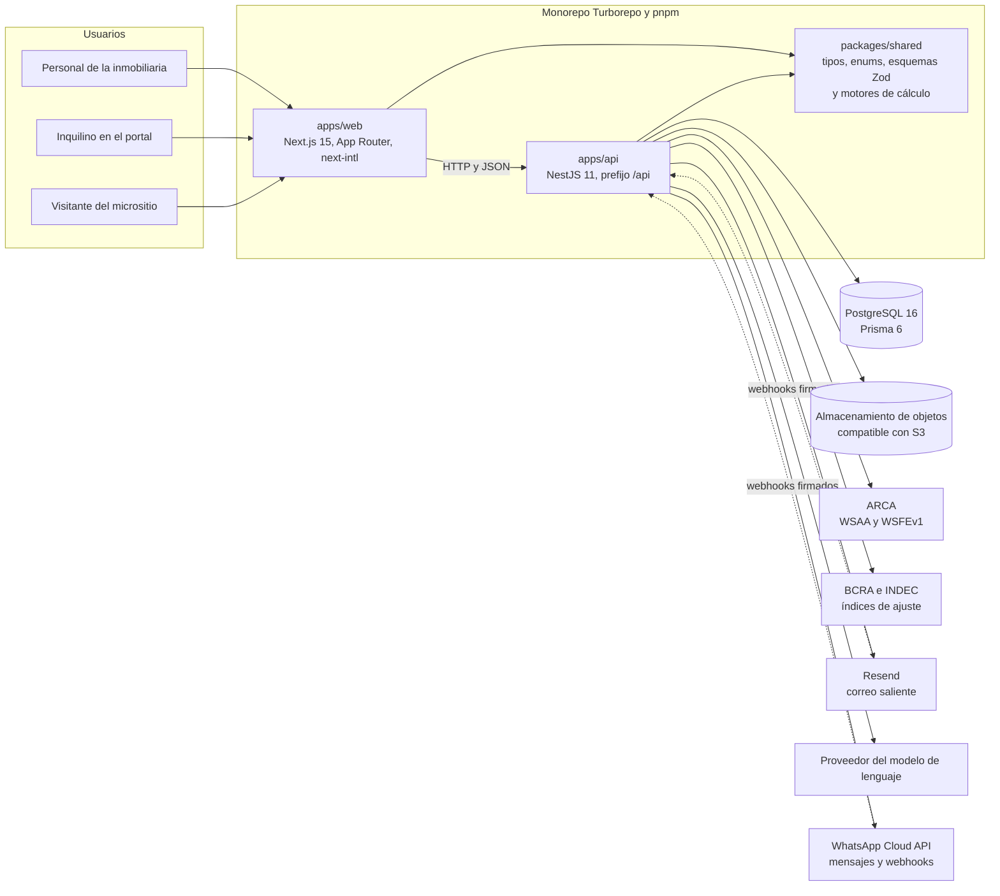
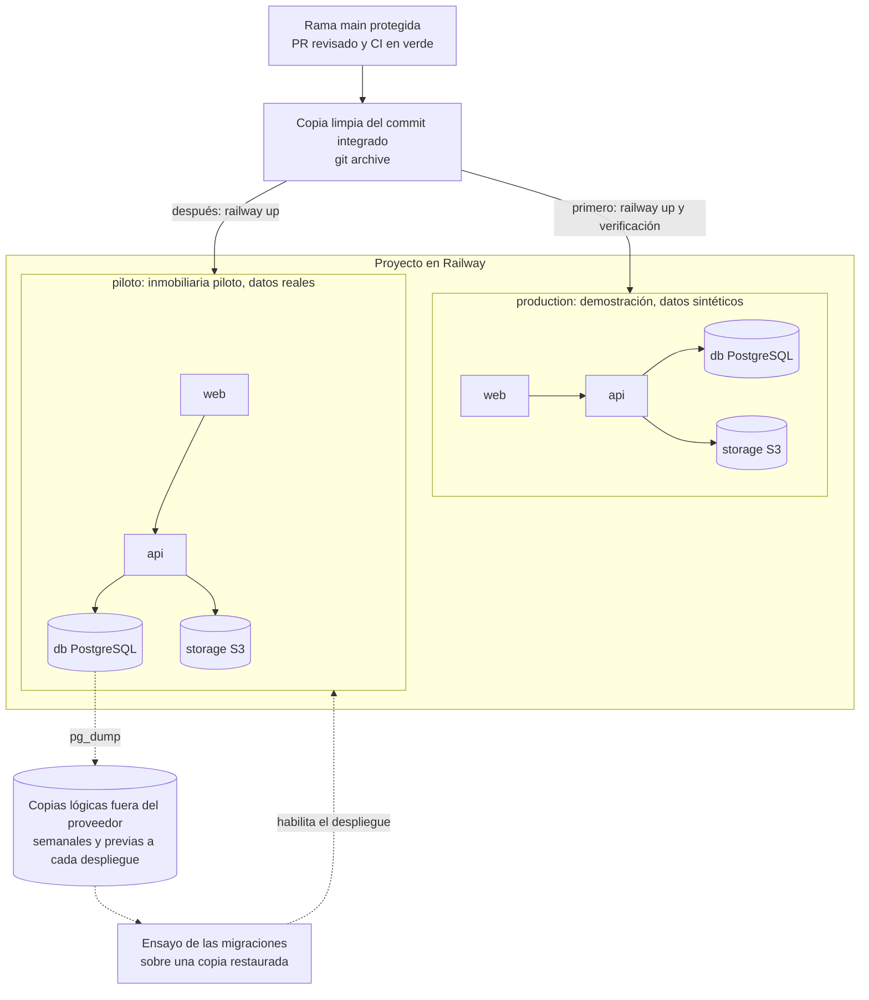
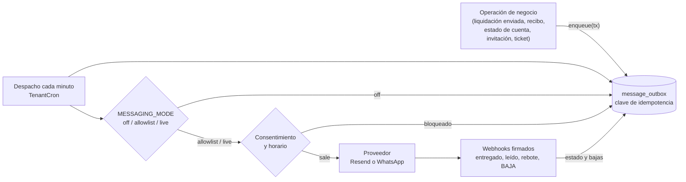
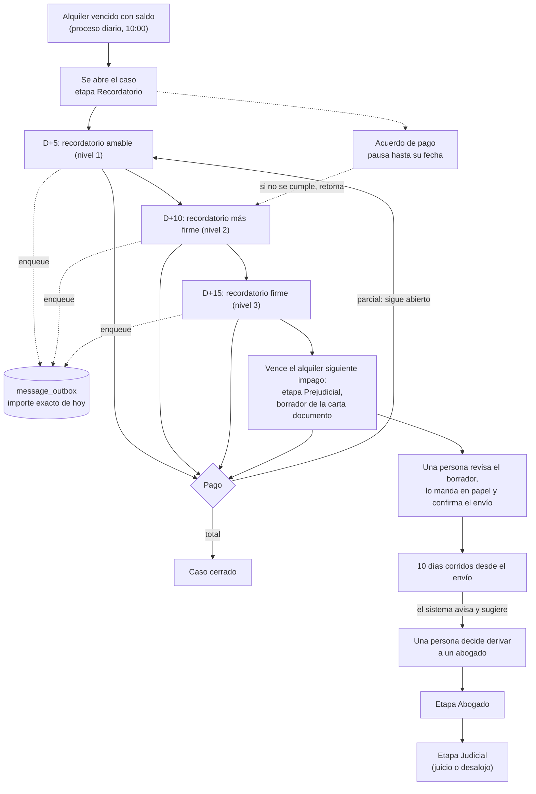

# Arquitectura

## Vista de alto nivel

Realfy se implementa como un monorepo TypeScript gestionado con Turborepo y workspaces de pnpm. El monorepo agrupa dos aplicaciones desplegables (`apps/api` y `apps/web`) y al menos un paquete compartido (`packages/shared`) donde viven tipos, enums y utilidades que ambas aplicaciones consumen.

El diagrama de contexto muestra quién usa el sistema, las piezas del monorepo y los servicios externos con los que habla la API. Sigue la convención del ADR-0016: es un bloque `mermaid` dentro del documento y reemplaza al dibujo de caracteres de la versión anterior, que nombraba un servidor SMTP que el sistema no usa (el correo sale por Resend) y no mostraba el almacenamiento de objetos. Las flechas punteadas son integraciones planificadas que todavía no existen.

La web y la API importan `packages/shared` en tiempo de compilación: no es un servicio sino código compartido, y es donde viven los motores puros de dinero (ajuste, liquidación, punitorios, rendición) que las dos aplicaciones usan con los mismos resultados. La API es la única que habla con la base, el almacenamiento y los servicios externos.

## Capas dentro del backend

El backend NestJS se organiza por módulos de dominio (uno por cada carpeta listada en la estructura del proyecto). Cada módulo respeta tres capas:

- **Controller**: expone endpoints REST, valida el contrato HTTP con DTOs y aplica `guards` de autenticación y permisos.
- **Service**: contiene la lógica de negocio, orquesta operaciones transaccionales y delega persistencia.
- **Persistencia (Prisma)**: cliente único inyectado a través de un módulo global. No se accede a `prisma` desde controladores.

Los servicios reciben el `tenantId` desde el contexto autenticado, jamás desde el body de la request. Esto es central para garantizar el aislamiento.

### Infraestructura común de la API

Lo que varios módulos necesitan vive en un solo lugar. La regla es **reutilizar antes de escribir**: si hace falta generar un PDF, una planilla, un mail o dar formato a un dato, se usa una de estas piezas y, si no alcanza, se extiende la pieza en lugar de armar una copia en el módulo.

- **Renderizador de PDF** (`apps/api/src/common/pdf/pdf-renderer.service.ts`): define las fuentes una vez, los estilos base y el paso de la definición de documento de pdfmake a un `Buffer` (`render`). Ofrece helpers de celda (`moneyCell`, `dateCell`, `headerCell`) y de pie de página (`pageFooter`). Los PDF de liquidaciones, rendiciones, reportes, comprobantes fiscales y contratos lo usan; cada uno solo arma el contenido.
- **Exportación tabular** (`apps/api/src/common/export/tabular.ts`): `buildCsv` (con BOM para Excel) y `buildXlsx` (encabezado, filtro, fila congelada, formato numérico y fila de totales). La usan la exportación de propiedades y personas, los reportes y el Libro IVA.
- **Registro de reportes** (`apps/api/src/modules/reports/report-registry.ts`): una entrada por reporte con clave, título, método de `ReportsService`, prefijo de archivo, claves del PDF y columnas del Excel. El controlador, el programador de envíos y los generadores de PDF y Excel leen de ahí; un reporte nuevo es una entrada más.
- **Transporte de mail** (`apps/api/src/common/email/common-email.service.ts`): único cliente de Resend. `send` no lanza y devuelve `sent`, `skipped` (sin `RESEND_API_KEY`, o retenido por `MESSAGING_MODE`) o `failed` (también cuando Resend rechaza el envío, DEF-65). Lo usa el proveedor de mail de la bandeja de salida; los pocos mails directos que quedan respetan el modo del ambiente.
- **Bandeja de salida** (`apps/api/src/common/messaging/outbox.service.ts`): `OutboxService.enqueue(tx, { channel, templateKey, vars, personId | to, relatedType, relatedId, idempotencyKey })` es la única forma de mandarle algo a una persona (ADR-0013); `pickChannel` elige WhatsApp o mail según el consentimiento. Las plantillas están en `@realfy/shared` (`MESSAGE_TEMPLATES`) y su texto de mail en `common/messaging/message-templates.ts`. El despacho, los proveedores y los webhooks viven en `modules/messaging`.
- **Formatos compartidos** (`packages/shared/src/format.ts` y `date-utils`): `personName`, `propertyLabel`, `formatMoneyAR`, `formatPeriodAR`, `formatPeriodShortAR` y `formatDateAR`. Las fechas sin hora se leen en UTC para que el día no retroceda.
- **Crons y auditoría** (`apps/api/src/common/scheduler/`, `apps/api/src/common/audit/audit.service.ts`). Todo proceso programado extiende `CronBaseService`, envuelve su trabajo en `runGuarded` (no corre con `NODE_ENV=test` y no tumba el proceso si falla) y declara `timeZone: AR_TIME_ZONE` (`@realfy/shared`, `America/Argentina/Buenos_Aires`; el nombre viejo `America/Buenos_Aires` solo se lee y se normaliza al escribir con `normalizeTimeZone`). Para recorrer las inmobiliarias usa `TenantCron.forEachActiveTenant(nombre, (tenantId, tenant) => ...)`: cada vuelta corre en un contexto con la inmobiliaria fijada, así que se usa `prisma.client` (con la extensión de tenant, que falla cerrado) y no se escribe `tenantId` a mano en los filtros; el error de una inmobiliaria se registra con el proceso, el `tenantId` y el identificador de correlación y no frena a las otras, y la función devuelve `{ ok, failed }`. Toda acción automática que mueve plata (punitorios, ajustes, condonaciones) deja su fila de auditoría con `AuditService.record(tx, { action, entity, entityId, before?, after?, userId?, metadata? })`, dentro de la misma transacción que el cambio; el interceptor de auditoría de los pedidos HTTP usa el mismo servicio, que aplica el mismo tapado de contraseñas y tokens. Los disparadores manuales (`POST /penalties/run`, `POST /notifications/run`) son solo Admin, y `POST /penalties/_run-now` además solo corre en modo de prueba.

## Frontend

`apps/web` está construido sobre Next.js 15 con App Router. Cada ruta vive bajo `/[locale]/...` para habilitar i18n con `next-intl`. El idioma por defecto es español (`es`) y existe un stub inicial de inglés (`en`) para sostener la trazabilidad de claves de traducción.

El frontend consume la API del backend a través de un cliente HTTP tipado, con el token JWT en `Authorization: Bearer`. El portal del inquilino vive en una rama de rutas separada (`/[locale]/portal/...`) y utiliza un flujo de autenticación distinto al de los usuarios internos.

### Convenciones de la web

Estas piezas viven en `apps/web/src` y son el lugar único para su tema. Antes de escribir un helper en una pantalla, se busca acá; si falta algo, se agrega acá y no en el archivo.

- **Cliente de API** (`lib/api-client.ts`, `lib/portal-api-client.ts`, `lib/create-api-client.ts`). `createApiClient` concentra el envío, la renovación única de la sesión ante un 401 y el reintento; el personal (cookies httpOnly) y el portal (token Bearer) solo aportan su configuración. Todo error sale como `ApiRequestError` con `status`, `errorCode`, `message`, `correlationId` y `details` (el contexto que agrega el servicio, como `problems`). El `correlationId` es el `x-request-id` que la API devuelve en cada respuesta y repite en el cuerpo de los errores. Las respuestas binarias pasan por `apiBlob`.
- **Descargas** (`lib/download.ts`). `downloadFile(path, nombre)` baja el archivo por el cliente de API, de modo que lleva la sesión. No se usa `window.open` ni `<a href>` directo a la API: no envían el token y se rompen con la sesión.
- **Formatos** (`lib/format.ts`, `ui/money-text.tsx`, `ui/date-text.tsx`). Dinero, fechas y porcentajes se formatean ahí, con el locale de next-intl. Las fechas de solo día (vencimientos, inicio y fin de contrato, períodos) llegan como medianoche UTC y se leen en UTC con `formatDate`; los instantes (`createdAt`, `paidAt`) usan `formatLocalDate` o `formatDateTime`, en la zona del usuario. Un `toLocaleDateString` suelto en una pantalla vuelve a mostrar el día anterior en Argentina.
- **Permisos** (`lib/permissions.ts`). `can(rol, acción)` y `useCan(acción)` leen una matriz acción -> roles con nombres de lo que habilitan (`contracts.manage`, `liquidaciones.act`, `indexData.manage`). La API sigue siendo la que impone el permiso; la matriz decide qué se muestra. El menú pasa por `useVisibleNavItems()`, y un `NavItem` puede declarar la acción que lo habilita.
- **Navegación** (`i18n/navigation.ts`). `Link`, `useRouter`, `usePathname` y `redirect` de `createNavigation(routing)` agregan el prefijo de locale solos: las rutas internas se escriben sin él (`href="/contracts"`). Fuera de React, `localizedPath('/auth/login')` arma la ruta con el locale actual. `next/link` queda solo para enlaces externos o del sitio público.
- **Diálogos y confirmaciones** (`ui/dialog.tsx`, `ui/confirm-dialog.tsx`). Un modal se arma con `Dialog` y una confirmación se pide con `useConfirm()`; no se usan `window.confirm` ni overlays `fixed inset-0` hechos a mano.
- **Estados** (`lib/status-registry.ts`, `ui/status-badge.tsx`). Un solo mapa entidad -> estado -> tono y etiqueta (liquidaciones, rendiciones, contratos, tickets, leads y visitas); las pantallas no definen `STATUS_VARIANT` propios. `<StatusBadge domain="liquidacion" status={s} />` pinta la chapa, y `statusAccent` da el color de la barra lateral de `EntityCard`. Los tonos significan lo mismo en todas las entidades: neutral (sin acción o fuera de juego), info (en revisión o en curso), brand (avanzó y espera el paso siguiente), warning (pendiente o a vigilar), success (terminó bien) y danger (terminó mal o urgente). Un estado nuevo en un enum se agrega al registro y sus etiquetas a `es.json` y `en.json`; una prueba revisa que no falte ninguno.
- **Formularios** (`ui/form-field.tsx`, `ui/input.tsx`, `ui/select.tsx`, `ui/textarea.tsx`, `hooks/use-zod-form.ts`). `FormField` enlaza la etiqueta con el control (`htmlFor`), la ayuda o el error con `aria-describedby` y marca `aria-invalid`; el control recibe esos atributos esparciendo lo que el campo le pasa: `<FormField label=".." error={errors.email}>{(c) => <Input {...c} />}</FormField>`. `Input`, `Select` y `Textarea` comparten `inputStyles()`, que es la única cadena de foco, borde y error. `useZodForm({ schema, initialValues, translate })` valida con el esquema compartido de `@realfy/shared` (los mensajes son claves i18n, que traduce `useSchemaMessages`), enfoca el primer campo inválido y, si la API responde con un `ApiRequestError`, reparte sus `details` en los campos (`fieldErrors`, `errors` o la lista de class-validator) y deja el error completo en `formError`. `person-form` y `property-form` son la migración de referencia.
- **Errores de la API** (`ui/error-notice.tsx`). `<ErrorNotice error={err} />` muestra el mensaje de un `ApiRequestError` con su `errorCode` y la referencia de correlación con un botón para copiarla, como `role="alert"`. Los códigos genéricos (`errors.codes.*`) tienen texto localizado. Un error no se disfraza de lista vacía: la pantalla muestra el aviso y oculta la grilla. Los errores de formulario van inline con `ErrorNotice`; la confirmación de un éxito, con `toast`.
- **Listados** (`hooks/use-paginated-list.ts`, `ui/pagination.tsx`, `ui/data-table.tsx`). `usePaginatedList({ key, path, limit, initialFilters })` es el listado paginado con filtros sobre react-query: la página vuelve a 1 al cambiar un filtro y se conserva la anterior en pantalla mientras llega la siguiente (`isLoading` es la primera carga, `isFetching` cualquier consulta). `PaginationBar` es la barra de rango, anterior y siguiente. `DataTable` envuelve `ResponsiveTable` (tabla en escritorio, tarjetas en móvil) con orden por columna (en el cliente con `sortValue`, o controlado para pedírselo a la API), paginación y aviso de error. El listado de personas es la referencia; el resto migra cuando se toque.
- **Grilla editable** (`EditableDataTable` en `ui/data-table.tsx`, `hooks/use-editable-grid.ts`, `lib/grid-paste.ts`). Base de las cargas masivas (boletas de servicios, cargos). Cada celda es un campo; Enter y las flechas navegan entre celdas (izquierda y derecha, al llegar al borde del texto), y Enter en la última fila agrega una. Pegar filas copiadas de una planilla las reparte desde la celda activa, agregando filas si hace falta (`parseClipboardGrid` entiende tabulaciones, saltos de línea y celdas entre comillas). La validación es por celda (obligatorio, decimal con `toDecimalString`, opción de lista o `validate` propio) y se muestra en las celdas tocadas, o en todas tras `validateAll()`. Las celdas y filas modificadas se marcan y se cuentan. La pantalla crea `useEditableGrid({ columns, initialRows })`, lee `filledRows`, `isValid` y `dirtyCount` para guardar, y llama a `reset(filas)` con lo guardado.
- **Impresión** (`ui/print-sheet.tsx`, `@media print` en `app/globals.css`). `PrintSheet` es el contenedor de un documento imprimible, con ranuras de encabezado y pie: en pantalla es una hoja A4; al imprimir se aplana. Los estilos de impresión fijan el margen de página, negro sobre blanco aunque la pantalla esté en modo oscuro y filas que no se cortan entre páginas; la navegación y el encabezado de la app se ocultan con `print:hidden`. Lo que no es parte del documento (botones, filtros) lleva `print:hidden` o `print-hide`, como `PrintButton`. Recibos y resúmenes de dueño se arman sobre esta pieza.
- **Estados de segmento** (`ui/segment-states.tsx`). `loading.tsx`, `error.tsx` y `not-found.tsx` de `(app)`, contratos, propiedades, personas y liquidaciones reexportan `SegmentLoading`, `SegmentError` y `SegmentNotFound`: esqueleto accesible, error con `ErrorNotice` y botón de reintento, y "no encontrado" con salida al panel. Un segmento nuevo con pantallas propias agrega esos tres archivos de una línea.
- **Reutilizar antes de escribir un helper.** Si una pantalla necesita formatear, descargar, preguntar un permiso o armar un enlace, usa la pieza de arriba. Los helpers locales con `es-AR` fijo, los arreglos literales de roles y los regex de `localePrefix` son justamente lo que estas piezas reemplazaron.

## Multi-tenant por row-level

Todas las tablas de dominio incluyen una columna `tenantId` que identifica a la inmobiliaria. Las dos únicas excepciones son `RefreshToken` y `PipelineStage`, que se aíslan por su relación con `User` y `Pipeline` respectivamente.

El filtro no se escribe en cada consulta ni se delega a repositorios envoltorios: lo inyecta una extensión del cliente de Prisma, que intercepta las operaciones sobre los modelos con alcance de inmobiliaria y agrega la condición al `where` de las lecturas y las mutaciones, y el `tenantId` al `data` de las creaciones. El identificador se toma del contexto de la petición, que viaja por `AsyncLocalStorage` y lo llenan las estrategias de autenticación después de verificar el token.

Cuando una consulta llega sin inmobiliaria en el contexto, la extensión **falla cerrado**: rechaza la operación en lugar de ejecutarla sin filtro. Los accesos legítimos sin sesión —las tareas programadas que barren todas las inmobiliarias, la resolución del micrositio público y los flujos de ingreso, donde la inmobiliaria todavía no se conoce— usan el cliente sin extensión con su filtro explícito, o una exención acotada a la operación.

El detalle de la decisión de row-level se documenta en el ADR 0003, y el del comportamiento que falla cerrado en el ADR 0006.

## Autenticación

Se utiliza JWT de acceso de corta duración (configurable, por defecto 15 minutos) y refresh tokens persistidos en la tabla `RefreshToken`. Cuando un refresh se usa, se rota: el anterior queda invalidado y se emite uno nuevo. Esto permite revocar sesiones puntualmente.

El portal del inquilino tiene su propio flujo con la tabla `InquilinoCredential` y `PortalRefreshToken`, totalmente separado del flujo de usuarios internos. No hay reutilización de tokens entre ámbitos.

## i18n

La internacionalización se resuelve con `next-intl`. Las claves de traducción viven en `apps/web/src/i18n/messages/es.json` y `en.json`. La regla operativa es que toda clave nueva agregada a `es.json` debe existir en `en.json`, aunque sea con el mismo valor en español, para no romper builds.

## Despliegue y CI

- Despliegue en Railway, en un proyecto con dos ambientes que tienen los mismos servicios y nada en común en datos ni en secretos: `production`, el ambiente de demostración de la defensa, con datos sintéticos, y `piloto`, el que usa la inmobiliaria piloto con datos reales (ADR-0014). Cada ambiente tiene cuatro servicios: `web` y `api`, construidos cada uno desde su propio `Dockerfile` y con su propia URL pública, la base PostgreSQL administrada y el almacenamiento de objetos compatible con S3, donde van las fotos y los adjuntos.
- Los despliegues son manuales y controlados; un empuje a `main` no despliega nada. Se despliega solo un commit ya integrado en `main` con la integración continua en verde, primero a `production` y, después de verificarlo, a `piloto`. Lo que se sube es una copia limpia de ese commit, obtenida con `git archive`, de modo que al ambiente no llega nada que no esté versionado. Antes de cada despliegue a `piloto` se toma una copia de la base, y una migración que reescribe datos se ensaya antes sobre una restauración de esa copia. El procedimiento está en `docs/despliegue.md` y en `docs/operacion-piloto.md`.
- Migraciones de Prisma versionadas en `apps/api/prisma/migrations`, y aplicadas en el arranque de cada despliegue de la API.
- CI en GitHub Actions sobre cada cambio hacia `main`: estilo, compilación de los tres paquetes del monorepo, pruebas unitarias con piso de cobertura, análisis estático en SonarCloud con su umbral de calidad, aplicación de todas las migraciones sobre una base vacía junto con el ensayo de las migraciones nuevas sobre una base con datos sintéticos de forma real, pruebas de extremo a extremo de la API contra una PostgreSQL real, despliegue efímero con prueba de humo, controles de código muerto y de duplicación, y la prueba de contrato con las fuentes externas de índices. La protección de `main` exige todos menos el último, que depende de la disponibilidad de servicios de terceros. Ninguno es de navegador: las pruebas de extremo a extremo son de nivel HTTP contra la aplicación NestJS completa. El detalle está en `docs/pruebas.md`.

El diagrama de despliegue muestra los dos ambientes y el camino de un cambio hasta el piloto. Las flechas punteadas son el circuito de copias que precede a cada despliegue en `piloto`.

Las copias nativas diarias y semanales del proveedor cubren los volúmenes de la base y del almacenamiento de `piloto`; la copia lógica fuera del proveedor cubre la pérdida de la cuenta o del proyecto. Los objetivos de recuperación y el tiempo de restauración medido están en `docs/despliegue.md`.

## Mensajería saliente

Todo mensaje a una persona —mail por Resend o WhatsApp por la Cloud API de Meta— pasa por una bandeja de salida transaccional (ADR-0013). La operación de negocio solo guarda el mensaje en `message_outbox`, dentro de su transacción y con una clave de idempotencia; un proceso programado lo despacha cada minuto. Así un proveedor lento o caído nunca rompe la operación, la misma operación repetida no duplica el mensaje y queda el registro de qué salió.

El modo es de cada ambiente y por defecto es `off`: los mensajes se encolan y se ven, pero no sale ninguno. `allowlist` manda solo a direcciones del equipo y `live` a quien corresponda; el ambiente `piloto` queda en `off` o `allowlist` hasta que el dueño de la inmobiliaria apruebe el envío a su cartera. El consentimiento se guarda como historial por persona y dirección: la baja se respeta siempre y WhatsApp necesita el alta explícita. Los PDF de los documentos no se guardan en la bandeja: se generan al despachar. Las pruebas usan un proveedor de prueba y nunca llaman a Resend ni a Meta. En `piloto`, Resend y WhatsApp todavía no tienen credenciales (el dominio verificado y la cuenta de WhatsApp Business están pendientes); sin ellas los mensajes quedan pendientes con el motivo a la vista y el Admin sigue compartiendo los enlaces de invitación a mano.

## Cobranza escalonada

La mora de un contrato se sigue con un caso de cobranza (`collection_cases`) que recorre etapas, con su línea de tiempo en `collection_actions` (ADR-0013). Un proceso diario, apagado de fábrica por inmobiliaria, abre el caso cuando un contrato tiene un alquiler vencido con saldo y encola cada recordatorio en la bandeja de salida con el importe exacto de ese día; la carta documento solo se prepara como borrador y una persona decide cuándo se manda y cuándo se deriva a un abogado.

Diagrama 7. Flujo de cobranza escalonada: de la mora al abogado, con lo que hace el sistema y lo que decide una persona.

Nada legal sale solo: la carta documento nunca se manda por el sistema (ni por mail ni por WhatsApp) y la derivación es manual. Con `MESSAGING_MODE` en `off` los recordatorios quedan encolados con su motivo y no sale ninguno. El ritmo y el plazo se configuran en los valores por defecto de la inmobiliaria.

## Decisiones técnicas clave

- **Monorepo Turborepo + pnpm**: una sola versión de cada dependencia, build incremental con cache (ADR 0001).
- **NestJS + Next.js + Prisma**: trade-off entre madurez del ecosistema, productividad y necesidad de tipado fuerte extremo a extremo (ADR 0002).
- **Multi-tenant row-level**: balance entre simplicidad operativa y aislamiento (ADR 0003), con la extensión de Prisma fallando cerrado ante la ausencia de contexto (ADR 0006).
- **Pruebas de extremo a extremo de nivel HTTP**: levantan la aplicación NestJS completa con Jest y `supertest` y pegan contra una PostgreSQL real con las migraciones aplicadas desde cero, reutilizando los tipos compartidos. Cubren el camino entero hasta la base, que es donde aparecen los errores de aislamiento y de permisos.
- **Filtro global de excepciones**: una sola forma de respuesta de error para toda la API, sin filtrar stacks ni detalles internos al cliente (ADR 0005).
- **Sistema de tarjetas compartido** para las pantallas que listan registros, dueño de la transición carga → contenido → vacío (ADR 0004).
- **next-intl** en lugar de soluciones manuales: integración nativa con App Router y soporte para mensajes con interpolación.
- **JWT con rotación de refresh**: prevención de reuso de tokens robados sin requerir base de sesiones server-side compleja.
- **Decisiones del piloto**: locadores por contrato con porcentaje de cobro, apoderados y titularidad separada (ADR 0007); impuestos y servicios trasladables con tres pagadores y reglas con vigencia (ADR 0008); reglas versionadas del contrato con valores por defecto de la inmobiliaria (ADR 0010); ajuste con rezago, estimación y corrección (ADR 0011); flujos de cobro, caja y custodia (ADR 0012); ambiente piloto con datos reales (ADR 0014); importación idempotente desde el sistema anterior (ADR 0015), y diagramas como código (ADR 0016). El índice con su estado está en `docs/adr/README.md`.

<!-- Cierre item 03 — listo para Hito 1 (2026-05-15) -->
