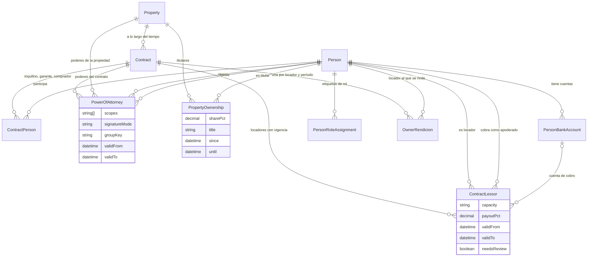

# Modelo de Datos

El modelo está implementado con Prisma sobre PostgreSQL. A continuación se describen las entidades principales agrupadas por dominio, sus campos representativos y sus relaciones más relevantes. El detalle exhaustivo de columnas e índices vive en `apps/api/prisma/schema.prisma`, que hoy define cincuenta y cinco modelos.

Una convención vale aclararla antes del detalle: **todas las tablas del dominio llevan una columna `tenantId`**, que es el ancla del aislamiento entre inmobiliarias. Sólo algunas declaran además la relación inversa hacia `Tenant`; el resto lleva la columna sin relación declarada, para no acumular medio centenar de campos de vuelta sobre la misma entidad. El filtro no se aplica a mano en cada consulta sino desde una extensión del cliente de Prisma, según se describe en el ADR 0006.

## Auth y Tenant

### Tenant

Inmobiliaria. Es el ancla de aislamiento del sistema.

- `id`, `name`, `slug`, `cuit`, `province`, `timezone`, `currency`, `tier`, `brandPrimary`, `brandSecondary`, `logoUrl`, `penaltyConfig`, `isActive`, `createdAt`.
- `slug` es lo que resuelve el micrositio público; `brandPrimary`, `brandSecondary` y `logoUrl` son los que lo pintan. `penaltyConfig` guarda como JSON los parámetros de punitorios de la inmobiliaria.

### User

Usuario interno de una inmobiliaria.

- `id`, `tenantId`, `email`, `passwordHash`, `firstName`, `lastName`, `role`, `isActive`, `lastLoginAt`.
- `role` toma uno de los siete valores de `UserRole`. Relación N-1 con `Tenant`, 1-N con `RefreshToken` y `AuditLog`.

### RefreshToken

Token de refresco emitido al usuario, rotado en cada uso.

- `id`, `token`, `userId`, `expiresAt`, `isRevoked`, `createdAt`.
- No lleva `tenantId`: su aislamiento depende de la relación con `User`. El token se guarda tal cual y la revocación es una marca booleana, no una fecha.

### UserInvitation

Invitación pendiente para incorporar un usuario nuevo.

- `id`, `tenantId`, `email`, `role`, `token`, `expiresAt`, `acceptedAt`.

### AuditLog

Registro de acciones sensibles.

- `id`, `tenantId`, `userId`, `action`, `entity`, `entityId`, `changes`, `ipAddress`, `userAgent`, `createdAt`.
- El detalle del cambio va en `changes`, como JSON.

## Personas

### Person

Persona física o jurídica genérica. Una misma persona puede tener varios roles.

- `id`, `tenantId`, `firstName`, `lastName`, `email`, `phone`, `phone2`, `cuit`, `fiscalCondition`, `personType`, `dni`, `address`, `maritalStatus`, `nationality`, `payoutMethod`, `externalRef`, `notes`, `isActive`.
- `personType` es `Fisica` (por defecto) o `Juridica`; `payoutMethod` es la forma de cobro del propietario (`Transferencia`, `Efectivo` o `Custodia`) y puede quedar vacía. `dni`, `address` (texto libre por ahora), `maritalStatus` y `nationality` son opcionales y alimentan los datos del contrato.
- `externalRef` es el identificador que la persona tenía en otro sistema (planilla, programa anterior). Es único por inmobiliaria (`@@unique([tenantId, externalRef])`); Postgres admite varias personas sin referencia. Una referencia repetida responde 409 `EXTERNAL_REF_TAKEN`.
- **Columnas deprecadas:** `bankName`, `cbu` y `bankAlias` ya no se leen ni se escriben. La fuente única de los datos bancarios es `PersonBankAccount`; el cliente de Prisma las omite en toda lectura. Quedan en la tabla una versión más, solo para poder volver atrás, y se eliminan en la migración siguiente. Reversa de la migración: ver la cabecera de `20261031030500_personas_datos_y_referencias`.

### PersonBankAccount

Cuenta bancaria de una persona, en una moneda. Es lo que alimenta la rendición al propietario.

- `id`, `tenantId`, `personId`, `currency`, `bankName`, `cbu`, `alias`, `holder`, `isDefault`, `createdAt`, `updatedAt`.
- Una persona puede tener varias cuentas, también varias en la misma moneda. Por cada moneda con cuentas hay exactamente una predeterminada: la primera que se carga lo es, promover otra intercambia la predeterminada y el servicio rechaza soltar o borrar la predeterminada mientras queden otras de esa moneda (409 `BANK_ACCOUNT_DEFAULT_REQUIRED`). La moneda no se edita: se crea otra cuenta.
- Lleva `tenantId` y está registrada en `TENANT_SCOPED_MODELS`; se borra en cascada con la persona.
- **Backfill de la migración:** cada persona con alguno de los tres datos bancarios viejos recibió una cuenta en pesos marcada como predeterminada, con el titular igual al nombre de la persona.

### PersonRoleAssignment

Vincula a una `Person` con un rol: propietario, inquilino, garante, comprador, proveedor, lead o apoderado.

- `id`, `tenantId`, `personId`, `role`, `assignedAt`, `propertyId`, `guarantorForPersonId`. Única por persona y rol (`@@unique([personId, role])`).
- El rol es una **etiqueta de cliente**: no dice a qué contrato ni a qué propiedad pertenece la persona. `ensureRole` es el único lugar que la crea, y la usan el alta de consultas, de proveedores, de locadores, de titulares, de poderes y la asignación manual. En el garante, `guarantorForPersonId` apunta a quién garantiza.
- **`propertyId` ya no se escribe.** La propiedad de un propietario vive en `PropertyOwnership`; la columna se conserva por una versión más para poder volver atrás y la migración copió sus valores a la titularidad.

### PropertyOwnership

Quién es titular de una propiedad. Es información opcional: no define a quién se le paga.

- `id`, `tenantId`, `propertyId`, `personId`, `sharePct` (`Decimal(7,4)`, opcional), `title` (por ejemplo, el título de dominio), `since`, `until`, `createdAt`, `updatedAt`.
- No se exige que los porcentajes sumen 100 ni que haya titulares cargados; cuando los datos existen sirven para un aviso del panel de calidad. Índices: `(tenantId, propertyId)` y `(tenantId, personId)`. Se borra en cascada con la propiedad y con la persona; lleva `tenantId` y está registrada en `TENANT_SCOPED_MODELS`.
- La migración creó una titularidad, sin porcentaje, por cada asignación de rol `Propietario` que tenía propiedad. El alta de un titular agrega a la persona el rol `Propietario`.

### PersonDocument

Documentación adjunta (DNI, recibos de sueldo, escrituras).

- `id`, `tenantId`, `personId`, `fileName`, `url`, `mimeType`, `sizeBytes`, `uploadedAt`.

### ProviderProfile

Perfil específico cuando la persona es proveedor de servicios.

- `id`, `tenantId`, `personId`, `rubros`, `coverageZones`, `isActive`, `notes`.
- `rubros` y `coverageZones` son arreglos, y son los dos criterios con los que se ofrecen proveedores habilitados para un ticket.

## Propiedades

### Property

Inmueble administrado por la inmobiliaria.

- `id`, `tenantId`, `title`, `description`, `type`, `street`, `number`, `floor`, `apartment`, `city`, `province`, `zipCode`, `country`, `latitude`, `longitude`, `area`, `rooms`, `bedrooms`, `bathrooms`, `garages`, `age`, `orientation`, `amenities`, `price`, `currency`, `cadastralId`, `parentPropertyId`, `externalRef`, `isActive`.
- `cadastralId` es la nomenclatura catastral (texto libre). `parentPropertyId` apunta al edificio que contiene la unidad (relación `edificio`, `onDelete: SetNull`): sirve para repartir gastos por consumo; no puede ser la propia propiedad, debe ser de la misma inmobiliaria y no puede formar un ciclo (`PROPERTY_SELF_PARENT`, `PARENT_PROPERTY_NOT_FOUND`, `PROPERTY_PARENT_CYCLE`). `externalRef` sigue la misma regla que en `Person`, con `@@unique([tenantId, externalRef])`.
- La dirección está desagregada en columnas, no en un campo único. La propiedad **no** tiene un estado de disponibilidad ni un propietario directo: el estado vive en cada `PropertyOperation` y la titularidad se expresa como una `PersonRoleAssignment` de rol propietario apuntando a la propiedad.
- Relación 1-N con `PropertyOperation`, `PropertyMedia`, `PriceHistory`, `PropertyValuation`, `Service`, `Ticket`, `LeadVisit`.

### PropertyOperation

Operación habilitada sobre la propiedad, con su propio estado.

- `id`, `tenantId`, `propertyId`, `operationType`, `state`, `price`, `currency`.
- `operationType` es alquiler, alquiler temporario o venta. `state` recorre la máquina de estados de disponibilidad: borrador, disponible, reservado, alquilado, vendido, ocupado, suspendido y archivado. Que el estado esté acá y no en la propiedad es lo que permite tener un mismo inmueble publicado en venta y alquilado a la vez.

### PropertyMedia

Imágenes de la propiedad, en dos resoluciones.

- `id`, `tenantId`, `propertyId`, `url`, `thumbnailUrl`, `mimeType`, `sizeBytes`, `width`, `height`, `sortOrder`, `isPrimary`.
- El orden de la galería es `sortOrder` y la portada es `isPrimary`. Ambas versiones del archivo viven en el almacenamiento de objetos; las URLs de lectura se firman por pedido.

### PriceHistory

Historial de cambios de precio de la propiedad.

- `id`, `tenantId`, `propertyId`, `price`, `currency`, `changedAt`, `changedByUserId`.

### PropertyValuation

Tasación de la propiedad.

- `id`, `tenantId`, `propertyId`, `valuationDate`, `value`, `currency`, `method`, `appraiser`, `notes`.

## Contratos

### Contract

Contrato entre locadores e inquilino, o de venta.

- `id`, `tenantId`, `propertyId`, `contractType`, `status`, `startDate`, `endDate`, `rentAmount`, `rentCurrency`, `depositAmount`, `depositCurrency`, `adjustmentType`, `adjustmentPeriod`, `customAdjustmentPct`, `notes`, `isActive`, `closedAt`, `externalRef`.
- `externalRef` identifica el contrato en el sistema anterior y es único por inmobiliaria (`@@unique([tenantId, externalRef])`, 409 `EXTERNAL_REF_TAKEN`).
- **La configuración del ajuste vive en el contrato**, no en una tabla aparte: `adjustmentType` toma IPC, ICL, CCP, porcentaje fijo o personalizado, `adjustmentPeriod` va de mensual a anual, y `customAdjustmentPct` guarda el porcentaje cuando la modalidad es de porcentaje fijo.
- Relación 1-N con `ContractPerson`, `ContractLessor`, `PowerOfAttorney`, `ContractGuarantee`, `ContractAdjustment`, `AdjustmentSchedule`, `Liquidacion`, `OwnerRendicion`; 1-1 con `ContractCommission` y `ContractClosureSummary`.

### ContractPerson

Relación N-M entre `Contract` y `Person`, indicando el rol de cada parte que **no** es locador: inquilino, garante y comprador.

- `id`, `tenantId`, `contractId`, `personId`, `role`.
- Las filas con rol `Propietario` son datos anteriores a `ContractLessor`: la migración las copió a locadores y ya no se leen ni se escriben. Los propietarios que llegan en `persons` al crear un contrato se guardan como locadores. `getParty` y `getParties` (`contract-parties.ts`) son la única forma de buscar una parte por rol.

### ContractLessor

Quien alquila en un contrato y qué parte del cobro le corresponde. No es la titularidad de la propiedad: el porcentaje es un acuerdo del contrato.

- `id`, `tenantId`, `contractId`, `personId`, `capacity` (`Propietario`, `Usufructuario`, `Sublocador`, `Acreedor`, `Otro`), `payoutPct` (`Decimal(7,4)`), `payeePersonId`, `bankAccountId`, `validFrom`, `validTo`, `needsReview`, `createdAt`, `updatedAt`.
- Índices: `(contractId, validTo)` y `(tenantId, personId)`. Se borra en cascada con el contrato y con la persona; si se borra el cobrador o la cuenta, esos campos quedan vacíos.
- **Regla:** los locadores vigentes en cada fecha del contrato suman exactamente 100,0000. La vigencia es `[validFrom, validTo)`: una cesión es cerrar a uno con `validTo` y abrir a otro con `validFrom` en esa misma fecha. Se exige al activar el contrato, al cambiar los locadores de un contrato que ya salió de borrador y al generar la rendición; si no se cumple, `LESSOR_SHARES_INVALID` con las fechas y sumas que no cierran. `getLessorsAt(contrato, fecha)` devuelve los vigentes.
- `payeePersonId` es el apoderado que cobra: solo se acepta con un poder vigente con alcance `Cobrar` del locador (`PAYEE_WITHOUT_POWER`). `bankAccountId` tiene que ser una cuenta del locador (`BANK_ACCOUNT_NOT_OF_LESSOR`).
- `needsReview` marca las filas que la migración repartió en partes iguales entre varios propietarios, por suposición; baja al confirmar o cambiar el porcentaje.
- Lleva `tenantId` y está registrada en `TENANT_SCOPED_MODELS`.

### PowerOfAttorney

Poder por el que un apoderado actúa en nombre de otra persona.

- `id`, `tenantId`, `principalId` (poderdante), `agentId` (apoderado), `scopes` (arreglo de `Cobrar`, `Firmar`, `Administrar`, validado en la API), `signatureMode` (`Indistinta` o `Conjunta`), `groupKey`, `contractId`, `propertyId`, `validFrom`, `validTo`, `documentUrl`, `createdAt`, `updatedAt`.
- Sin `contractId` ni `propertyId` es un poder general; con uno de los dos, vale solo para ese contrato o esa propiedad (no se admiten los dos a la vez). `getApoderadosAt` junta los que alcanzan a un contrato.
- Con firma conjunta, los apoderados del mismo alcance comparten `groupKey` (por defecto, poderdante y alcance) y firman juntos; con firma indistinta `groupKey` queda vacía.
- Un poder con alcance `Cobrar` que un locador usa como cobrador no se puede revocar ni recortar (`POWER_IN_USE`). Dar un poder agrega a la persona el rol `Apoderado`.
- Índices: `(tenantId, principalId)`, `(tenantId, agentId)` y `(contractId)`. Lleva `tenantId` y está registrada en `TENANT_SCOPED_MODELS`.

### Partes del contrato

La titularidad (`PropertyOwnership`) no se conecta con el cobro: quien recibe dinero lo define `ContractLessor`, y la rendición se reparte entre los locadores vigentes.

### ContractGuarantee

Garantías asociadas al contrato.

- `id`, `tenantId`, `contractId`, `type`, `status`, `description`, `amount`, `currency`, `issuer`, `policyNumber`, `startDate`, `endDate`.
- `type` es seguro de caución, garantía propietaria, garantía bancaria, depósito u otra. La garantía no apunta a una `Person`: los datos del garante se cargan en `issuer` y la vinculación como persona, cuando existe, se expresa por `PersonRoleAssignment`.

### AdjustmentSchedule

Cronograma de ajustes pendientes del contrato. Es lo que el barrido diario consulta para saber a qué contratos les toca ajustar.

- `id`, `tenantId`, `contractId`, `nextAdjustmentDate`, `periodNumber`, `status`.
- `status` recorre pendiente, calculado, aplicado y omitido. Cuelga del contrato directamente, no de un registro de configuración intermedio.

### ContractAdjustment

Ajuste ya calculado o aplicado sobre el contrato. Es el registro histórico, uno por período ajustado.

- `id`, `tenantId`, `contractId`, `periodNumber`, `adjustmentDate`, `previousAmount`, `newAmount`, `percentage`, `currency`, `indexType`, `indexValues`, `notes`, `calculatedAt`, `appliedAt`.
- `indexValues` guarda como JSON los valores de índice que se usaron en el cálculo, de modo que un ajuste aplicado se pueda reconstruir aunque después se corrija la serie publicada. Mientras `appliedAt` esté vacío, el ajuste está calculado pero no impactado en el contrato.

### IndexData

Valores publicados de los índices.

- `id`, `tenantId`, `indexType`, `period`, `value`, `source`.
- `indexType` toma IPC, ICL, CVS, CER o UVA. Los valores se consumen como variación del período, no como nivel absoluto.

### ContractTemplate

Plantillas para generar el documento del contrato.

- `id`, `tenantId`, `name`, `contractType`, `body`, `variables`, `isDefault`, `isActive`.

### ContractCommission

Comisión de la inmobiliaria sobre un contrato. Es el parámetro que determina la rendición al propietario.

- `id`, `tenantId`, `contractId`, `type`, `percentage`, `fixedAmount`, `adminFee`, `currency`, `notes`.

### ContractClosureSummary

Resumen de gestión producido al cerrar el contrato.

- `id`, `tenantId`, `contractId` (único), `summary`, `highlights`, `metrics`, `source`, `model`, `generatedAt`.
- `source` distingue si el texto lo produjo el modelo de lenguaje o las reglas propias del sistema, y `model` registra cuál se usó cuando corresponde.

## Liquidaciones y cobranzas

### Liquidacion

Liquidación mensual al inquilino.

- `id`, `tenantId`, `contractId`, `period`, `status`, `dueDate`, `subtotal`, `total`, `currency`, `notes`, `pdfUrl`, `sentAt`, `paidAt`.
- Relación 1-N con `LiquidacionLineItem`, `Payment` y `Penalty`.

### LiquidacionLineItem

Línea de la liquidación.

- `id`, `tenantId`, `liquidacionId`, `type`, `description`, `amount`, `currency`, `sortOrder`.
- `type` toma alquiler, ajuste, extra, descuento o multa.

### Payment

Pago aplicado a una liquidación.

- `id`, `tenantId`, `liquidacionId`, `amount`, `currency`, `method`, `reference`, `notes`, `paidAt`.
- `method` es transferencia, efectivo, MercadoPago o cheque. El pago no registra qué usuario lo cargó: esa traza queda en `AuditLog`.

### Penalty

Punitorio calculado sobre una liquidación vencida.

- `id`, `tenantId`, `liquidacionId`, `amount`, `appliedOn`, `daysOverdue`, `compoundBase`, `status`, `waivedAt`, `waivedBy`, `waiveReason`, `settledLiquidacionId`.
- La condonación no borra el registro: lo marca con su fecha, su responsable y su motivo. `settledLiquidacionId` apunta a la liquidación en la que el punitorio terminó cobrándose.

### Service / ServicePayment

Servicios asociados a una propiedad (gas, luz, ABL) y sus pagos.

- `Service`: `id`, `tenantId`, `propertyId`, `serviceType`, `providerName`, `accountNumber`, `amount`, `currency`, `dueDay`, `isActive`, `notes`.
- `ServicePayment`: `id`, `tenantId`, `serviceId`, `amount`, `paymentDate`, `period`, `notes`.

### OwnerRendicion / RendicionLineItem

Rendición mensual al propietario y sus conceptos.

- `OwnerRendicion`: `id`, `tenantId`, `contractId`, `ownerId`, `period`, `status`, `rentCollected`, `commissionAmount`, `adminFeeAmount`, `deductionTotal`, `netDeposit`, `currency`, `pdfUrl`, `sentAt`, `depositedAt`, `notes`. Única por contrato, período y locador (`@@unique([contractId, period, ownerId])`): hay una rendición por cada locador vigente al inicio del período.
- **Reparto:** cada renglón de la rendición (lo cobrado, la comisión, los gastos, las deducciones) se reparte entre los locadores según `payoutPct`, por el método del mayor resto, de modo que las partes suman el renglón y los netos suman el neto total. Con un solo locador la rendición es la de siempre.
- `RendicionLineItem`: `id`, `tenantId`, `rendicionId`, `type`, `description`, `amount`, `isDebit`, `currency`, `sortOrder`.
- Los montos de la rendición están desagregados en columnas propias —lo cobrado, la comisión, el honorario administrativo, el total deducido y el depósito neto— y no se recalculan al leer.

## Facturación electrónica (ARCA)

### ArcaCertificate

Certificado digital de la inmobiliaria para autenticarse contra el WSAA de ARCA. El certificado y su clave privada se guardan cifrados: el contenido se sella con una clave de datos (DEK) propia de la fila, y esa DEK se envuelve a su vez con la clave maestra del sistema.

- `id`, `tenantId` (único), `commonName`, `notBefore`, `notAfter`, `isProduction`, `isActive`, `certEncrypted`, `keyEncrypted`, `dekWrapped`, `kekVersion`.
- Relación 1-1 con `Tenant`. Relación 1-N con `ArcaCertificateAccessLog`.

### ArcaCertificateAccessLog

Auditoría de cada desencriptado de la clave privada del certificado, de forma que un uso indebido pueda trazarse hasta el actor y el motivo que lo originó.

- `id`, `tenantId`, `certificateId`, `actor`, `reason`, `createdAt`.

### ArcaIssuer

CUIT en nombre del cual la inmobiliaria puede facturar: el propio (`isSelf`) o el de un propietario que le delegó el servicio de facturación electrónica (WSFE) en ARCA.

- `id`, `tenantId`, `cuit`, `businessName`, `fiscalCondition`, `delegationStatus` (Pending, Active, Revoked), `delegationVerifiedAt`, `delegationLastError`, `isSelf`, `isActive`.
- Único por `(tenantId, cuit)`. Relación 1-N con `ArcaPuntoDeVenta` y con `Comprobante`.

### ArcaPuntoDeVenta

Punto de venta habilitado en ARCA para un emisor determinado.

- `id`, `issuerId`, `number`, `nombre`, `tipo`, `bloqueado`, `lastSyncAt`.
- Único por `(issuerId, number)`. Relación N-1 con `ArcaIssuer`.

### ArcaRequestLog

Registro literal de cada llamada a los web services de ARCA (WSAA/WSFEv1), con el request y la respuesta completos, ya que un rechazo de AFIP sólo se entiende junto al payload exacto que lo produjo.

- `id`, `tenantId`, `issuerId?`, `operation`, `issuerCuit?`, `requestPayload`, `responsePayload`, `latencyMs`, `success`, `errorCode?`, `errorMessage?`, `comprobanteId?`.

### Comprobante

Comprobante electrónico autorizado por ARCA (factura, nota de crédito o nota de débito, en sus variantes A, B o C) emitido, en general, sobre un `Payment`; el vínculo es opcional.

- `id`, `tenantId`, `paymentId?`, `issuerId?`, `type` (`ComprobanteType`), `status` (Emitido, Anulado), `cbteTipo`, `puntoDeVenta`, `numero`, `docTipo`, `docNro`, `receptorName`, `receptorFiscalCondition`, `impTotal`, `impNeto`, `impIva`, `cae`, `caeFchVto`, `emittedAt`.
- La combinación `(tenantId, issuerId, puntoDeVenta, cbteTipo, numero)` es única: AFIP numera por CUIT, punto de venta y tipo, sin huecos ni repeticiones, así que dos emisores de la misma inmobiliaria pueden tener el mismo número.
- Relación N-1 opcional con `Payment` (si se borra el pago, `paymentId` queda en nulo: `ON DELETE SET NULL`) y N-1 con `ArcaIssuer`. Una nota de crédito referencia al comprobante que anula a través de `originalComprobanteId` (relación `ComprobanteNC`).

### LibroIvaExport

Libro IVA ventas del período, generado y exportado a Excel para su guarda en almacenamiento de objetos. Hay un registro por tenant y período: regenerar un período reemplaza el archivo anterior.

- `id`, `tenantId`, `period`, `rowCount`, `s3Key`, `fileUrl`, `generatedAt`.
- Único por `(tenantId, period)`. Relación N-1 con `Tenant`.

## CRM

### Pipeline / PipelineStage

Embudo configurable con sus etapas ordenadas.

- `Pipeline`: `id`, `tenantId`, `type`, `name`, `isActive`.
- `PipelineStage`: `id`, `pipelineId`, `name`, `sortOrder`, `staleDays`, `isDefault`.
- La etapa no lleva `tenantId`: su aislamiento depende de la relación con `Pipeline`. `staleDays` es la cantidad de días tras la cual un lead detenido en esa etapa se marca como estancado.

### Lead

Interesado en alquilar, comprar o publicar.

- `id`, `tenantId`, `personId`, `pipelineId`, `currentStageId`, `propertyId`, `assignedToUserId`, `source`, `status`, `notes`, `budget`, `budgetCurrency`, `lostReason`, `convertedAt`, `lostAt`, `lastContactAt`, `staleDays`, `isActive`.
- La etapa actual es `currentStageId`, y el lead guarda además su embudo en `pipelineId`. Al descartarse conserva `lostReason` y `lostAt`; al convertirse, `convertedAt` y la `Person` resultante en `personId`.

### LeadInteraction

Eventos registrados sobre el lead.

- `id`, `tenantId`, `leadId`, `type`, `notes`, `contactedBy`, `occurredAt`.

### LeadVisit

Visita agendada sobre una propiedad concreta.

- `id`, `tenantId`, `leadId`, `propertyId`, `scheduledAt`, `completedAt`, `status`, `outcome`, `notes`, `conductedBy`.

## Tickets

### TicketCategory

Categoría configurable (plomería, electricidad, otros).

- `id`, `tenantId`, `name`, `isActive`.

### Ticket

Reclamo abierto por el inquilino o por la inmobiliaria.

- `id`, `tenantId`, `propertyId`, `categoryId`, `createdByUserId`, `createdByPersonId`, `assignedToUserId`, `providerId`, `title`, `description`, `status`, `priority`, `slaDeadline`, `costAmount`, `costCurrency`, `costPayer`, `providerNotes`, `resolvedAt`, `closedAt`.
- El ticket cuelga de la propiedad, no del contrato. Quien lo abre se registra en una de dos columnas según el ámbito: `createdByUserId` si lo abrió el personal, `createdByPersonId` si entró por el portal del inquilino. `slaDeadline` se deriva de la prioridad.

### TicketComment / TicketAttachment

Conversación y archivos asociados al ticket.

- `TicketComment`: `id`, `tenantId`, `ticketId`, `userId`, `personId`, `content`.
- `TicketAttachment`: `id`, `tenantId`, `commentId`, `url`, `thumbnailUrl`, `mimeType`, `sizeBytes`, `width`, `height`.
- El adjunto cuelga del comentario, no del ticket: todo archivo entra acompañando un mensaje.

## Portal del inquilino

### InquilinoCredential

Credenciales del inquilino para el portal de autogestión.

- `id`, `tenantId`, `personId`, `passwordHash`, `isActive`, `lastLoginAt`.
- No guarda un correo propio: el inquilino ingresa con el correo de su `Person`, de modo que no hay dos direcciones que puedan divergir.

### PortalRefreshToken

Equivalente al `RefreshToken` de los usuarios internos, acotado al portal.

- `id`, `token`, `personId`, `tenantId`, `expiresAt`, `isRevoked`.

### PortalInvitation

Invitación al inquilino para activar su acceso.

- `id`, `tenantId`, `personId`, `invitedByUserId`, `token`, `expiresAt`, `acceptedAt`.

## Puntaje, notificaciones y reportes

### TenantScoreConfig / TenantScore

Pesos de los criterios de puntaje y resultado calculado por inquilino.

- `TenantScoreConfig`: `id`, `tenantId`, `guaranteeWeight`, `jobStabilityWeight`, `referencesWeight`, `paymentHistoryWeight`, `manualRatingWeight`.
- `TenantScore`: `id`, `tenantId`, `personId`, `guaranteeScore`, `jobStabilityScore`, `referencesScore`, `paymentHistoryScore`, `manualRating`, `totalScore`, `notes`, `scoredByUserId`, `scoredAt`.
- Los cinco componentes se guardan por separado y `totalScore` se calcula siempre en el servidor, ponderando por la configuración de la inmobiliaria.

### Notification

Avisos generados para un usuario interno.

- `id`, `tenantId`, `userId`, `type`, `title`, `message`, `isRead`, `entityType`, `entityId`.
- `entityType` y `entityId` son los que permiten llevar al usuario directo al registro que originó el aviso.

### EmailTemplate

Plantillas reutilizables de correo.

- `id`, `tenantId`, `name`, `subject`, `body`, `variables`, `isActive`.

### ReportSchedule

Envío periódico de un reporte.

- `id`, `tenantId`, `reportType`, `frequency`, `filters`, `recipients`, `format`, `isActive`, `lastRunAt`, `nextRunAt`.

## Relaciones críticas

- `Tenant` 1-N `User`, `Property`, `Person`, `Pipeline`, `Ticket`, `TicketCategory`, `ArcaIssuer`, `ReportSchedule`, con relación declarada. El resto de las tablas del dominio —`Contract`, `Liquidacion`, `Lead`, `Payment` y demás— lleva la columna `tenantId` sin relación inversa.
- `Property` 1-N `PropertyOperation`, y es la operación la que tiene el estado de disponibilidad. La titularidad se expresa con `PropertyOwnership`, no con una clave foránea en `Property`, y es opcional.
- `Property` 1-N `Contract` a lo largo del tiempo.
- `Contract` N-M `Person` mediante `ContractPerson` (inquilino, garante, comprador) y mediante `ContractLessor` (locadores, con porcentaje de cobro y vigencia).
- `Person` N-M `Person` mediante `PowerOfAttorney` (poderdante y apoderado), con alcance general o acotado a un contrato o una propiedad.
- `Contract` 1-N `AdjustmentSchedule` (lo pendiente) y 1-N `ContractAdjustment` (lo calculado y aplicado).
- `Contract` 1-N `Liquidacion` 1-N `LiquidacionLineItem`.
- `Liquidacion` 1-N `Payment` 1-N `Comprobante` (opcional), y 1-N `Penalty`.
- `Contract` 1-1 `ContractCommission`, y esa comisión es la que determina el `netDeposit` de `OwnerRendicion`.
- `Lead` N-1 `Pipeline` y N-1 `PipelineStage` a través de `currentStageId`.
- `Ticket` N-1 `Property`, N-1 `TicketCategory` y N-1 `Person` en el rol de proveedor (opcional). `TicketAttachment` cuelga de `TicketComment`.
- `InquilinoCredential` 1-1 `Person`, con el rol de inquilino asignado por `PersonRoleAssignment`.
- `RefreshToken` y `PipelineStage` son las dos únicas tablas sin `tenantId`: se aíslan por su padre, `User` y `Pipeline` respectivamente.
