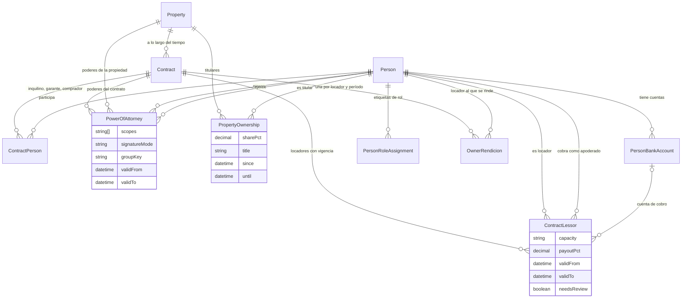
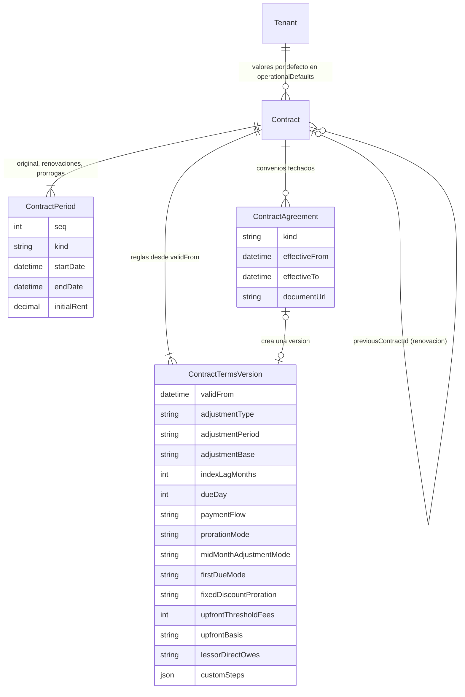
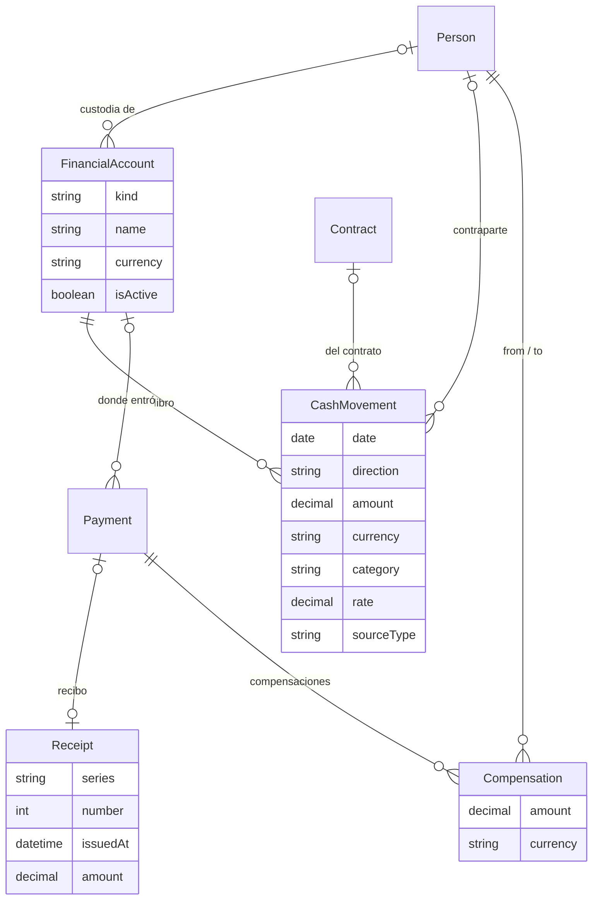
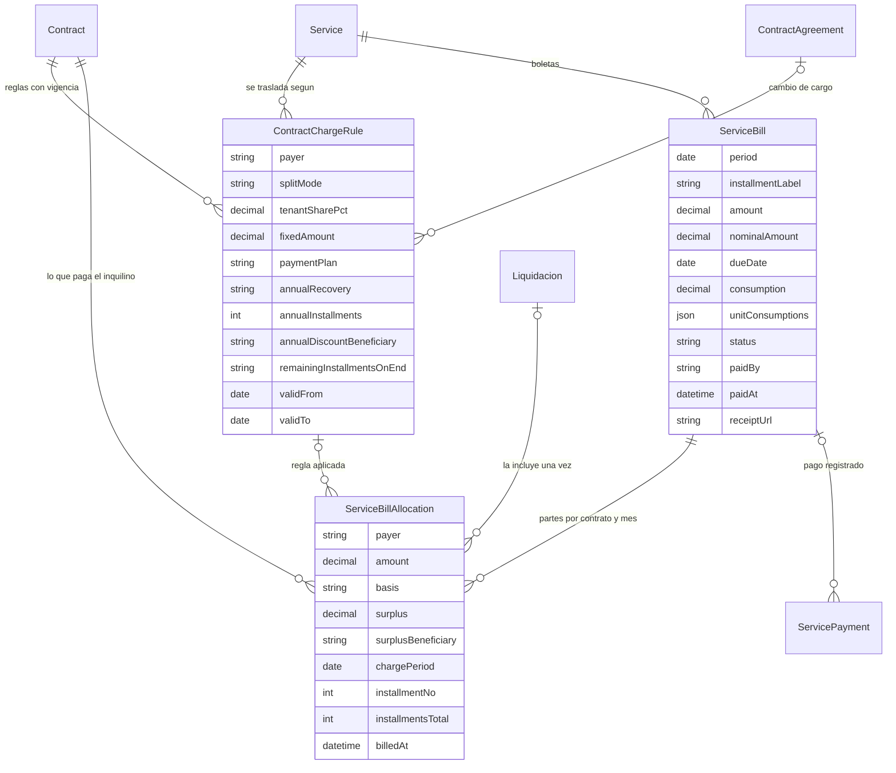
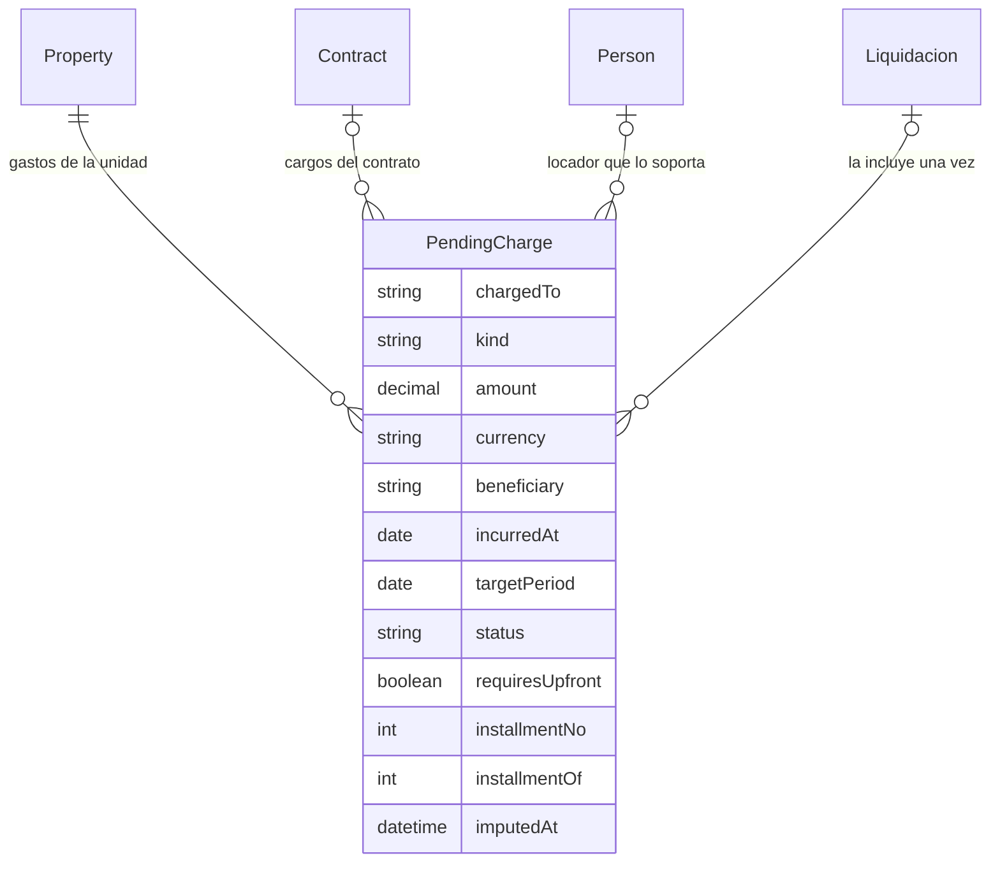
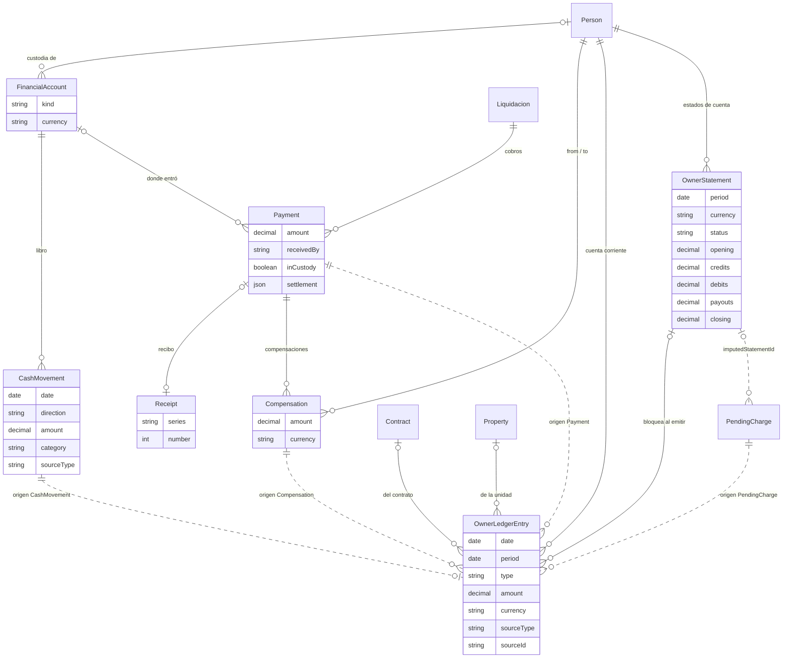

# Modelo de Datos

El modelo está implementado con Prisma sobre PostgreSQL. A continuación se describen las entidades principales agrupadas por dominio, sus campos representativos y sus relaciones más relevantes. El detalle exhaustivo de columnas e índices vive en `apps/api/prisma/schema.prisma`, que hoy define sesenta y cinco modelos.

Una convención vale aclararla antes del detalle: **todas las tablas del dominio llevan una columna `tenantId`**, que es el ancla del aislamiento entre inmobiliarias. Sólo algunas declaran además la relación inversa hacia `Tenant`; el resto lleva la columna sin relación declarada, para no acumular medio centenar de campos de vuelta sobre la misma entidad. El filtro no se aplica a mano en cada consulta sino desde una extensión del cliente de Prisma, según se describe en el ADR 0006.

## Auth y Tenant

### Tenant

Inmobiliaria. Es el ancla de aislamiento del sistema.

- `id`, `name`, `slug`, `cuit`, `province`, `timezone`, `currency`, `tier`, `brandPrimary`, `brandSecondary`, `logoUrl`, `penaltyConfig`, `readPolicy`, `operationalDefaults`, `isActive`, `createdAt`.
- `slug` es lo que resuelve el micrositio público; `brandPrimary`, `brandSecondary` y `logoUrl` son los que lo pintan. `penaltyConfig` guarda como JSON los parámetros de punitorios de la inmobiliaria. `readPolicy` guarda, también como JSON, qué roles leen cada recurso sensible (un arreglo de roles por recurso); `null` significa la política por defecto, en la que todos los roles de personal leen todo. Se valida con un esquema compartido y exige al Admin en cada recurso. `operationalDefaults` guarda como JSON los valores por defecto de la operación (vencimiento, anticipación de la liquidación, rezago del IPC, pago a cuenta con índice estimado, comisión, honorarios, tasación, umbral de anticipo, cadencia de cobranza y semáforo de vencimientos); se valida con `OperationalDefaultsSchema`, que da a cada campo su valor de arranque, y `null` significa los valores del código. Ver ADR-0010.

### User

Usuario interno de una inmobiliaria.

- `id`, `tenantId`, `email`, `passwordHash`, `firstName`, `lastName`, `role`, `isActive`, `lastLoginAt`.
- `role` toma uno de los siete valores de `UserRole`. Relación N-1 con `Tenant`, 1-N con `RefreshToken` y `AuditLog`.

### RefreshToken

Token de refresco emitido al usuario, rotado en cada uso.

- `id`, `token`, `userId`, `expiresAt`, `isRevoked`, `createdAt`.
- No lleva `tenantId`: su aislamiento depende de la relación con `User`. El token se guarda tal cual y la revocación es una marca booleana, no una fecha.

### UserInvitation

Invitación pendiente para incorporar un usuario nuevo.

- `id`, `tenantId`, `invitedByUserId`, `email`, `role`, `token`, `expiresAt`, `acceptedAt`.
- `token` guarda el SHA-256 en hexadecimal de un valor aleatorio de 256 bits; el valor en claro se entrega una sola vez, al Admin. Dura 7 días y se consume al aceptarse. Reenviar la invitación reemplaza el hash.

### PasswordResetToken

Enlace de un solo uso para elegir una contraseña nueva.

- `id`, `tenantId`, `userId`, `tokenHash` (único), `expiresAt`, `usedAt`, `createdById`, `createdAt`.
- Guarda solo el SHA-256 del token. Dura 1 hora y `usedAt` marca que ya se consumió; generar uno nuevo para el mismo usuario consume los anteriores sin usar. Lo genera el Admin o el pedido por correo.

### AuditLog

Registro de acciones sensibles.

- `id`, `tenantId`, `userId`, `action`, `entity`, `entityId`, `changes`, `ipAddress`, `userAgent`, `createdAt`.
- El detalle del cambio va en `changes`, como JSON.

## Personas

### Person

Persona física o jurídica genérica. Una misma persona puede tener varios roles.

- `id`, `tenantId`, `firstName`, `lastName`, `email`, `phone`, `phone2`, `cuit`, `fiscalCondition`, `personType`, `dni`, `address`, `maritalStatus`, `nationality`, `payoutMethod`, `externalRef`, `notes`, `isActive`.
- `personType` es `Fisica` (por defecto) o `Juridica`; `payoutMethod` es la forma de cobro del propietario (`Transferencia`, `Efectivo` o `Custodia`) y puede quedar vacía. `dni`, `address` (texto libre por ahora), `maritalStatus` y `nationality` son opcionales y alimentan los datos del contrato.
- `externalRef` es el identificador que la persona tenía en otro sistema (planilla, programa anterior). Es único por inmobiliaria (`@@unique([tenantId, externalRef])`); Postgres admite varias personas sin referencia. Una referencia repetida responde 409 `EXTERNAL_REF_TAKEN`.
- **Columnas deprecadas:** `bankName`, `cbu` y `bankAlias` ya no se leen ni se escriben. La fuente única de los datos bancarios es `PersonBankAccount`; el cliente de Prisma las omite en toda lectura. Quedan en la tabla una versión más, solo para poder volver atrás, y se eliminan en la migración siguiente. Reversa de la migración: ver la cabecera de `20261031030500_personas_datos_y_referencias`.

### PersonBankAccount

Cuenta bancaria de una persona, en una moneda. Es lo que alimenta el pago al locador.

- `id`, `tenantId`, `personId`, `currency`, `bankName`, `cbu`, `alias`, `holder`, `isDefault`, `createdAt`, `updatedAt`.
- Una persona puede tener varias cuentas, también varias en la misma moneda. Por cada moneda con cuentas hay exactamente una predeterminada: la primera que se carga lo es, promover otra intercambia la predeterminada y el servicio rechaza soltar o borrar la predeterminada mientras queden otras de esa moneda (409 `BANK_ACCOUNT_DEFAULT_REQUIRED`). La moneda no se edita: se crea otra cuenta.
- Lleva `tenantId` y está registrada en `TENANT_SCOPED_MODELS`; se borra en cascada con la persona.
- **Backfill de la migración:** cada persona con alguno de los tres datos bancarios viejos recibió una cuenta en pesos marcada como predeterminada, con el titular igual al nombre de la persona.

### PersonRoleAssignment

Vincula a una `Person` con un rol: propietario, inquilino, garante, comprador, proveedor, lead o apoderado.

- `id`, `tenantId`, `personId`, `role`, `assignedAt`, `propertyId`, `guarantorForPersonId`. Única por persona y rol (`@@unique([personId, role])`).
- El rol es una **etiqueta de cliente**: no dice a qué contrato ni a qué propiedad pertenece la persona. `ensureRole` es el único lugar que la crea, y la usan el alta de consultas, de proveedores, de locadores, de titulares, de poderes y la asignación manual. En el garante, `guarantorForPersonId` apunta a quién garantiza.
- **`propertyId` ya no se escribe.** La propiedad de un propietario vive en `PropertyOwnership`; la columna se conserva por una versión más para poder volver atrás y la migración copió sus valores a la titularidad.

### PropertyOwnership

Quién es titular de una propiedad. Es información opcional: no define a quién se le paga.

- `id`, `tenantId`, `propertyId`, `personId`, `sharePct` (`Decimal(7,4)`, opcional), `title` (por ejemplo, el título de dominio), `since`, `until`, `createdAt`, `updatedAt`.
- No se exige que los porcentajes sumen 100 ni que haya titulares cargados; cuando los datos existen sirven para un aviso del panel de calidad. Índices: `(tenantId, propertyId)` y `(tenantId, personId)`. Se borra en cascada con la propiedad y con la persona; lleva `tenantId` y está registrada en `TENANT_SCOPED_MODELS`.
- La migración creó una titularidad, sin porcentaje, por cada asignación de rol `Propietario` que tenía propiedad. El alta de un titular agrega a la persona el rol `Propietario`.

### PersonDocument

Documentación adjunta (DNI, recibos de sueldo, escrituras).

- `id`, `tenantId`, `personId`, `fileName`, `url`, `mimeType`, `sizeBytes`, `uploadedAt`.

### ProviderProfile

Perfil específico cuando la persona es proveedor de servicios.

- `id`, `tenantId`, `personId`, `rubros`, `coverageZones`, `isActive`, `notes`.
- `rubros` y `coverageZones` son arreglos, y son los dos criterios con los que se ofrecen proveedores habilitados para un ticket.

## Propiedades

### Property

Inmueble administrado por la inmobiliaria.

- `id`, `tenantId`, `title`, `description`, `type`, `street`, `number`, `floor`, `apartment`, `city`, `province`, `zipCode`, `country`, `latitude`, `longitude`, `area`, `rooms`, `bedrooms`, `bathrooms`, `garages`, `age`, `orientation`, `amenities`, `price`, `currency`, `cadastralId`, `parentPropertyId`, `externalRef`, `isActive`.
- `cadastralId` es la nomenclatura catastral (texto libre). `parentPropertyId` apunta al edificio que contiene la unidad (relación `edificio`, `onDelete: SetNull`): sirve para repartir gastos por consumo; no puede ser la propia propiedad, debe ser de la misma inmobiliaria y no puede formar un ciclo (`PROPERTY_SELF_PARENT`, `PARENT_PROPERTY_NOT_FOUND`, `PROPERTY_PARENT_CYCLE`). `externalRef` sigue la misma regla que en `Person`, con `@@unique([tenantId, externalRef])`.
- La dirección está desagregada en columnas, no en un campo único. La propiedad **no** tiene un estado de disponibilidad ni un propietario directo: el estado vive en cada `PropertyOperation` y la titularidad se expresa como una `PersonRoleAssignment` de rol propietario apuntando a la propiedad.
- Relación 1-N con `PropertyOperation`, `PropertyMedia`, `PriceHistory`, `PropertyValuation`, `Service`, `Ticket`, `LeadVisit`.

### PropertyOperation

Operación habilitada sobre la propiedad, con su propio estado.

- `id`, `tenantId`, `propertyId`, `operationType`, `state`, `price`, `currency`.
- `operationType` es alquiler, alquiler temporario o venta. `state` recorre la máquina de estados de disponibilidad: borrador, disponible, reservado, alquilado, vendido, ocupado, suspendido y archivado. Que el estado esté acá y no en la propiedad es lo que permite tener un mismo inmueble publicado en venta y alquilado a la vez.

### PropertyMedia

Imágenes de la propiedad, en dos resoluciones.

- `id`, `tenantId`, `propertyId`, `url`, `thumbnailUrl`, `mimeType`, `sizeBytes`, `width`, `height`, `sortOrder`, `isPrimary`.
- El orden de la galería es `sortOrder` y la portada es `isPrimary`. Ambas versiones del archivo viven en el almacenamiento de objetos; las URLs de lectura se firman por pedido.

### PriceHistory

Historial de cambios de precio de la propiedad.

- `id`, `tenantId`, `propertyId`, `price`, `currency`, `changedAt`, `changedByUserId`.

### PropertyValuation

Tasación de la propiedad.

- `id`, `tenantId`, `propertyId`, `valuationDate`, `value`, `currency`, `method`, `appraiser`, `notes`.

## Contratos

### Contract

Contrato entre locadores e inquilino, o de venta.

- `id`, `tenantId`, `propertyId`, `contractType`, `status`, `startDate`, `endDate`, `rentAmount`, `rentCurrency`, `depositAmount`, `depositCurrency`, `adjustmentType`, `adjustmentPeriod`, `customAdjustmentPct`, `notes`, `isActive`, `closedAt`, `actualEndDate`, `previousContractId`, `externalRef`.
- `actualEndDate` es el fin real o la prórroga de palabra; el fin efectivo es `coalesce(actualEndDate, endDate)`. Un contrato pasado de su fin pactado sin fin real sigue liquidándose mientras esté `Activo`. `previousContractId` encadena las renovaciones.
- `externalRef` identifica el contrato en el sistema anterior y es único por inmobiliaria (`@@unique([tenantId, externalRef])`, 409 `EXTERNAL_REF_TAKEN`).
- **Las columnas de ajuste son la vista vigente.** `adjustmentType` toma IPC, ICL, CCP, porcentaje fijo, personalizado, UVA o escalonado (las dos últimas todavía no tienen cálculo), `adjustmentPeriod` va de mensual a anual, y `customAdjustmentPct` guarda el porcentaje cuando la modalidad es de porcentaje fijo. La fuente de las reglas de cada fecha es `ContractTermsVersion`; estas columnas se mantienen en sincronía con la versión vigente hoy (ADR-0010).
- Relación 1-N con `ContractPerson`, `ContractLessor`, `PowerOfAttorney`, `ContractGuarantee`, `ContractAdjustment`, `AdjustmentSchedule`, `Liquidacion`, `OwnerRendicion` (histórico), `OwnerLedgerEntry`, `ContractPeriod`, `ContractAgreement`, `ContractTermsVersion`; 1-1 con `ContractCommission` y `ContractClosureSummary`.

### ContractPerson

Relación N-M entre `Contract` y `Person`, indicando el rol de cada parte que **no** es locador: inquilino, garante y comprador.

- `id`, `tenantId`, `contractId`, `personId`, `role`.
- Las filas con rol `Propietario` son datos anteriores a `ContractLessor`: la migración las copió a locadores y ya no se leen ni se escriben. Los propietarios que llegan en `persons` al crear un contrato se guardan como locadores. `getParty` y `getParties` (`contract-parties.ts`) son la única forma de buscar una parte por rol.

### ContractLessor

Quien alquila en un contrato y qué parte del cobro le corresponde. No es la titularidad de la propiedad: el porcentaje es un acuerdo del contrato.

- `id`, `tenantId`, `contractId`, `personId`, `capacity` (`Propietario`, `Usufructuario`, `Sublocador`, `Acreedor`, `Otro`), `payoutPct` (`Decimal(7,4)`), `payeePersonId`, `bankAccountId`, `validFrom`, `validTo`, `needsReview`, `createdAt`, `updatedAt`.
- Índices: `(contractId, validTo)` y `(tenantId, personId)`. Se borra en cascada con el contrato y con la persona; si se borra el cobrador o la cuenta, esos campos quedan vacíos.
- **Regla:** los locadores vigentes en cada fecha del contrato suman exactamente 100,0000. La vigencia es `[validFrom, validTo)`: una cesión es cerrar a uno con `validTo` y abrir a otro con `validFrom` en esa misma fecha. Se exige al activar el contrato, al cambiar los locadores de un contrato que ya salió de borrador y al generar la rendición; si no se cumple, `LESSOR_SHARES_INVALID` con las fechas y sumas que no cierran. `getLessorsAt(contrato, fecha)` devuelve los vigentes.
- `payeePersonId` es el apoderado que cobra: solo se acepta con un poder vigente con alcance `Cobrar` del locador (`PAYEE_WITHOUT_POWER`). `bankAccountId` tiene que ser una cuenta del locador (`BANK_ACCOUNT_NOT_OF_LESSOR`).
- `needsReview` marca las filas que la migración repartió en partes iguales entre varios propietarios, por suposición; baja al confirmar o cambiar el porcentaje.
- Lleva `tenantId` y está registrada en `TENANT_SCOPED_MODELS`.

### PowerOfAttorney

Poder por el que un apoderado actúa en nombre de otra persona.

- `id`, `tenantId`, `principalId` (poderdante), `agentId` (apoderado), `scopes` (arreglo de `Cobrar`, `Firmar`, `Administrar`, validado en la API), `signatureMode` (`Indistinta` o `Conjunta`), `groupKey`, `contractId`, `propertyId`, `validFrom`, `validTo`, `documentUrl`, `createdAt`, `updatedAt`.
- Sin `contractId` ni `propertyId` es un poder general; con uno de los dos, vale solo para ese contrato o esa propiedad (no se admiten los dos a la vez). `getApoderadosAt` junta los que alcanzan a un contrato.
- Con firma conjunta, los apoderados del mismo alcance comparten `groupKey` (por defecto, poderdante y alcance) y firman juntos; con firma indistinta `groupKey` queda vacía.
- Un poder con alcance `Cobrar` que un locador usa como cobrador no se puede revocar ni recortar (`POWER_IN_USE`). Dar un poder agrega a la persona el rol `Apoderado`.
- Índices: `(tenantId, principalId)`, `(tenantId, agentId)` y `(contractId)`. Lleva `tenantId` y está registrada en `TENANT_SCOPED_MODELS`.

### Partes del contrato

La titularidad (`PropertyOwnership`) no se conecta con el cobro: quien recibe dinero lo define `ContractLessor`, y cada cobro se reparte entre los locadores vigentes y se asienta en su cuenta corriente (la rendición por contrato queda como histórico). Los titulares solo soportan un gasto de una unidad sin contrato.

### Reglas versionadas, acuerdos y períodos

Las reglas de un contrato se resuelven por capas (defecto de la inmobiliaria, contrato, acuerdo) y se versionan en lugar de pisarse (ADR-0010).

#### ContractPeriod

Un tramo de vigencia del contrato.

- `id`, `tenantId`, `contractId`, `seq`, `kind` (`Original`, `Renovacion`, `Prorroga`), `startDate`, `endDate`, `initialRent`, `signedAt`, `feeAmount` y `feeCurrency` (honorarios de renovación pactados), `guarantorPersonIds` (garantes que reafirmaron).
- `@@unique([contractId, seq])`. Todo contrato tiene el período 1 (`Original`): se crea con el contrato y la migración lo creó para los existentes (`initialRent` es el alquiler anterior al primer ajuste aplicado, o el actual si no hubo). Editar el fin pactado del contrato mueve el fin del último período.

#### ContractAgreement

Convenio fechado que cambia las reglas del contrato.

- `id`, `tenantId`, `contractId`, `kind` (`Renegociacion`, `Rebaja`, `Bonificacion`, `CambioRegla`, `CambioReparto`, `CambioCargo`, `Prorroga`, `Renovacion`), `effectiveFrom`, `effectiveTo`, `documentUrl`, `notes`, `createdById`.
- `Prorroga` (prórroga de palabra: `effectiveFrom` es el fin efectivo anterior y `effectiveTo` el nuevo) y `Renovacion` (renovación como período) no se cargan por `POST /contracts/:id/agreements`: tienen su propia acción. La renovación sí trae un `termsPatch` (alquiler acordado y regla de ajuste).
- Los cuatro primeros tipos traen un `termsPatch` que crea una `ContractTermsVersion` en la misma transacción; `CambioReparto` y `CambioCargo` solo se registran.

#### ContractTermsVersion

Foto de las reglas vigentes del contrato desde `validFrom`. Nunca se modifica: un cambio crea otra.

- `id`, `tenantId`, `contractId`, `validFrom`, `agreementId`, `adjustmentType`, `adjustmentPeriod`, `adjustmentBase` (`Original` o `Vigente`), `indexLagMonths` (por defecto 2), `fixedInitialMonths` (0), `customPct`, `customSteps` (JSON, lista de `{ fromMonth, pct }` para el escalonado), `rentOverride`, `discountPct`, `discountAmount`, `dueDay`, `paymentFlow` (`Partido`, `TodoInmobiliaria`, `TodoLocador`), `penaltyConfig` (JSON).
- Cuatro convenciones de liquidación, pactables por contrato y con valor por defecto de la inmobiliaria (`Tenant.operationalDefaults`): `prorationMode` (`DiasReales`, `Mes30`, `SinProrrateo`), `midMonthAdjustmentMode` (`DesdePeriodoSiguiente`, `Prorrateado`, `DesdeEsePeriodo`), `firstDueMode` (`DiaDeInicio`, `VencimientoMesSiguiente`, `AlFirmar`) y `fixedDiscountProration` (`Proporcional`, `Completo`). Las columnas son obligatorias y su valor por defecto en la base es el comportamiento original (días reales, el ajuste rige desde el período siguiente, vence el día de inicio, descuento fijo proporcional), de modo que las versiones existentes liquidan igual que antes. Un contrato nuevo las toma de los valores por defecto de la inmobiliaria o de lo que se pacte en el alta; un convenio puede cambiarlas con `termsPatch`. Además pacta el anticipo del centro de carga: `upfrontThresholdFees` (entero, en comisiones mensuales; `null` = el de la inmobiliaria) y `upfrontBasis` (`ComisionPactada` por defecto, o `PorcentajePorDefecto`); las versiones existentes quedan con `null` y `ComisionPactada`, el comportamiento anterior. Y pacta `lessorDirectOwes` (`TodoLoAjeno` o `SoloInmobiliaria`: qué le debe a la inmobiliaria el locador que cobra directamente; `null` = el de la inmobiliaria, `operationalDefaults.cash.lessorDirectOwes`), que el reparto del cobro lee de la versión vigente en el período (ADR-0009); las versiones existentes quedaron con `null`.
- `@@unique([contractId, validFrom])`. La versión vigente a una fecha es la última con `validFrom` anterior o igual. La migración creó una por contrato con sus columnas de hoy: base `Vigente` (lo que hace el motor actual), rezago 0 (el motor anterior no lo aplicaba; los contratos nuevos toman el de los valores por defecto, 2), vencimiento el día 10 y flujo `Partido`.
- Las tres tablas llevan `tenantId` y están registradas en `TENANT_SCOPED_MODELS`.

### ContractFollowUp y FollowUpTask

Seguimiento del fin de un contrato y los pasos de su checklist.

- `ContractFollowUp`: `id`, `tenantId`, `contractId`, `kind` (`Renovacion` o `Devolucion`), `status` (`Abierto` o `Cerrado`), `dueDate` (el fin efectivo del contrato cuando se abrió), `assigneeId`, `outcome` (`Pendiente`, `Renovado`, `Devuelto`, `Prorrogado`), `notes`, `closedAt`.
- `@@unique([contractId, kind, dueDate])`: el proceso diario es idempotente y un contrato no repite el seguimiento de un mismo fin efectivo. El proceso diario también sigue a los contratos `Vencido` sin decisión. Una prórroga de palabra o una renovación cierran el abierto (y devuelven un contrato `Vencido` a `Activo`); el nuevo fin efectivo abre otro cuando entra en la ventana.
- `FollowUpTask`: `id`, `tenantId`, `followUpId`, `code`, `label`, `position`, `done`, `doneAt`, `doneById`, `dueDate`; `@@unique([followUpId, code])`. Las plantillas de checklist son constantes del paquete compartido (`FOLLOW_UP_CHECKLISTS`); al cambiar el tipo se arma el checklist del tipo nuevo y se conserva lo ya hecho en los pasos que se repiten.
- El semáforo (`expirationLight`) no se guarda: sale del fin efectivo del contrato y de `Tenant.operationalDefaults.expiryLight`. Ambas tablas llevan `tenantId` y están en `TENANT_SCOPED_MODELS`. La migración no crea seguimientos.

### ContractGuarantee

Garantías asociadas al contrato.

- `id`, `tenantId`, `contractId`, `type`, `status`, `description`, `amount`, `currency`, `issuer`, `policyNumber`, `startDate`, `endDate`.
- `type` es seguro de caución, garantía propietaria, garantía bancaria, depósito u otra. La garantía no apunta a una `Person`: los datos del garante se cargan en `issuer` y la vinculación como persona, cuando existe, se expresa por `PersonRoleAssignment`.

### AdjustmentSchedule

Cronograma de ajustes pendientes del contrato. Es lo que el barrido diario consulta para saber a qué contratos les toca ajustar.

- `id`, `tenantId`, `contractId`, `nextAdjustmentDate`, `periodNumber`, `status`.
- `status` recorre pendiente, calculado, aplicado y omitido. Cuelga del contrato directamente, no de un registro de configuración intermedio.

### ContractAdjustment

Ajuste ya calculado o aplicado sobre el contrato. Es el registro histórico, uno por período ajustado.

- `id`, `tenantId`, `contractId`, `periodNumber`, `adjustmentDate`, `previousAmount`, `newAmount`, `percentage`, `currency`, `indexType`, `indexValues`, `notes`, `calculatedAt`, `appliedAt`, `isProvisional`, `trueUpOfId`, `trueUpBilledAt`.
- `@@unique([contractId, periodNumber, isProvisional])`: puede haber un ajuste provisional (calculado con un índice estimado) y el definitivo del mismo período. `trueUpOfId` apunta al provisional que corrige. `trueUpBilledAt` queda vacío hasta que una liquidación incluye la diferencia retroactiva de la corrección (ADR-0011).
- `indexValues` guarda como JSON los valores de índice que se usaron en el cálculo (`observations`, con los estimados marcados en `estimated`), el rezago y la base, de modo que un ajuste aplicado se pueda reconstruir aunque después se corrija la serie publicada. Mientras `appliedAt` esté vacío, el ajuste está calculado pero no impactado en el contrato.

### IndexData

Valores publicados de los índices.

- `id`, `tenantId`, `indexType`, `period`, `value`, `source`, `isEstimate`, `estimateSource`.
- `indexType` toma IPC, ICL, CVS, CER, UVA o tasa activa del Banco Nación (`TasaActivaBNA`). Los valores se consumen como variación del período, no como nivel absoluto.
- `isEstimate` marca un valor esperado (`estimateSource`, por ejemplo `REM`). El valor oficial lo reemplaza bajo la misma clave `[tenantId, indexType, period]`; un estimado nunca pisa a un oficial (409 `OFFICIAL_VALUE_EXISTS`), y el cálculo de ajustes usa el oficial de cada mes y, sin él, el estimado solo si la inmobiliaria permite el pago a cuenta (`allowProvisional`).

### ContractTemplate

Plantillas para generar el documento del contrato.

- `id`, `tenantId`, `name`, `contractType`, `body`, `variables`, `isDefault`, `isActive`.

### ContractCommission

Comisión de la inmobiliaria sobre un contrato. Es el parámetro que determina lo que se le descuenta al locador en su cuenta corriente.

- `id`, `tenantId`, `contractId`, `type`, `percentage`, `fixedAmount`, `adminFee`, `currency`, `repairMgmtFeePct`, `notes`.
- `repairMgmtFeePct` es el honorario por gestión de una reparación a cargo del locador, en porcentaje de su importe; se asienta como `Honorario` junto con el cargo. Nulo (como quedaron todas las comisiones existentes) = sin honorario.

### ContractClosureSummary

Resumen de gestión producido al cerrar el contrato.

- `id`, `tenantId`, `contractId` (único), `summary`, `highlights`, `metrics`, `source`, `model`, `generatedAt`.
- `source` distingue si el texto lo produjo el modelo de lenguaje o las reglas propias del sistema, y `model` registra cuál se usó cuando corresponde.

## Liquidaciones y cobranzas

### Liquidacion

Liquidación mensual al inquilino.

- `id`, `tenantId`, `contractId`, `period`, `status`, `dueDate`, `subtotal`, `total`, `currency`, `notes`, `pdfUrl`, `sentAt`, `paidAt`, `kind`, `isProvisional`, `receiptSeq`.
- `kind` es mensual, pago a cuenta o egreso. `isProvisional` marca que el alquiler usó un ajuste provisional (índice estimado), y la liquidación sale como pago a cuenta hasta que se corrija. `receiptSeq` es el número de recibo, único por inmobiliaria (`@@unique([tenantId, receiptSeq])`; nulo hasta que se aprueba).
- Relación 1-N con `LiquidacionLineItem`, `Payment` y `Penalty`.

### LiquidacionLineItem

Línea de la liquidación.

- `id`, `tenantId`, `liquidacionId`, `type`, `description`, `amount`, `currency`, `sortOrder`, `commissionable`, `beneficiary`, `sourceType`, `sourceId`.
- `type` toma alquiler, ajuste, extra, descuento, multa, impuesto, servicio, cargo, honorario o ajuste retroactivo.
- `beneficiary` dice a quién le corresponde el importe: locador, inmobiliaria o ente (proveedor o servicio). `commissionable` indica si el renglón entra en la base de la comisión: alquiler, ajustes, punitorios y descuentos sí; reparaciones, impuestos y servicios nunca. Los renglones existentes se migraron con esa regla y todos al locador.
- `sourceType` y `sourceId` apuntan al registro de origen (boleta, cargo, punitorio, ajuste) y tienen un índice por inmobiliaria.

### DocumentSequence

Contador por inmobiliaria y serie: los recibos de liquidación (`RECIBO_LIQUIDACION`) y los recibos de cobro (`RECIBO_COBRO`, o una serie por moneda o por cuenta según la inmobiliaria).

- `id`, `tenantId`, `series`, `next`, con `@@unique([tenantId, series])`.
- Un solo `INSERT ... ON CONFLICT DO UPDATE` incrementa `next` (`nextDocumentNumber`), de modo que dos aprobaciones o dos cobros simultáneos no repiten número; dentro de la transacción del documento, un rollback no gasta número.

### Payment

Pago aplicado a una liquidación.

- `id`, `tenantId`, `liquidacionId`, `amount`, `currency`, `method`, `reference`, `notes`, `paidAt`, `receivedBy`, `accountId`, `receivedByUserId`, `inCustody`, `receiptId`, `externalRef`, `settlement`.
- `method` es transferencia, efectivo, MercadoPago o cheque. `receivedBy` dice quién recibió el dinero (`Inmobiliaria` o `Locador`); `accountId`, en qué cuenta de la inmobiliaria entró; `receivedByUserId`, quién lo recibió en la oficina; `inCustody`, que la parte de los locadores quedó en custodia. `receiptId` es su recibo (a lo sumo uno, único). `externalRef` es única por inmobiliaria. `settlement` guarda el reparto del cobro (settlement-engine) al registrarlo.
- Los cobros anteriores a la caja quedaron recibidos por la inmobiliaria, sin cuenta ni recibo.

### Caja y cobros

Cuentas, libro, recibos de cobro y compensaciones de la inmobiliaria (ítem 36, ADR-0012).

- `FinancialAccount`: `id`, `tenantId`, `kind` (`Caja`, `Banco`, `Custodia`), `name`, `currency` (una sola por cuenta: `ARS`, `USD` o `EUR`), `ownerPersonId` (el locador de una custodia), `isActive`. `@@unique([tenantId, kind, ownerPersonId, currency])`: una custodia por locador y moneda. La caja y el banco de cada moneda se crean al primer cobro.
- `CashMovement`: `id`, `tenantId`, `accountId`, `date`, `direction` (`In`, `Out`), `amount` (siempre positivo), `currency`, `category` (`AlquilerCobrado`, `PagoLocador`, `PagoEnte`, `PagoProveedor`, `Honorario`, `Gasto`, `ComisionEmpleado`, `Sena`, `Custodia`, `Compensacion`, `Conversion`), `counterpartyId`, `contractId`, `rate` (tipo de cambio de una conversión), `sourceType`/`sourceId` (cobro, entrega de custodia, compensación, conversión, cargo o manual), `note`, `createdById`. El saldo de una cuenta es entradas menos salidas. Índices `[tenantId, accountId, date]`, `[tenantId, category, date]` y `[tenantId, sourceType, sourceId]`.
- `Receipt`: `id`, `tenantId`, `series`, `number`, `issuedAt`, `amount`, `currency`, con `@@unique([tenantId, series, number])`. Se emite en la transacción del cobro.
- `Compensation`: `id`, `tenantId`, `paymentId`, `fromLessorId` (quien recibió el cobro o lo cubre), `toLessorId` (locador del contrato al que le correspondía), `amount`, `currency`, `note`, `createdById`.
- `Currency` suma `EUR`. Los cuatro modelos están en `TENANT_SCOPED_MODELS` y en la limpieza de las pruebas de integración; las tablas nacieron vacías.

### Penalty

Punitorio calculado sobre una liquidación vencida.

- `id`, `tenantId`, `liquidacionId`, `amount`, `appliedOn`, `daysOverdue`, `compoundBase`, `status`, `waivedAt`, `waivedBy`, `waiveReason`, `settledLiquidacionId`.
- La condonación no borra el registro: lo marca con su fecha, su responsable y su motivo. `settledLiquidacionId` apunta a la liquidación en la que el punitorio terminó cobrándose: la siguiente, como renglón `Multa` (`sourceType` `Penalty`, `sourceId` la liquidación de origen), o la propia si se cobró al instante con `settlePenalties`. Cada fila es el devengo de un tramo (lo que faltaba respecto de lo ya registrado, condonado o cobrado). `penaltyConfig` (de la inmobiliaria y de `ContractTermsVersion`) admite el modo `max_bna_or_daily`, con `bnaMultiplier` y `yearDays` opcionales.

### Service / ServicePayment

Servicios e impuestos asociados a una propiedad (gas, luz, tasa municipal, impuesto inmobiliario) y sus pagos.

- `Service`: `id`, `tenantId`, `propertyId`, `serviceType` (Electricidad, Gas, Agua, Internet, Expensas, Municipal, ImpuestoInmobiliario, Otro), `providerName`, `accountNumber`, `amount`, `currency`, `dueDay`, `billingFrequency` (Mensual por defecto, Bimestral, Trimestral, Anual), `hasAnnualOption` (falso por defecto), `isActive`, `notes`.
- `ServicePayment`: `id`, `tenantId`, `serviceId`, `amount`, `paymentDate`, `period`, `notes`, `billId` (opcional: el pago de la boleta que lo originó; si se borra la boleta queda nulo).

### Impuestos y servicios trasladables

Quién paga cada impuesto o servicio de un contrato, las boletas y lo que se cobra al inquilino en cada liquidación (ADR-0008).

- `ContractChargeRule`: `id`, `tenantId`, `contractId`, `serviceId`, `payer` (`Inquilino`, `Inmobiliaria`, `Propietario`), `splitMode` (`Porcentaje`, `Consumo`, `Fijo`), `tenantSharePct` (100 por defecto), `fixedAmount`, `paymentPlan` (`Mensual`, `Anual`), `annualRecovery` (`Prorrateado` por defecto, `Unico`), `annualInstallments` (1 a 12, 12 por defecto), `annualDiscountBeneficiary` (`Inquilino` por defecto, `Locador`, `Inmobiliaria`), `remainingInstallmentsOnEnd` (`CobrarEnLiquidacionFinal` por defecto, `Descartar`), `validFrom`, `validTo`, `agreementId`, `notes`. Única por `[contractId, serviceId, validFrom]`: un cambio cierra la regla vigente y crea otra, no la pisa.
- `ServiceBill`: `id`, `tenantId`, `serviceId`, `period` (primer día del mes), `installmentLabel`, `amount`, `nominalAmount`, `currency`, `dueDate`, `consumption`, `unitConsumptions` (lista de propiedad y consumo), `status` (`Pendiente`, `Pagada`, `Anulada`), `paidBy` (`Inquilino`, `Inmobiliaria`, `Propietario`), `paidAt`, `receiptUrl`, `notes`, `createdById`. Única por `[serviceId, period, installmentLabel]`.
- `ServiceBillAllocation`: `id`, `tenantId`, `billId`, `contractId`, `ruleId`, `payer`, `amount`, `basis` (texto con el cálculo), `surplus` y `surplusBeneficiary` (parte de `amount` que es la diferencia por el descuento anual y a quién va), `chargePeriod` (mes de la liquidación en que se cobra), `installmentNo`, `installmentsTotal`, `liquidacionId`, `billedAt`. Única por `[billId, contractId, chargePeriod]`. Una parte con `billedAt` ya está en una liquidación y no se rehace.
- Los tres modelos llevan `tenantId` y están registrados en `TENANT_SCOPED_MODELS`. El renglón de liquidación que sale de una parte lleva `sourceType` `ServiceBillAllocation` y el id de la parte como `sourceId`.

### Centro de carga

Gastos y cargos puntuales del mes que se imputan una sola vez, al inquilino en su liquidación o al locador en su estado (ítem 35).

- `PendingCharge`: `id`, `tenantId`, `propertyId`, `contractId` (opcional: un gasto de una unidad vacía no tiene contrato), `chargedTo` (`Inquilino`, `Locador`, `Inmobiliaria`), `lessorPersonId`, `kind` (`Reparacion`, `ExpensaExtra`, `Devolucion`, `HonorarioGestion`, `AjusteRetroactivo`, `Otro`), `description`, `amount` (con signo), `currency`, `beneficiary` (`Locador` o `Inmobiliaria`: quién recibe el dinero), `incurredAt`, `targetPeriod` (primer mes en que se imputa; sin mes, en la próxima liquidación), `status` (`Pendiente`, `Imputado`, `CobradoAnticipado`, `Anulado`), `requiresUpfront`, `installmentNo`, `installmentOf`, `installmentGroupId` (las cuotas de un cargo lo comparten), `imputedLiquidacionId`, `imputedStatementId` (sin clave foránea: lo completa el estado de cuenta del locador), `imputedAt`, `sourceType`, `sourceId`, `notes`, `createdById`. Índices `[tenantId, contractId, status]` y `[tenantId, propertyId, status]`.
- Registrado en `TENANT_SCOPED_MODELS` y en la limpieza de las pruebas de integración. Sin backfill: la tabla nace vacía.
- Un cargo `chargedTo = Inmobiliaria` queda `Pendiente` hasta que se cierra como `Gasto` de una cuenta de la caja (`CashMovement` con `sourceType = PendingCharge`); entonces pasa a `Imputado` y ya no se libera.
- Anular o borrar la liquidación que lo tomó devuelve el cargo a `Pendiente` (`imputedLiquidacionId` nulo) en la misma transacción, igual que las partes de boletas y las correcciones de ajustes.
- **Cargos al locador y su estado de cuenta (3.2, ADR-0009).** Los cargos `chargedTo = Locador` quedan `Pendiente` hasta el estado del mes en que se imputan (`targetPeriod`, o el del gasto si no tiene). Por defecto, al generar los estados de ese mes se asientan como `Cargo` (y `Honorario` por gestión si es una reparación y el contrato pacta `repairMgmtFeePct`) entre quienes lo soportan —`lessorPersonId`; si no, los locadores del contrato según su porcentaje; sin contrato, los del último contrato de la unidad o sus titulares— y pasan a `Imputado` con `imputedStatementId` = el estado de quien más lo soporta, en la misma transacción. Con `ownerAccounts.lessorChargeTiming = AlEmitirEstado` eso ocurre al emitir. Anular el estado no los devuelve a `Pendiente` (siguen en la cuenta corriente), y un cargo al locador imputado no se libera a mano.

### Cuenta corriente del locador

Asientos por locador y estado de cuenta mensual consolidado (ítem 37, ADR-0009). La
rendición por contrato (`OwnerRendicion`) queda como histórico de solo lectura.

Las líneas punteadas son referencias por origen (`sourceType`/`sourceId`), sin clave
foránea.

- `OwnerLedgerEntry`: `id`, `tenantId`, `personId`, `contractId` y `propertyId` (opcionales; `SetNull` si se borran), `date`, `period` (primer día del mes del estado al que va, según el día de cierre de la inmobiliaria), `type` (`SaldoInicial`, `Alquiler`, `Punitorio`, `ReintegroImpuesto`, `Comision`, `Honorario`, `Cargo`, `PagoEnte`, `Transferencia`, `EntregaEfectivo`, `CobroDirecto`, `Compensacion`, `Custodia`, `Ajuste`), `amount` (con signo: positivo, la inmobiliaria le debe al locador), `currency`, `description`, `statementId` (el estado emitido que lo bloquea), `sourceType` y `sourceId` (`Payment`, `Compensation`, `CashMovement`, `ServiceBill`, `PendingCharge`, `OpeningBalance` con la moneda como id), `createdById`, `createdAt`. `@@unique([tenantId, sourceType, sourceId, personId, type])`: cada origen se asienta una sola vez por persona y concepto. Índices `[tenantId, personId, currency, date]`, `[tenantId, period]` y `[statementId]`. La persona es `Restrict`: un locador con cuenta corriente no se borra.
- `OwnerStatement`: `id`, `tenantId`, `personId`, `period`, `currency`, `status` (`Borrador`, `Emitido`, `Enviado`, `Anulado`), `opening`, `credits`, `debits`, `payouts`, `closing`, `pdfUrl`, `sentAt`, `issuedAt`, `annulledAt`, `annulReason`, `createdById`. `@@unique([tenantId, personId, period, currency])`: un estado por locador, mes y moneda, con todas sus unidades. `opening` es el cierre del último emitido más los saldos iniciales del período; `closing = opening + credits − debits − payouts`.
- Los asientos se escriben en la transacción de la operación que los origina (cobro, compensación, entrega de custodia, pago al locador, boleta, cargo, saldo inicial). Emitir un estado pone su id en los asientos sin emitir hasta su mes; anular lo quita.
- Los dos modelos están en `TENANT_SCOPED_MODELS` y en la limpieza de las pruebas de integración. En la unión de personas los asientos y los estados pasan a la persona conservada; si las dos tienen un asiento del mismo origen y concepto, o un estado del mismo mes y moneda, la unión se rechaza (`conflict`).
- Sin backfill: las tablas nacieron vacías. Cada locador arranca con un `SaldoInicial` por moneda, que carga la gerencia o la importación.

### OwnerRendicion / RendicionLineItem

Rendición mensual al propietario y sus conceptos. **Histórico de solo lectura** desde
3.2: no se generan rendiciones nuevas ni cambian las existentes; las reemplazan la
cuenta corriente y el estado de cuenta del locador (ADR-0009). Los reportes las siguen
mostrando marcadas como históricas.

- `OwnerRendicion`: `id`, `tenantId`, `contractId`, `ownerId`, `period`, `status`, `rentCollected`, `commissionAmount`, `adminFeeAmount`, `deductionTotal`, `netDeposit`, `currency`, `pdfUrl`, `sentAt`, `depositedAt`, `notes`. Única por contrato, período y locador (`@@unique([contractId, period, ownerId])`): hay una rendición por cada locador vigente al inicio del período.
- **Reparto:** cada renglón de la rendición (lo cobrado, la comisión, los gastos, las deducciones) se reparte entre los locadores según `payoutPct`, por el método del mayor resto, de modo que las partes suman el renglón y los netos suman el neto total. Con un solo locador la rendición es la de siempre.
- `RendicionLineItem`: `id`, `tenantId`, `rendicionId`, `type`, `description`, `amount`, `isDebit`, `currency`, `sortOrder`.
- Los montos de la rendición están desagregados en columnas propias —lo cobrado, la comisión, el honorario administrativo, el total deducido y el depósito neto— y no se recalculan al leer.

## Facturación electrónica (ARCA)

### ArcaCertificate

Certificado digital de la inmobiliaria para autenticarse contra el WSAA de ARCA. El certificado y su clave privada se guardan cifrados: el contenido se sella con una clave de datos (DEK) propia de la fila, y esa DEK se envuelve a su vez con la clave maestra del sistema.

- `id`, `tenantId` (único), `commonName`, `notBefore`, `notAfter`, `isProduction`, `isActive`, `certEncrypted`, `keyEncrypted`, `dekWrapped`, `kekVersion`.
- Relación 1-1 con `Tenant`. Relación 1-N con `ArcaCertificateAccessLog`.

### ArcaCertificateAccessLog

Auditoría de cada desencriptado de la clave privada del certificado, de forma que un uso indebido pueda trazarse hasta el actor y el motivo que lo originó.

- `id`, `tenantId`, `certificateId`, `actor`, `reason`, `createdAt`.

### ArcaIssuer

CUIT en nombre del cual la inmobiliaria puede facturar: el propio (`isSelf`) o el de un propietario que le delegó el servicio de facturación electrónica (WSFE) en ARCA.

- `id`, `tenantId`, `cuit`, `businessName`, `fiscalCondition`, `delegationStatus` (Pending, Active, Revoked), `delegationVerifiedAt`, `delegationLastError`, `isSelf`, `isActive`.
- Único por `(tenantId, cuit)`. Relación 1-N con `ArcaPuntoDeVenta` y con `Comprobante`.

### ArcaPuntoDeVenta

Punto de venta habilitado en ARCA para un emisor determinado.

- `id`, `issuerId`, `number`, `nombre`, `tipo`, `bloqueado`, `lastSyncAt`.
- Único por `(issuerId, number)`. Relación N-1 con `ArcaIssuer`.

### ArcaRequestLog

Registro literal de cada llamada a los web services de ARCA (WSAA/WSFEv1), con el request y la respuesta completos, ya que un rechazo de AFIP sólo se entiende junto al payload exacto que lo produjo.

- `id`, `tenantId`, `issuerId?`, `operation`, `issuerCuit?`, `requestPayload`, `responsePayload`, `latencyMs`, `success`, `errorCode?`, `errorMessage?`, `comprobanteId?`.

### Comprobante

Comprobante electrónico autorizado por ARCA (factura, nota de crédito o nota de débito, en sus variantes A, B o C) emitido, en general, sobre un `Payment`; el vínculo es opcional.

- `id`, `tenantId`, `paymentId?`, `issuerId?`, `type` (`ComprobanteType`), `status` (Emitido, Anulado), `cbteTipo`, `puntoDeVenta`, `numero`, `docTipo`, `docNro`, `receptorName`, `receptorFiscalCondition`, `impTotal`, `impNeto`, `impIva`, `cae`, `caeFchVto`, `emittedAt`.
- La combinación `(tenantId, issuerId, puntoDeVenta, cbteTipo, numero)` es única: AFIP numera por CUIT, punto de venta y tipo, sin huecos ni repeticiones, así que dos emisores de la misma inmobiliaria pueden tener el mismo número.
- Relación N-1 opcional con `Payment` (si se borra el pago, `paymentId` queda en nulo: `ON DELETE SET NULL`) y N-1 con `ArcaIssuer`. Una nota de crédito referencia al comprobante que anula a través de `originalComprobanteId` (relación `ComprobanteNC`).

### LibroIvaExport

Libro IVA ventas del período, generado y exportado a Excel para su guarda en almacenamiento de objetos. Hay un registro por tenant y período: regenerar un período reemplaza el archivo anterior.

- `id`, `tenantId`, `period`, `rowCount`, `s3Key`, `fileUrl`, `generatedAt`.
- Único por `(tenantId, period)`. Relación N-1 con `Tenant`.

## CRM

### Pipeline / PipelineStage

Embudo configurable con sus etapas ordenadas.

- `Pipeline`: `id`, `tenantId`, `type`, `name`, `isActive`.
- `PipelineStage`: `id`, `pipelineId`, `name`, `sortOrder`, `staleDays`, `isDefault`.
- La etapa no lleva `tenantId`: su aislamiento depende de la relación con `Pipeline`. `staleDays` es la cantidad de días tras la cual un lead detenido en esa etapa se marca como estancado.

### Lead

Interesado en alquilar, comprar o publicar.

- `id`, `tenantId`, `personId`, `pipelineId`, `currentStageId`, `propertyId`, `assignedToUserId`, `source`, `status`, `notes`, `budget`, `budgetCurrency`, `lostReason`, `convertedAt`, `lostAt`, `lastContactAt`, `staleDays`, `isActive`.
- La etapa actual es `currentStageId`, y el lead guarda además su embudo en `pipelineId`. Al descartarse conserva `lostReason` y `lostAt`; al convertirse, `convertedAt` y la `Person` resultante en `personId`.

### LeadInteraction

Eventos registrados sobre el lead.

- `id`, `tenantId`, `leadId`, `type`, `notes`, `contactedBy`, `occurredAt`.

### LeadVisit

Visita agendada sobre una propiedad concreta.

- `id`, `tenantId`, `leadId`, `propertyId`, `scheduledAt`, `completedAt`, `status`, `outcome`, `notes`, `conductedBy`.

## Tickets

### TicketCategory

Categoría configurable (plomería, electricidad, otros).

- `id`, `tenantId`, `name`, `isActive`.

### Ticket

Reclamo abierto por el inquilino o por la inmobiliaria.

- `id`, `tenantId`, `propertyId`, `categoryId`, `createdByUserId`, `createdByPersonId`, `assignedToUserId`, `providerId`, `title`, `description`, `status`, `priority`, `slaDeadline`, `costAmount`, `costCurrency`, `costPayer`, `providerNotes`, `resolvedAt`, `closedAt`.
- El ticket cuelga de la propiedad, no del contrato. Quien lo abre se registra en una de dos columnas según el ámbito: `createdByUserId` si lo abrió el personal, `createdByPersonId` si entró por el portal del inquilino. `slaDeadline` se deriva de la prioridad.

### TicketComment / TicketAttachment

Conversación y archivos asociados al ticket.

- `TicketComment`: `id`, `tenantId`, `ticketId`, `userId`, `personId`, `content`.
- `TicketAttachment`: `id`, `tenantId`, `commentId`, `url`, `thumbnailUrl`, `mimeType`, `sizeBytes`, `width`, `height`.
- El adjunto cuelga del comentario, no del ticket: todo archivo entra acompañando un mensaje.

## Portal del inquilino

### InquilinoCredential

Credenciales del inquilino para el portal de autogestión.

- `id`, `tenantId`, `personId`, `passwordHash`, `isActive`, `lastLoginAt`.
- No guarda un correo propio: el inquilino ingresa con el correo de su `Person`, de modo que no hay dos direcciones que puedan divergir.

### PortalRefreshToken

Equivalente al `RefreshToken` de los usuarios internos, acotado al portal.

- `id`, `token`, `personId`, `tenantId`, `expiresAt`, `isRevoked`.

### PortalInvitation

Invitación al inquilino para activar su acceso.

- `id`, `tenantId`, `personId`, `invitedByUserId`, `token`, `expiresAt`, `acceptedAt`.

## Puntaje, notificaciones y reportes

### TenantScoreConfig / TenantScore

Pesos de los criterios de puntaje y resultado calculado por inquilino.

- `TenantScoreConfig`: `id`, `tenantId`, `guaranteeWeight`, `jobStabilityWeight`, `referencesWeight`, `paymentHistoryWeight`, `manualRatingWeight`.
- `TenantScore`: `id`, `tenantId`, `personId`, `guaranteeScore`, `jobStabilityScore`, `referencesScore`, `paymentHistoryScore`, `manualRating`, `totalScore`, `notes`, `scoredByUserId`, `scoredAt`.
- Los cinco componentes se guardan por separado y `totalScore` se calcula siempre en el servidor, ponderando por la configuración de la inmobiliaria.

### Notification

Avisos generados para un usuario interno.

- `id`, `tenantId`, `userId`, `type`, `title`, `message`, `isRead`, `entityType`, `entityId`.
- `entityType` y `entityId` son los que permiten llevar al usuario directo al registro que originó el aviso.

### EmailTemplate

Plantillas reutilizables de correo.

- `id`, `tenantId`, `name`, `subject`, `body`, `variables`, `isActive`.

### ReportSchedule

Envío periódico de un reporte.

- `id`, `tenantId`, `reportType`, `frequency`, `filters`, `recipients`, `format`, `isActive`, `lastRunAt`, `nextRunAt`.

## Importación desde el sistema anterior

Las dos tablas que registran cada corrida del importador (ADR-0015). Ambas son por inmobiliaria y están en el filtro de aislamiento.

### ImportBatch

Una corrida del importador o su ensayo.

- `id`, `tenantId`, `kind` (origen, por defecto `SistemaAnterior`), `status`, `dryRun`, `atomic`, `createdById`, `counts`, `startedAt`, `finishedAt`.
- `status` recorre `Validando` o `Ejecutando` mientras corre y termina en `Validado` (ensayo), `Completado` o `Fallido` (un lote todo o nada con alguna fila con error, o un fallo del proceso).
- `counts` guarda como JSON `{ total, errors, byEntity }`, con la cantidad de filas `Creado`, `Actualizado`, `SinCambios` y `Error` de cada entidad.
- `createdById` apunta al usuario que lo envió y queda vacío si el usuario se borra.

### ImportRowLog

El resultado de cada fila de un lote.

- `id`, `tenantId`, `batchId`, `entity` (`Persona`, `Propiedad` o `Contrato`), `externalRef`, `rowNumber`, `action`, `entityId`, `errors`, `createdAt`.
- `action` es `Creado`, `Actualizado`, `SinCambios` o `Error`. `rowNumber` es la posición (desde 1) de la fila en su arreglo del pedido. `entityId` es el registro resultante y queda vacío si la fila falló.
- `errors` guarda como JSON la lista de `{ code, message, field? }` de la fila.
- Se borra en cascada con su lote; `@@index([batchId, action])` sirve a la consulta de errores.

## Relaciones críticas

- `Tenant` 1-N `User`, `Property`, `Person`, `Pipeline`, `Ticket`, `TicketCategory`, `ArcaIssuer`, `ReportSchedule`, con relación declarada. El resto de las tablas del dominio —`Contract`, `Liquidacion`, `Lead`, `Payment` y demás— lleva la columna `tenantId` sin relación inversa.
- `Property` 1-N `PropertyOperation`, y es la operación la que tiene el estado de disponibilidad. La titularidad se expresa con `PropertyOwnership`, no con una clave foránea en `Property`, y es opcional.
- `Property` 1-N `Contract` a lo largo del tiempo.
- `Contract` N-M `Person` mediante `ContractPerson` (inquilino, garante, comprador) y mediante `ContractLessor` (locadores, con porcentaje de cobro y vigencia).
- `Person` N-M `Person` mediante `PowerOfAttorney` (poderdante y apoderado), con alcance general o acotado a un contrato o una propiedad.
- `Contract` 1-N `AdjustmentSchedule` (lo pendiente) y 1-N `ContractAdjustment` (lo calculado y aplicado).
- `Contract` 1-N `Liquidacion` 1-N `LiquidacionLineItem`.
- `Liquidacion` 1-N `Payment` 1-N `Comprobante` (opcional), y 1-N `Penalty`.
- `Contract` 1-1 `ContractCommission`, y esa comisión es la que determina lo que se le descuenta al locador en `OwnerLedgerEntry` (antes, el `netDeposit` de `OwnerRendicion`, que queda como histórico).
- `Person` 1-N `OwnerLedgerEntry` y 1-N `OwnerStatement`; un estado emitido bloquea sus asientos (`statementId`).
- `Lead` N-1 `Pipeline` y N-1 `PipelineStage` a través de `currentStageId`.
- `Ticket` N-1 `Property`, N-1 `TicketCategory` y N-1 `Person` en el rol de proveedor (opcional). `TicketAttachment` cuelga de `TicketComment`.
- `InquilinoCredential` 1-1 `Person`, con el rol de inquilino asignado por `PersonRoleAssignment`.
- `RefreshToken` y `PipelineStage` son las dos únicas tablas sin `tenantId`: se aíslan por su padre, `User` y `Pipeline` respectivamente.
