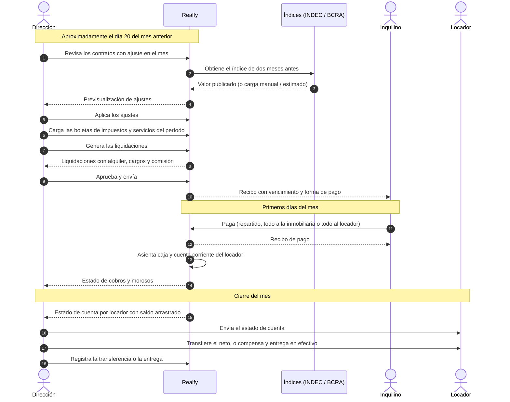

# Piloto en una inmobiliaria real

Este capítulo describe el piloto con el que se valida Realfy en uso real: una inmobiliaria que administra alquileres en Argentina y que pasa su ciclo mensual del sistema que usa hoy a Realfy. Fija el contexto, qué se mide, qué entra en el alcance, en qué fases y fechas se ejecuta, quién hace qué, cómo se decide que los números cierran y cómo se protegen los datos.

El registro de hallazgos está en `31-registro-de-feedback.md`, su trazabilidad hacia casos de uso, decisiones y pruebas en `33-matriz-de-trazabilidad.md` y el tratamiento de datos personales en `../privacidad-datos.md`.

## Contexto

La inmobiliaria piloto es una empresa familiar de administración de alquileres que lleva el ciclo mensual completo con una base de datos de escritorio y planillas: ajustes de alquiler, impuestos y servicios, recibos al inquilino, cobros, rendición a cada locador y un estado de cuenta por locador que se arma a mano. Lo usan tres personas, cada una con una función distinta. Su nombre, su ubicación y sus datos no figuran en este repositorio: el repositorio es público y el acuerdo de uso de cifras agregadas con la inmobiliaria sigue pendiente (ver «Gobernanza de datos»).

Dos hechos organizan todo el piloto:

- **El ciclo mensual es el corazón de la operación y su mayor costo.** Empieza unos diez días antes del mes que se cobra, con el índice de dos meses antes, y termina con las transferencias a los locadores. Hoy se hace con doble carga de datos y con un atraso sistemático en el estado de cuenta que recibe cada locador.
- **Las reglas del negocio son pactables.** Cada contrato puede apartarse de los valores habituales de la inmobiliaria, y los cambios posteriores son acuerdos con fecha. Un sistema con reglas fijas en el código no sirve para este uso.

La validación en uso real corrige una limitación que el alcance original de la tesis reconocía: hasta el Hito 4 el sistema se había probado con datos sintéticos y en un ambiente de demostración, sin usuarios que dependieran de él.

## Objetivos y métricas

**Objetivo general.** Que la inmobiliaria deje la base de escritorio y las planillas para el ciclo mensual de alquileres, y que la tesis muestre ese uso como validación en campo, con trazabilidad completa de hallazgo a decisión, cambio, prueba y métrica.

**Objetivos específicos.**

1. Reproducir en Realfy el ciclo mensual completo de una cartera real, con las reglas pactadas por contrato.
2. Reconciliar los resultados contra el sistema actual hasta que no queden diferencias sin explicar.
3. Reducir el tiempo del ciclo y el atraso en la rendición a los locadores.
4. Registrar cada fricción del uso real y llevarla hasta una corrección verificada.

| Métrica | Qué mide | Línea base | Meta |
|---|---|---|---|
| Reconciliación | Diferencias sin explicar entre Realfy y el sistema actual, por contrato (total del recibo, comisión y neto al locador) y por locador (total del estado de cuenta) | No aplica | 0 diferencias sin explicar; cada diferencia explicada queda registrada como FB o como defecto |
| Tiempo del ciclo mensual | Horas de trabajo del ciclo completo, medidas por tarea | Se mide en la línea base | Reducción del 50 % respecto de la línea base |
| Valoración de uso | Puntaje que cada usuario da al sistema en la sesión quincenal | Se mide en la línea base | 8 o más sobre 10 |
| Atraso del estado de cuenta | Días entre el cierre del mes y la entrega del estado de cuenta al locador | Se mide en la línea base | 5 días o menos |
| Errores de carga | Datos corregidos después de emitido el recibo | Se mide en la línea base | Se informa la evolución por ciclo |
| Tiempo de detección a corrección | Días entre el registro de un FB o defecto y su corrección verificada | No aplica | Se informa por ciclo |

Las metas son umbrales de aceptación fijados antes de medir; los valores de la línea base se toman en el primer ciclo y se publican en la tabla única de cifras del informe, con su fecha de medición. En este repositorio no se publican valores derivados de los datos de la inmobiliaria sin su consentimiento.

## Alcance

El alcance sale de un relevamiento del funcionamiento de la inmobiliaria. Se prioriza por cuánto bloquea el uso:

- **P0, bloquean el piloto de administración.** Sin esto la inmobiliaria no puede dejar sus planillas: activar un contrato creado desde la web; que una persona pueda ser locador de varias propiedades y que haya varios locadores por contrato; datos de persona completos (documento, domicilio, forma de cobro, varias cuentas bancarias); impuestos y servicios en la liquidación con quién paga y qué porcentaje; ajustes masivos y con rezago del índice, con una fuente de índices que no dependa de un único proveedor; liquidación con vencimiento configurable, prorrateo y recibo con monto en letras y «por cuenta y orden»; pago partido entre la inmobiliaria y el locador; estado de cuenta consolidado por locador; invitación de usuarios, cambio y recuperación de contraseña, y menú por rol; carga de datos del sistema anterior.
- **P1, para operar todo el ciclo dentro de Realfy.** Punitorios dentro de la liquidación y configurables por contrato; renovación como período del contrato con alertas de vencimiento; plantillas de contrato con interfaz; depósito con moneda, cuotas y regla de devolución, y liquidación de egreso; adjuntos; envío de mails; garante como entidad; monedas y custodia; modalidad en la que el locador cobra directamente y la inmobiliaria solo factura sus honorarios.
- **P2, ventas y crecimiento.** Inventario estructurado de ingreso y egreso, operación de venta, integración con portales de publicación, portal del propietario, lectura automática de documentos escaneados y presupuestos de proveedores aprobados por el locador.

Las decisiones de diseño que atraviesan todo el trabajo son tres: toda regla se resuelve en el orden valor de la inmobiliaria, reglas del contrato vigente a la fecha y acuerdos fechados, sin pisar historia; el dinero se calcula con motores puros y exactos, y cada movimiento deja asiento; y cada dato tiene una sola fuente de verdad.

### Relación con las exclusiones del alcance original

`01-alcance-y-objetivos.md` dejó fuera del alcance de la tesis cuestiones que el piloto vuelve necesarias o discutibles. La relación queda así:

| Exclusión original | Tratamiento en el piloto |
|---|---|
| Contabilidad completa | Sigue fuera; entra una caja operativa y una cuenta corriente por locador, que no son un libro contable |
| Cobros automáticos por pasarela o recaudadora | Sigue fuera; se modela el registro del pago, incluido el efectivo en oficina, y la recaudadora externa se declara como trabajo futuro |
| Integraciones con portales externos de publicación | Sigue fuera salvo que el portal ofrezca una interfaz; entra la publicación asistida (estado por portal y aviso listo para copiar) y el portal público propio |
| Operaciones de venta con escrituración | La escrituración sigue fuera; entran la reserva, la seña y el registro de honorarios y comisiones |
| Liquidación tributaria del propietario o del inquilino | Sigue fuera; la facturación de honorarios se hace por cuenta del locador y sus parámetros fiscales se validan con el contador |
| App móvil nativa y firma digital con certificación oficial | Siguen fuera |

Además, el alcance original no preveía el uso con datos reales de personas; el piloto lo incorpora en un ambiente separado (ver «Gobernanza de datos»). Quedan fuera del piloto y se declaran como trabajo futuro: el inventario estructurado con fotos (se mantiene como adjunto), el portal del propietario y una capa de análisis de garantes más allá del scoring actual.

La versión vigente del alcance se actualiza en el PR de cada ítem que mueve una de estas fronteras.

## Fases y fechas

El ritmo lo marca el ciclo de la inmobiliaria: la liquidación se prepara alrededor del día 20 del mes anterior y los pagos se cobran en los primeros días del mes. Las oleadas de desarrollo se ordenan para llegar a cada cierre de mes con lo que ese ciclo necesita.

| Fase | Fecha de liquidación | Modo | Evidencia para la tesis |
|---|---|---|---|
| Línea base | ≈ 20/11/2026 | La inmobiliaria opera con su sistema actual y se mide | Tiempos por tarea, errores y atrasos |
| C1 | ≈ 20/11/2026 | Sombra: el equipo replica el ciclo en el ambiente `piloto` | Reconciliación de recibos |
| C2 | ≈ 20/12/2026 | Paralelo completo: la inmobiliaria mira y compara | Reconciliación de recibos y estados de cuenta; primeros FB de uso real |
| C3 | ≈ 20/01/2027 | La inmobiliaria opera en Realfy, con su sistema actual como respaldo; las tres personas están activas | Métricas antes y después; FB y defectos del uso real |
| C4 | ≈ 20/02/2027 | Realfy es el sistema principal | Cierre del piloto |

- **30/11/2026.** Entrega final con el piloto en curso: relevamiento, plan, línea base, C1 y registro de feedback hasta esa fecha.
- **Defensa, febrero de 2027.** Se presenta con el anexo del piloto actualizado tras C2 y C3. Si el C4 cae después de la defensa, se informa como cierre posterior.
- **Feedback.** Una sesión de 15 minutos por semana con la inmobiliaria y un canal dentro de la aplicación (tickets con la categoría «piloto»), además del canal de mensajería. Cada hallazgo entra al registro en menos de 24 horas (ver `31-registro-de-feedback.md`).

## Roles

### En la inmobiliaria (por función)

| Función | Qué hace en el piloto |
|---|---|
| Dirección | Decide las reglas de la inmobiliaria, valida los resultados de cada ciclo, administra el sistema y participa de la sesión semanal |
| Atención y publicación | Atiende consultas, publica en portales, muestra propiedades y acompaña operaciones |
| Muestras e inventarios | Muestra y capta propiedades, analiza garantías y hace los inventarios; responde consultas |

Por ahora las tres funciones ven todo el contenido del sistema. El mecanismo de menú y de permisos por rol se construye igual, para que la apertura sea una configuración y no una limitación del código.

### En el equipo de la tesis

| Integrante | Ítems |
|---|---|
| Manuel | 30, 35, 37, 38, 40, 41, 45 y la coordinación del piloto |
| Romeo | 31, 32, 43, 44 |
| Mariano | 33, 34, 36, 39, 42 |
| Todos | 46 |

Cada ítem lo firma su dueño, se integra por un PR revisado por otro integrante y se mergea con un merge commit titulado `Merge: ... (#N)`.

## Ciclo mensual

El diagrama muestra el ciclo que Realfy debe reproducir. El tiempo corre de arriba hacia abajo; el día 20 es el punto de partida y las transferencias a los locadores cierran el ciclo.

## Criterio de reconciliación

Para el mes en paralelo, el resultado de Realfy se compara contra el del sistema actual:

- **Por contrato:** total del recibo, comisión y neto al locador.
- **Por locador:** total del estado de cuenta.

El criterio de aceptación es diferencia cero. Una diferencia distinta de cero solo se acepta si está explicada y queda registrada como FB (si el sistema actual hacía algo implícito que Realfy debe replicar o corregir) o como defecto (si el error es de Realfy). La reconciliación se automatiza con una suite que corre en la integración continua sobre casos sintéticos con la forma real; la versión con datos reales corre fuera del repositorio.

Antes de la importación al ambiente `piloto`, el procedimiento de carga se ensaya de punta a punta contra una base de prueba y produce un informe de diferencias; se repite hasta que no queden diferencias sin explicar.

## Gobernanza de datos

- **Ambiente separado.** El piloto corre en un ambiente `piloto`, con su base de datos y su almacenamiento propios, distinto del de demostración. No se reinicia ni se recrea la base con datos reales.
- **Nada real en el repositorio.** Ni datos, ni capturas, ni cifras derivadas. Los casos de prueba, los ejemplos y los documentos usan datos sintéticos. Las fuentes del relevamiento y los datos reales se guardan fuera del repositorio, con acceso restringido al equipo.
- **Aislamiento entre inmobiliarias.** Se mantiene lo decidido en ADR-0006; todo modelo nuevo se registra en el filtro por inmobiliaria.
- **Copias de respaldo.** Copias nativas diarias y semanales del proveedor y una copia semanal de la base fuera del proveedor de alojamiento, con prueba de restauración (ver `../despliegue.md`).
- **Cifras en la tesis.** Los resultados del piloto se reportan agregados, con la fecha de medición, y solo con consentimiento de la inmobiliaria, que se decide más adelante y sigue pendiente.

La decisión está registrada en `../adr/0014-ambiente-piloto-con-datos-reales.md`, y el procedimiento de despliegue, copias, restauración e incidentes en `../operacion-piloto.md`.

El detalle de los datos personales que guarda el sistema, su base legal, los accesos y los derechos de los titulares está en `../privacidad-datos.md`.

## Riesgos

El registro completo de riesgos del proyecto está en `../calidad/04-riesgos.md`; estos son los propios del piloto.

| Riesgo | Mitigación |
|---|---|
| Exactitud del dinero (redondeos, repartos) | Motores puros con pruebas de valores conocidos y reconciliación por ciclo |
| Dos fuentes de verdad durante la transición | Cada PR cambia todos los lectores del dato que mueve; las columnas viejas se deprecan una versión |
| Valores nuevos de tipos enumerados de la base en la misma transacción | La carga inicial va en una migración separada |
| Tareas programadas sin contexto de inmobiliaria | Pruebas de aislamiento y disparo manual de cada tarea |
| Fuente del índice de precios | CSV del INDEC, BCRA como respaldo, carga manual y estimado con corrección posterior |
| Adopción | Paralelo obligatorio y empezar por lo que más pesa: estados de cuenta y vencimientos |
| Datos personales reales | Ambiente aislado, permisos, privacidad documentada y nada en el repositorio |
| Reglas legales y fiscales no confirmadas | Tablas configurables con vigencia anual y validación del contador y del abogado |
| Verificación de la mensajería por una plataforma externa | Empezar por mail y dejar la mensajería instantánea para la última oleada |
| Conflictos entre ramas de trabajo | Integración temprana y ramas cortas |
| Carga de trabajo de la tesis | El piloto alimenta el informe; la documentación va en el mismo PR que el cambio |

## Ítems del cronograma

Los ítems 30 a 46 se suman a los 05 a 29 del tablero del proyecto. Cada uno tiene un issue con criterios de aceptación, las etiquetas `piloto` y `origen:*`, los PR enlazados y los casos de prueba asignados. El número de issue es el del ítem más 58. El detalle está en `04-backlog.md`.

| Ítem | Título | Dueño | Depende | Oleada | Issue |
|---|---|---|---|---|---|
| 30 | Piloto: relevamiento, plan y registro de feedback | Manuel | — | 0 | #88 |
| 31 | Base de proceso: protección de rama, plantillas, pruebas web, CI | Romeo | — | 0 | #89 |
| 32 | Usuarios, invitaciones, contraseñas y permisos por rol | Romeo | 31 | 1 | #90 |
| 33 | Personas, locadores, apoderados y titularidad | Mariano | 31 | 1 | #91 |
| 34 | Reglas del contrato, acuerdos y ajustes con rezago | Mariano | 33 | 2 | #92 |
| 35 | Liquidación mensual completa: boletas, cargos, punitorios, recibo | Manuel | 34 | 2 | #93 |
| 36 | Cobros, caja, efectivo, custodia y compensaciones | Mariano | 35 | 3 | #94 |
| 37 | Cuenta corriente y estado de cuenta del locador | Manuel | 36 | 3 | #95 |
| 38 | Facturación por cuenta del locador | Manuel | 37 | 4 | #96 |
| 39 | Migración desde el sistema anterior y calidad de datos | Mariano | 33 a 37 | 3 | #97 |
| 40 | Vencimientos, renovaciones, prórrogas y depósitos | Manuel | 34 | 4 | #98 |
| 41 | Honorarios: alta, renovación, venta, tasación, comisiones del personal | Manuel | 36 | 4 | #99 |
| 42 | Incidencias y reparaciones con imputación | Mariano | 36 | 4 | #100 |
| 43 | Mensajería, bandeja de consultas y cobranza escalonada | Romeo | 32, 35 | 4 y 5 | #101 |
| 44 | Ventas, llaves y publicación | Romeo | 41 | 5 | #102 |
| 45 | Validación en campo: ciclos en paralelo, reconciliación y métricas | Manuel | 39 | 3 a 5 | #103 |
| 46 | Documentación, informe y defensa con el piloto | Todos | Todos | Continuo | #104 |
